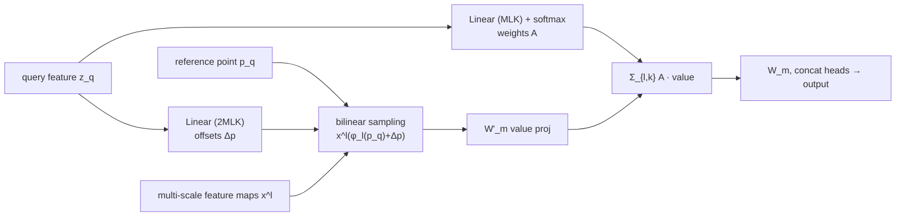
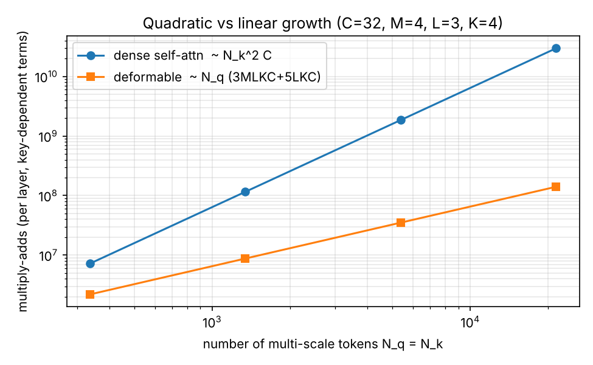
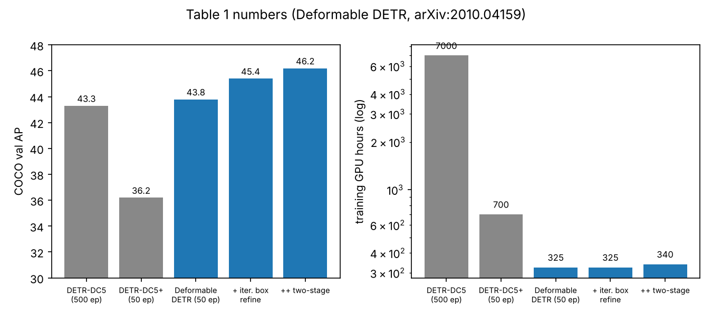

# Deformable attention: 전역 attention을 "reference 주변 K개 샘플링"으로 바꾼 Deformable DETR

> 원문: [Deformable DETR: Deformable Transformers for End-to-End Object Detection](https://arxiv.org/abs/2010.04159) — Zhu, Su, Lu, Li, Wang, Dai (SenseTime 등), arXiv 2020-10, **ICLR 2021 Oral**(arXiv 코멘트 및 ICLR 사이트 oral 목록 기준). 이 글은 arXiv v4 HTML 전문(약 6.9만 자)을 추출해 읽고 정리했다. 아래 수치와 표/그림 번호는 모두 그 본문 기준이다.

## 왜 나왔나

DETR는 anchor와 NMS를 없앴지만 논문이 짚는 두 가지 약점이 있었다(Sec. 3).

- **느린 수렴**: 초기화 시 $U_m z_q$, $V_m x_k$가 평균 0 분산 1이면 attention weight가 $A_{mqk}\approx 1/N_k$ (uniform)가 된다. 이미지에서는 $N_k=HW$가 매우 커서 gradient가 모호해지고, 학습이 끝나야 attention이 객체 극단점에만 sparse하게 몰린다. 그래서 DETR는 500 epoch이 필요했다.
- **작은 물체와 해상도**: encoder self-attention이 $O(H^2W^2C)$라 고해상도 feature map(작은 물체에 필요)을 쓸 수 없다. DETR의 $AP_S$는 Faster R-CNN + FPN(26.6)보다 한참 낮은 20.5다(Table 1).

관련 연구는 세 갈래다: 고정 sparse 패턴(local window 등), 데이터 의존 sparse(LSH, k-means routing), low-rank. 저자들은 image 도메인 sparse 연구가 대부분 첫 갈래이고, 실제로는 같은 FLOPs의 convolution보다 최소 3배 느리다고 지적한다(memory access 패턴 문제, Sec. 2). 한편 deformable convolution은 효율적이지만 "원소 간 관계 모델링"이 없다. 이 둘을 합친 것이 deformable attention이다.

## 핵심 아이디어

**key를 전부 보지 말고, query가 "어디를 볼지"를 스스로 예측해서 K개만 샘플링한다.** 각 query는 reference point $p_q$를 갖고, query feature $z_q$에서 선형 투영으로 (a) 샘플링 offset $\Delta p_{mqk}$와 (b) attention weight $A_{mqk}$를 직접 뽑는다. query-key 내적이 없으므로 $N_q N_k$ 항이 사라진다. 샘플링 점이 몇 개든($K\ll HW$) 비용이 feature map 크기에 선형이다.

<p align="center"></p>

*그림 1. Deformable DETR 전체 구조. 다중 해상도 feature map을 encoder의 multi-scale deformable attention이 처리하고, decoder의 object query가 cross-attention으로 reference point 주변만 샘플링한다. FPN이 없다는 점에 주목. (출처: 논문 Fig. 1, arXiv:2010.04159)*

구성 요소 (Sec. 4):

1. **Multi-scale deformable attention**: $L=4$개 레벨 feature(ResNet C3~C5 + C5에 3x3 stride-2 conv로 만든 최저 해상도, Appendix A.2)에서 각 head마다 레벨별 $K$점씩 샘플링한다. 같은 softmax가 레벨과 점 전체($LK$)에 걸쳐 정규화되므로 **레벨 간 정보 교환이 FPN 없이 attention 안에서 일어난다**.
2. **Encoder**: 모든 픽셀이 query이자 자기 자신이 reference point. 어느 레벨인지 알려주기 위해 고정 위치 인코딩과 별도로 **학습되는 scale-level embedding** $e_l$을 더한다.
3. **Decoder**: cross-attention만 deformable로 교체하고 object query 간 self-attention은 그대로 둔다(키가 feature map이 아니라 query들이기 때문). reference point는 object query embedding에서 선형층 + sigmoid로 예측한다.
4. **박스를 reference 기준 offset으로 예측** (Appendix A.3): 디코더 attention이 박스 주변에 걸리도록 묶어 수렴을 돕는다.
5. **Iterative box refinement / two-stage** (Sec. 4.2): 디코더 층마다 박스를 보정하고, encoder-only 버전으로 만든 proposal을 decoder query로 쓴다.



*그림 2. deformable attention의 데이터 흐름(식 2, 3을 도식화한 직접 그림). query에서 offset과 weight가 나오고, 키는 샘플링으로만 접근한다. (직접 그림: mermaid, 논문 Fig. 2의 흐름 재구성)*

## 수식

표준 multi-head attention (논문 식 1):

$$\mathrm{MHA}(z_q,x)=\sum_{m=1}^{M}W_m\Big[\sum_{k\in\Omega_k}A_{mqk}\cdot W'_m x_k\Big],\quad A_{mqk}\propto\exp\!\Big\{\tfrac{z_q^\top U_m^\top V_m x_k}{\sqrt{C_v}}\Big\}$$

$m$은 head, $C_v=C/M$, $W'_m$은 value 투영, $W_m$은 출력 투영이다. 복잡도는 $O(N_qC^2+N_kC^2+N_qN_kC)$이고 $N_q=N_k\gg C$인 이미지에서는 셋째 항이 지배한다.

단일 스케일 deformable attention (식 2):

$$\mathrm{DeformAttn}(z_q,p_q,x)=\sum_{m=1}^{M}W_m\Big[\sum_{k=1}^{K}A_{mqk}\cdot W'_m\,x(p_q+\Delta p_{mqk})\Big]$$

- $K\ll HW$는 head당 샘플 수. $\Delta p_{mqk}\in\mathbb R^2$는 범위 제한 없는 실수라서 $p_q+\Delta p$가 분수 좌표가 되고, **bilinear interpolation**으로 값을 읽는다(미분 가능 → offset이 gradient로 학습됨).
- $A_{mqk}\in[0,1]$, $\sum_k A_{mqk}=1$. 구현은 $z_q$에 $3MK$ 채널 선형층 하나를 걸어 앞 $2MK$를 offset, 뒤 $MK$를 softmax 입력으로 쓴다.

멀티스케일 (식 3):

$$\mathrm{MSDeformAttn}(z_q,\hat p_q,\{x^l\})=\sum_{m=1}^{M}W_m\Big[\sum_{l=1}^{L}\sum_{k=1}^{K}A_{mlqk}\cdot W'_m\,x^l\big(\phi_l(\hat p_q)+\Delta p_{mlqk}\big)\Big]$$

$\hat p_q\in[0,1]^2$는 정규화 좌표((0,0)=좌상단), $\phi_l$은 그것을 $l$번째 레벨 해상도로 환산하는 함수, 정규화는 $\sum_{l,k}A_{mlqk}=1$. 한 query가 head당 $LK$개 점을 본다. **$L=1,K=1$이고 $W'_m$을 항등행렬로 고정하면 deformable convolution과 같아진다**(Sec. 4.1). 즉 deformable conv의 "샘플링 위치 학습"에 Transformer의 "여러 점 + 가중합 + 멀티 레벨"을 얹은 일반화다.

복잡도 (Appendix A.1): offset과 weight 계산이 $O(3N_qCMK)$, 나머지가 $O(N_qC^2+\min(HWC^2,N_qKC^2)+5N_qKC)$. encoder($N_q=HW$)에서 $O(HWC^2)$로 **공간 크기에 선형**, decoder cross-attention은 $N_q=N$일 때 $HW$와 무관하다(Sec. 4.1). $\min$은 $W'_mx$를 샘플링 전에 모든 픽셀에 미리 계산할지, 샘플된 점에만 계산할지 중 싼 쪽을 고른다는 뜻이다.

박스 예측 (Appendix A.3, A.4): $\hat b_q=\{\sigma(b_{qx}+\sigma^{-1}(\hat p_{qx})),\ \sigma(b_{qy}+\sigma^{-1}(\hat p_{qy})),\ \sigma(b_{qw}),\ \sigma(b_{qh})\}$. 중심은 reference point의 logit 공간에서 보정한다. iterative refinement는 $\hat b^d=\sigma(\Delta b^d+\sigma^{-1}(\hat b^{d-1}))$ 형태이고, 초기값은 $\hat b^0_{x,y}=\hat p_{x,y}$, $\hat b^0_{w,h}=0.1$ (0.05~0.5에서 비슷한 성능). 안정화를 위해 gradient는 $\Delta b$로만 흐르게 하고, $d$번째 층의 샘플링 offset은 이전 박스 크기 $(\hat b^{d-1}_w,\hat b^{d-1}_h)$로 스케일링한다.

## 코드

numpy만 쓴 최소 구현이다. (1) bilinear 샘플링, (2) 식 3의 $M=4$ head, $L=3$ 레벨, $K=4$ 점짜리 MSDeformAttn forward, (3) dense self-attention과의 비용 비교(논문 Appendix A.1의 key 의존 항을 직접 대입한 **내 계산**이지 논문이 보고한 수치가 아님), (4) 초기화 시 dense softmax가 거의 uniform이라는 관찰의 시뮬레이션이다.

```python
import numpy as np
rng=np.random.default_rng(0)

def bilinear(x,p):
    """x:(C,H,W), p:(...,2) in pixel coords (px,py). zero padding outside."""
    C,H,W=x.shape
    px,py=p[...,0],p[...,1]
    x0,y0=np.floor(px).astype(int),np.floor(py).astype(int)
    out=np.zeros(p.shape[:-1]+(C,))
    for dx in (0,1):
        for dy in (0,1):
            xi,yi=x0+dx,y0+dy
            w=(1-abs(px-xi))*(1-abs(py-yi))
            ok=(xi>=0)&(xi<W)&(yi>=0)&(yi<H)
            v=x[:,np.clip(yi,0,H-1),np.clip(xi,0,W-1)]   # (C,...)
            out+=(w*ok)[...,None]*np.moveaxis(v,0,-1)
    return out

def ms_deform_attn(z,pref,feats,Wo,Wa,Wv,Wm,M,K):
    """z:(C,) query; pref:(2,) normalized in [0,1]; feats: list of (C,H,W). Eq.(3)."""
    L=len(feats);C=z.shape[0];Cv=C//M
    off=(Wo@z).reshape(M,L,K,2)                      # sampling offsets, unconstrained
    A=(Wa@z).reshape(M,L*K)
    A=np.exp(A-A.max(1,keepdims=True));A/=A.sum(1,keepdims=True)  # softmax over L*K
    A=A.reshape(M,L,K)
    out=np.zeros(C)
    for m in range(M):
        acc=np.zeros(Cv)
        for l,x in enumerate(feats):
            H,W=x.shape[1:]
            loc=pref*np.array([W,H])-0.5+off[m,l]   # phi_l(p) + delta p (pixel coords)
            v=bilinear(x,loc)@Wv[m].T                 # (K,Cv) value projection W'_m
            acc+=A[m,l]@v
        out+=Wm[m]@acc
    return out,A,off

C,M,K,L=32,4,4,3
feats=[rng.normal(size=(C,h,h)) for h in (32,16,8)]
z=rng.normal(size=C)
Wo=rng.normal(size=(M*L*K*2,C))*0.5;Wa=rng.normal(size=(M*L*K,C))*0.1
Wv=rng.normal(size=(M,C//M,C))/np.sqrt(C);Wm=rng.normal(size=(M,C,C//M))/np.sqrt(C)
y,A,off=ms_deform_attn(z,np.array([0.4,0.6]),feats,Wo,Wa,Wv,Wm,M,K)
print("out",y.shape,"keys per query per head:",L*K,"vs dense:",sum(f.shape[1]*f.shape[2] for f in feats))
print("attn weights sum per head:",A.reshape(M,-1).sum(1).round(3))
# sanity: bilinear at integer pixel == lookup
x=feats[0];print("bilinear@int ok:",np.allclose(bilinear(x,np.array([3.,5.])),x[:,5,3]))
# cost: dense self-attn over multi-scale tokens vs deformable (MACs of the N_q*N_k*C style terms)
print(f"{'HxW(level1)':>12} {'N_k=sum':>9} {'dense QK+AV':>14} {'deform 3MKC+5KC':>16}")
for s in (16,32,64,128):
    Nk=sum((s//2**i)**2 for i in range(L))
    dense=2*Nk*Nk*C                  # N_q=N_k, scores + weighted sum
    deform=Nk*(3*M*L*K*C+5*L*K*C)    # appendix A.1 terms that depend on K
    print(f"{s:>5}x{s:<6} {Nk:>9} {dense:>14,} {deform:>16,}")
# init: dense softmax with unit-variance q,k is ~uniform 1/N_k
for Nk in (100,1000,10000):
    s=rng.normal(size=Nk)*1.0;a=np.exp(s);a/=a.sum()
    print(f"N_k={Nk:6d} max attn={a.max():.4f}  1/N_k={1/Nk:.4f}  entropy/log(N_k)={-(a*np.log(a)).sum()/np.log(Nk):.3f}")
```

실제 실행 출력:

```text
out (32,) keys per query per head: 12 vs dense: 1344
attn weights sum per head: [1. 1. 1. 1.]
bilinear@int ok: True
 HxW(level1)   N_k=sum    dense QK+AV  deform 3MKC+5KC
   16x16           336      7,225,344        2,193,408
   32x32          1344    115,605,504        8,773,632
   64x64          5376  1,849,688,064       35,094,528
  128x128        21504 29,595,009,024      140,378,112
N_k=   100 max attn=0.0587  1/N_k=0.0100  entropy/log(N_k)=0.900
N_k=  1000 max attn=0.0208  1/N_k=0.0010  entropy/log(N_k)=0.926
N_k= 10000 max attn=0.0025  1/N_k=0.0001  entropy/log(N_k)=0.947
```

- 한 query가 head당 보는 key는 12개(3레벨 x 4점)인데 dense는 1344개다. 이게 "pre-filter" 역할이다.
- 해상도를 8배(16→128) 키우면 dense 항은 약 4,100배(7.2M→29.6G) 늘고 deformable 항은 약 64배(2.2M→140M) 늘어난다. 토큰 수 $N$에 대해 $N^2$ vs $N$이다.
- 마지막 블록은 unit-variance 점수의 dense softmax가 $N_k$가 커져도 정규화 엔트로피가 0.9~0.95로 유지됨(= 거의 uniform, 최댓값이 $1/N_k$의 수~수십 배일 뿐)을 보여, 논문의 "초기 attention이 평균에 가깝다" 설명이 왜 그럴듯한지 보여준다. (무작위 가우시안 가정이므로 학습된 모델의 값은 아니다.)

<p align="center"></p>

*그림 3. 위 코드의 비용식을 로그-로그로 그린 것. dense는 기울기 2(이차), deformable은 기울기 1(선형)이다. 고해상도를 encoder에 넣을 수 있게 한 이유. (직접 그림: 논문 Appendix A.1의 복잡도 항에 C=32, M=4, L=3, K=4를 대입)*

## 그림으로 보는 동작

<p align="center"></p>

*그림 4. Table 1의 핵심 숫자. 왼쪽은 val AP, 오른쪽은 학습 GPU 시간(로그). 같은 50 epoch에서 DETR-DC5+는 36.2 AP, Deformable DETR는 43.8 AP이고, 500 epoch DETR-DC5(43.3 AP, 7000 GPU h)를 325 GPU h로 넘는다. (직접 그림: 논문 Table 1의 수치)*

<p align="center"></p>

*그림 5. 최종 예측의 각 항을 입력 픽셀로 미분한 gradient norm(Appendix A.5). 왼쪽은 중심 x 좌표: 객체의 좌/우 경계 부근이 밝다. 오른쪽은 클래스 점수: DETR와 달리 객체 **내부** 픽셀도 본다. 저자들은 클래스 판별에는 극단점뿐 아니라 내부 점이 필요하기 때문이라고 추측한다. (출처: 논문 Fig. 5, arXiv:2010.04159)*

<p align="center"></p>

*그림 6. 마지막 decoder 층의 multi-scale deformable cross-attention(Appendix A.6). 점 색이 attention weight, 초록 십자가 reference point, 초록 박스가 예측이다. 샘플링 점이 객체 전체 전경에 퍼지고, 객체의 크기와 모양에 따라 위치와 weight가 적응한다. DETR가 극단점만 보던 것과 대비된다. (출처: 논문 Fig. 6, arXiv:2010.04159)*

<p align="center"></p>

*그림 7. 같은 시각화의 encoder 쪽(Fig. 6a). 각 query 픽셀의 샘플링 점이 자기 인스턴스 위에 모이고, 인접 인스턴스와 분리된다. 저자들은 DETR처럼 encoder 단계에서 이미 인스턴스가 분리된다고 본다. (출처: 논문 Fig. 6, arXiv:2010.04159)*

## 트레이드오프와 함정

**설정(Sec. 5)**: COCO 2017, ResNet-50 backbone(FPN 없음), $M=8$, $K=4$, 50 epoch(40 epoch에서 lr x0.1), Adam lr $2\times10^{-4}$, $\beta=(0.9,0.999)$, weight decay $10^{-4}$, **offset과 reference point 투영의 lr은 x0.1**, classification에 Focal Loss(weight 2), object query 100→300. 공정 비교용으로 같은 변경을 적용한 DETR-DC5+를 함께 보고한다.

**Table 1 (val)**

| 방법 | Epoch | AP | AP_S | AP_M | AP_L | Params | FLOPs | GPU h | FPS |
|---|---|---|---|---|---|---|---|---|---|
| Faster R-CNN + FPN | 109 | 42.0 | 26.6 | 45.4 | 53.4 | 42M | 180G | 380 | 26 |
| DETR | 500 | 42.0 | 20.5 | 45.8 | 61.1 | 41M | 86G | 2000 | 28 |
| DETR-DC5 | 500 | 43.3 | 22.5 | 47.3 | 61.1 | 41M | 187G | 7000 | 12 |
| DETR-DC5 | 50 | 35.3 | 15.2 | 37.5 | 53.6 | 41M | 187G | 700 | 12 |
| DETR-DC5+ | 50 | 36.2 | 16.3 | 39.2 | 53.9 | 41M | 187G | 700 | 12 |
| Deformable DETR | 50 | 43.8 | 26.4 | 47.1 | 58.0 | 40M | 173G | 325 | 19 |
| + iterative box refinement | 50 | 45.4 | 26.8 | 48.3 | 61.7 | 40M | 173G | 325 | 19 |
| ++ two-stage | 50 | 46.2 | 28.8 | 49.2 | 61.7 | 40M | 173G | 340 | 19 |

읽는 법:
- **수렴**: 10배 적은 epoch로 DETR-DC5(500 ep)와 동급 이상(43.8 vs 43.3). $AP_S$는 22.5→26.4로 크게 오른다. 수렴 곡선은 Fig. 3.
- **속도**: FLOPs는 DETR-DC5와 비슷(173G vs 187G)하지만 FPS가 1.6배(19 vs 12). 저자들은 DETR-DC5의 병목이 Transformer attention의 대량 memory access라고 본다. 그래도 Faster R-CNN + FPN(26 FPS)보다 약 25% 느린데, **불규칙(unordered) memory access** 때문이라고 인정한다. FLOPs가 곧 속도가 아니라는 좋은 사례다.
- **대형 객체는 오히려 손해**: $AP_L$ 58.0은 DETR의 61.1보다 낮다(refinement 후 61.7로 회복). 전역 attention이 큰 물체에 유리했던 부분을 sparse 샘플링이 일부 잃는다는 해석은 내 추정이다.

**Table 2 ablation (val)**

| MS inputs | MS attention | K | FPN | AP | AP_S |
|---|---|---|---|---|---|
| ✗ | ✗ | 1 | ✗ | 39.7 | 21.2 |
| ✓ | ✗ | 1 | ✗ | 41.4 | 24.1 |
| ✓ | ✗ | 4 | ✗ | 42.3 | 24.8 |
| ✓ | ✓ | 4 | ✗ | 43.8 | 26.4 |
| ✓ | ✓ | 4 | FPN | 43.8 | 26.5 |
| ✓ | ✓ | 4 | BiFPN | 43.9 | 25.6 |

- 멀티스케일 입력 +1.7 AP(특히 $AP_S$ +2.9), $K$ 1→4 +0.9, 레벨 간 교환(MS attention) +1.5. FPN/BiFPN은 더해도 이득이 없다 → 레벨 간 교환이 attention 안에서 이미 해결됨.
- 맨 윗줄(단일 스케일, $K=1$)은 deformable convolution으로 퇴화한 설정이고 가장 낮다. 즉 "여러 점 + 멀티 레벨 + 학습된 가중치"가 모두 기여한다.

**Table 3 (test-dev)**: ResNet-50 46.9, ResNet-101 48.7, ResNeXt-101 49.0, ResNeXt-101+DCN 50.1, 여기에 TTA(flip + multi-scale)를 얹으면 52.3 AP. 비교 대상은 ATSS 50.7(TTA), TSD 51.2(TTA), EfficientDet-D7 52.2다. 최고 수치(52.3)는 TTA 포함임에 유의.

**함정/한계**
- 샘플링 위치가 학습되는 만큼 **offset 투영의 lr을 0.1배**로 낮추는 등 초기화와 lr 설정이 중요하다(Sec. 5). offset이 초기에 엉뚱한 곳으로 튀면 attention이 학습되지 않는다는 것은 내 추론이다.
- **불규칙 gather + bilinear**는 dense matmul만큼 최적화돼 있지 않다. 논문도 conv보다 느리다고 인정한다(NPU/가속기 관점에서 gather 패턴이 걸림돌이 될 수 있다는 점은 내 의견).
- decoder의 object query self-attention은 여전히 dense다(그래서 two-stage에서 픽셀 전부를 query로 쓰지 못하고 encoder-only 제안 네트워크를 쓴다, Sec. 4.2).
- reference point를 query에서 예측하는 구조라서 사실상 "검출 prior"를 다시 도입한 셈이다. 완전한 prior 제거라는 DETR의 순수성에서 한 발 물러선 trade-off로 볼 수 있다(내 해석).

## 대표 논문/참고

- Carion et al., *DETR* (arXiv:2005.12872) — 직전 개념 글(2026-11-12) 참고.
- Dai et al. 2017, Zhu et al. 2019, *Deformable ConvNets* v1/v2 — 샘플링 offset 학습의 원형. 식 2가 $L=K=1$일 때 이와 같아진다.
- Lin et al. 2017, *FPN* / Tan et al. 2020, *BiFPN* — Table 2에서 비교된 멀티스케일 융합.
- Teed & Deng 2020, *RAFT* — iterative refinement의 아이디어 출처.
- Lin et al. 2017, *Focal Loss* — 이 논문의 분류 손실.
- 다음 개념 후보: Mask2Former (multi-scale deformable attention 기반 pixel decoder를 쓰는 후속).
