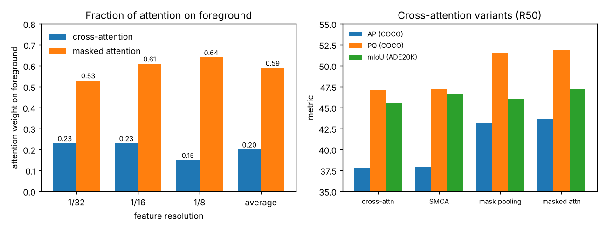

# Mask2Former: masked attention으로 panoptic·instance·semantic을 한 구조로 묶다

> 원문: [Masked-attention Mask Transformer for Universal Image Segmentation](https://arxiv.org/abs/2112.01527) — Cheng, Misra, Schwing, Kirillov, Girdhar (FAIR, UIUC), arXiv 2021-12 (v3 2022-06), CVPR 2022. 이 글은 arXiv v3 HTML 전문을 읽고 정리했다. 아래 수치와 표/그림 번호는 모두 그 본문 기준이다.

## 왜 나왔나

DETR 계열의 set prediction은 "마스크 N개 + 클래스 N개"를 내놓는 mask classification으로 어떤 분할 과제든 표현할 수 있다. MaskFormer(DETR 기반)와 K-Net이 이를 보였지만 논문이 짚는 문제는 두 가지다(Sec. 1).

- **범용인데 특화 모델보다 약하다**: instance segmentation에서 universal 구조의 최고 성능이 특화 SOTA보다 9 AP 넘게 낮았다(Fig. 1).
- **학습이 무겁다**: MaskFormer는 40.1 AP까지 300 epoch가 필요하고 32GB GPU 한 장에 이미지 1장만 들어갔다. 반면 특화 모델 Swin-HTC++는 72 epoch에 더 높은 성능을 낸다.

저자들은 느린 수렴의 원인을 DETR 때와 같은 곳에서 찾는다. cross-attention이 이미지 전체를 보기 때문에, query가 "자기 객체 영역"에만 attend하는 법을 배우는 데 많은 epoch가 든다는 것이다(Sec. 3.2.1, [46, 22] 인용). 이전 글의 Deformable attention이 "reference 주변 K점만 샘플링"으로 풀었다면, 여기서는 **이미 예측한 마스크 안쪽만 보게 만드는** 방식으로 푼다. 분할에서는 이전 층의 마스크 예측이라는 공짜 prior가 있기 때문에 가능한 선택이다.

<p align="center"></p>

*그림 1. 기존 universal 구조(MaskFormer, K-Net 등)는 panoptic·semantic에서는 경쟁력이 있지만 instance에서 특화 모델에 크게 뒤진다. Mask2Former는 세 과제 모두에서 특화 모델과 같거나 앞선다는 것이 논문의 주장이다(본문 표 1~3). (출처: 논문 Fig. 1, arXiv:2112.01527)*

## 핵심 아이디어

구조는 MaskFormer의 meta architecture를 그대로 쓴다(Sec. 3.1): **backbone → pixel decoder(고해상도 per-pixel embedding 생성) → Transformer decoder(object query 처리)**. 최종 마스크는 query 임베딩과 per-pixel 임베딩의 내적으로 얻는다. 바뀐 것은 Transformer decoder다.

1. **Masked attention**: cross-attention에서 query마다 "직전 층이 예측한 foreground 마스크 안쪽"에만 attend한다. 전역 문맥은 query 간 self-attention이 담당한다는 가정이다.
2. **효율적 multi-scale**: pixel decoder의 1/32, 1/16, 1/8 feature를 **decoder 층마다 하나씩 번갈아(round robin)** 넣는다. 전부 한 층에 넣지 않는다.
3. **최적화 개선 3종**: self/cross 순서 교체(masked attention이 먼저), 학습되는 query feature, dropout 제거.
4. **Point-sampled mask loss**: 마스크 손실을 전체 해상도가 아니라 K=12544(112×112)개 점에서만 계산해 학습 메모리를 18GB → 6GB로 줄인다(Sec. 3.3).

<p align="center"></p>

*그림 2. Mask2Former 전체 구조. 오른쪽 Transformer decoder 한 블록은 masked attention → self-attention → FFN 순서이고, 이 3층 블록을 해상도 1/32, 1/16, 1/8 순으로 L번 반복한다. 중간 층의 마스크 예측이 다음 층의 attention mask가 된다. (출처: 논문 Fig. 2, arXiv:2112.01527)*

## 수식

표준 cross-attention(잔차 포함, 논문 식 1):

$$X_l=\mathrm{softmax}(Q_lK_l^\top)V_l+X_{l-1}$$

$`X_l\in\mathbb R^{N\times C}`$는 $N$개 query의 $l$번째 층 feature, $`Q_l=f_Q(X_{l-1})`$, $`K_l,V_l\in\mathbb R^{H_lW_l\times C}`$는 이미지 feature의 선형 변환이다. $`H_l,W_l`$은 그 층에 배정된 해상도다.

Masked attention(식 2)은 softmax 안에 additive mask를 하나 더한다.

$$X_l=\mathrm{softmax}\big(\mathcal M_{l-1}+Q_lK_l^\top\big)V_l+X_{l-1},\qquad
\mathcal M_{l-1}(x,y)=\begin{cases}0 & M_{l-1}(x,y)=1\cr -\infty & \text{otherwise}\end{cases}$$

- $`M_{l-1}\in\lbrace 0,1\rbrace^{N\times H_lW_l}`$: **이전 층 $(l-1)$의 마스크 예측을 0.5로 이진화하고 현재 키 해상도로 resize**한 것. $`M_0`$은 decoder에 들어가기 전의 학습 query feature $`X_0`$에서 바로 뽑은 마스크다.
- $-\infty$가 더해진 위치는 softmax 후 정확히 0이므로, query는 자기 마스크의 foreground 픽셀만 키로 본다. 추가 비용은 마스크 예측을 매 층 계산하는 것이다. 표 4(a)에서 masked attention을 빼면 FLOPs가 226G→213G로 줄어든다(+13G).

왜 필요한가에 대한 논문의 가설(Appendix C.2): softmax는 0이 되지 않으므로, 배경 수천 픽셀의 작은 가중치가 합쳐지면 object 픽셀의 큰 가중치를 압도한다. $-\infty$ 마스크는 이 합산을 구조적으로 없앤다.

마스크 손실은 BCE와 Dice의 합이다(Sec. 4.1).

$$\mathcal L_{\text{mask}}=\lambda_{\text{ce}}\mathcal L_{\text{ce}}+\lambda_{\text{dice}}\mathcal L_{\text{dice}},\qquad \mathcal L=\mathcal L_{\text{mask}}+\lambda_{\text{cls}}\mathcal L_{\text{cls}}$$

$`\lambda_{\text{ce}}=\lambda_{\text{dice}}=5.0`$, $`\lambda_{\text{cls}}=2.0`$(GT와 매칭된 예측) 또는 $0.1$(no-object로 매칭되지 않은 예측). MaskFormer가 쓰던 focal loss 대신 BCE를 쓴다(Table 12(a)). 이 손실은 matching cost와 최종 loss 양쪽에서 **점 샘플링**으로 계산한다. matching에서는 모든 예측·GT 마스크에 같은 K개 점을 균일 샘플링하고, 최종 loss에서는 쌍마다 PointRend식 importance sampling으로 다른 점을 뽑는다(Sec. 3.3).

Multi-scale 배치(Sec. 3.2.2): decoder 층 $3L$개 중 처음 세 층이 $H/32,H/16,H/8$ feature를 받고 그 패턴을 반복한다. 각 해상도에는 sinusoidal 위치 임베딩 $`e_{\text{pos}}`$와 학습되는 scale-level 임베딩 $`e_{\text{lvl}}`$을 더한다. 기본값은 $L=3$(총 9층), query 100개(Swin-L panoptic만 200개).

## 코드

numpy로 masked attention의 핵심만 재현했다(32×32 feature, 반지름 6 원형 객체가 전체의 11%). query는 객체 픽셀과 약하게 상관된 feature를 찾도록 만들었고, 직전 층의 마스크 예측은 8% 픽셀을 무작위로 뒤집어 "불완전한 마스크"를 흉내냈다. 이어서 점 샘플링 Dice가 전체 마스크 Dice를 얼마나 잘 근사하는지도 본다. **합성 데이터라서 논문 수치와 직접 비교할 수 없고, 메커니즘만 보여주는 용도다.**

```python
import numpy as np
rng=np.random.default_rng(0)
H=W=32; C=16; N=H*W
yy,xx=np.mgrid[:H,:W]
fg=((yy-10)**2+(xx-12)**2<=36)          # object region (~113 px of 1024)
proto=rng.normal(size=C)
X=rng.normal(size=(N,C))*1.0            # background features
X[fg.ravel()]+=1.0*proto                 # object pixels weakly correlated with the query
q=proto/np.linalg.norm(proto)*2.0        # a query that "knows" the object
K=X; V=X
def softmax(s):
    s=s-s.max(); e=np.exp(s); return e/e.sum()
s=K@q/np.sqrt(C)
a_cross=softmax(s)
# masked attention (Eq.2): M_{l-1}=0 on predicted fg, -inf elsewhere; noisy previous-layer prediction
pred=fg.copy(); flip=rng.random((H,W))<0.08; pred^=flip
M=np.where(pred.ravel(),0.0,-np.inf)
a_mask=softmax(s+M)
print("fg pixels: %d / %d (%.1f%%)"%(fg.sum(),N,100*fg.mean()))
print("attention mass on fg  cross: %.3f   masked: %.3f"%(a_cross[fg.ravel()].sum(),a_mask[fg.ravel()].sum()))
print("max weight on bg      cross: %.4f   masked: %.4f"%(a_cross[~fg.ravel()].max(),a_mask[~fg.ravel()].max()))
print("effective #keys (1/sum a^2) cross: %.1f masked: %.1f"%(1/(a_cross**2).sum(),1/(a_mask**2).sum()))
for name,a in(("cross",a_cross),("masked",a_mask)):
    out=a@V; print(name,"cos(out,proto)=%.3f"%(out@proto/np.linalg.norm(out)/np.linalg.norm(proto)))
# empty predicted mask -> all -inf -> NaN
with np.errstate(all="ignore"): print("empty mask softmax:",softmax(s+np.full(N,-np.inf))[:2])
# point-sampled dice loss vs full-mask dice (Sec 3.3)
def dice(p,g): return 1-(2*(p*g).sum()+1)/(p.sum()+g.sum()+1)
logit=np.where(fg,1.5,-1.5)+rng.normal(size=(H,W))*1.5
p=1/(1+np.exp(-logit)); g=fg.astype(float)
full=dice(p.ravel(),g.ravel())
for k in (64,256,784):
    vals=[dice(p.ravel()[i],g.ravel()[i]) for i in (rng.choice(N,k,replace=False) for _ in range(200))]
    print("dice full=%.3f  K=%3d points: mean=%.3f std=%.3f"%(full,k,np.mean(vals),np.std(vals)))
```

실제 실행 출력(위 코드를 그대로 python3로 돌린 결과):

```text
fg pixels: 113 / 1024 (11.0%)
attention mass on fg  cross: 0.433   masked: 0.885
max weight on bg      cross: 0.0034   masked: 0.0051
effective #keys (1/sum a^2) cross: 383.7 masked: 97.6
cross cos(out,proto)=0.996
masked cos(out,proto)=0.996
empty mask softmax: [nan nan]
dice full=0.608  K=64 points: mean=0.593 std=0.091
dice full=0.608  K=256 points: mean=0.608 std=0.042
dice full=0.608  K=784 points: mean=0.609 std=0.012
```

- foreground가 11%뿐인데 일반 softmax는 질량의 43%만 객체에 둔다. 배경 가중치 하나는 0.0034로 작지만 900여 픽셀이 합쳐지는 것이다. 마스크를 씌우면 88.5%(나머지는 뒤집힌 가짜 foreground)로 올라간다. 논문의 가설과 같은 방향이다.
- 실질 key 수(역 참여율)가 384 → 98로 줄어, 같은 query가 훨씬 좁은 영역을 본다.
- 내 장난감에서 출력 feature의 cosine은 둘 다 0.996으로 같다. 이 예제의 객체 신호가 너무 단순해서 평균만으로도 충분하기 때문이다. **즉 이 코드는 "어디를 보는가"만 보이고 "그래서 성능이 오르는가"는 보이지 않는다.** 그건 표 4(c)가 말해 준다.
- **함정**: 예측 마스크가 비면 한 행이 전부 $-\infty$가 되어 softmax가 NaN을 낸다(출력 `nan nan`). 논문 본문은 이 경우를 다루지 않는다. 구현할 때는 빈 마스크를 전체 1로 대체하는 식의 처리가 필요하다는 것이 내 판단이다.
- 점 샘플링 Dice는 K=256에서 평균은 전체 값과 같고 표준편차가 0.04 정도다. 단일 이미지·단일 쌍 기준이므로 배치 평균에서는 더 줄어든다. 표 5에서 점 손실이 성능을 떨어뜨리지 않는 것과 일관된다.

## 그림으로 보는 동작

<p align="center"></p>

*그림 3. "cat"을 예측하는 단일 query의 마지막 세 층(왼쪽부터 1/32, 1/16, 1/8) attention map. 윗줄 cross-attention은 이미지 곳곳에 퍼지고 최대 응답이 객체 밖(옆 고양이 쪽)에 있다. 아랫줄 masked attention은 예측 마스크 안쪽, 특히 해상도가 높아질수록 윤곽에 집중한다. (출처: 논문 Fig. 10(a), arXiv:2112.01527 Appendix C.2)*

<p align="center"></p>

*그림 4. 왼쪽: 전체 COCO val에서 attention 가중치 중 foreground(GT 매칭 기준)에 놓인 비율. cross-attention은 평균 0.20, masked attention은 0.59다(논문 Table 10(b) 수치 그대로). 오른쪽: cross-attention 변형 비교(논문 Table 4(c), R50). (직접 그림: 논문 Table 10(b), Table 4(c)의 숫자)*

<p align="center"></p>

*그림 5. 학습되는 query feature를 decoder에 넣기 전에 pixel decoder의 최고 해상도 feature와 내적해 만든 마스크가 region proposal처럼 쓰인다는 도식. 이 $`M_0`$이 첫 masked attention의 마스크가 된다. 논문은 이 마스크를 class-agnostic AR@100으로 평가해, decoder 층이 깊어질수록 AR@100이 계속 오른다고 보고한다(Fig. 3). (출처: 논문 Fig. 3 하단 오른쪽, arXiv:2112.01527)*

<p align="center"> </p>

*그림 6. COCO panoptic val 한 장의 GT(왼쪽)와 Swin-L Mask2Former(57.8 PQ) 예측(오른쪽). 사람 여럿이 겹친 장면에서도 개별 instance와 stuff(하늘, 건물, 풀)가 한 모델에서 나온다. (출처: 논문 Fig. V, arXiv:2112.01527 Appendix D)*

## 트레이드오프와 함정

**메인 결과** (논문 표 1~3, 모두 single-scale 기준 명시된 것 외에는 표 값 그대로):

| 과제 / 데이터 | 모델 | 지표 | 값 |
|---|---|---|---|
| Panoptic, COCO | MaskFormer R50 (300 ep) | PQ | 46.5 |
| | Mask2Former R50 (50 ep) | PQ | 51.9 |
| | MaskFormer Swin-L | PQ | 52.7 |
| | K-Net Swin-L (36 ep) | PQ | 54.6 |
| | Mask2Former Swin-L, 200 query (100 ep) | PQ | **57.8** |
| Instance, COCO | Mask R-CNN R50 (400 ep, LSJ) | AP | 42.5 |
| | Mask2Former R50 (50 ep) | AP | 43.7 |
| | Swin-HTC++ (72 ep) | AP / AP$^{\text{boundary}}$ | 49.5 / 34.1 |
| | Mask2Former Swin-L | AP / AP$^{\text{boundary}}$ | **50.1** / 36.2 |
| Semantic, ADE20K | BEiT-UperNet BEiT-L (m.s.) | mIoU | 57.0 |
| | Mask2Former Swin-L-FaPN (s.s. / m.s.) | mIoU | 56.4 / **57.7** |

표 1에서 R50 기준 MaskFormer 대비 +5.4 PQ, $`\mathrm{AP}^{\text{Th}}_{\text{pan}}`$ 33.0→41.7, 수렴은 약 6배 빠르다(300→50 epoch). 그러나 **속도는 느려졌다**: R50에서 FLOPs 181G→226G, fps 17.6→8.6. Swin-L은 868G, 4.0 fps다. 성능 대비 효율(Fig. III)에서는 가장 가벼운 Mask2Former가 가장 무거운 MaskFormer를 FLOPs 1/4로 이긴다고 하지만 절대 지연은 따로 봐야 한다.

**Ablation에서 얻은 교훈** (R50, 표 4):

- 표 4(a): masked attention 제거 시 AP 43.7→37.8(−5.9), PQ −4.8, mIoU −1.7. 고해상도 feature 제거는 AP −2.2, PQ −1.7, mIoU −1.1. masked attention의 이득은 instance·panoptic에서 semantic보다 크다.
- 표 4(b): 최적화 개선은 FLOPs 증가 없이 AP/PQ/mIoU를 합쳐 +1.4/+1.1/+0.9. learnable query 제거 −0.8 AP, cross-first −0.5 AP, dropout 유지 −0.7 AP(mIoU는 변화 없음).
- 표 4(c): 다른 변형과 비교. cross-attention 37.8 AP, SMCA 37.9, mask pooling(K-Net식) 43.1, masked attention 43.7. mask pooling이 의외로 강하지만 semantic에서는 masked attention(47.2)이 더 낫다(46.0).
- 표 4(d): 단일 1/32는 41.5 AP, 1/8은 44.0 AP(239G). naive 3스케일은 44.0 AP(247G)에 mIoU는 46.3으로 오히려 1/8 단일(47.4)보다 낮다. 효율적 방식은 43.7 AP / 226G다. 번갈아 넣기는 연산을 아끼는 대신 AP를 0.3 잃는 선택이다.
- 표 4(e): pixel decoder는 FPN 41.5 → MSDeformAttn 43.7 AP. 과제별로 최고 pixel decoder가 다르다(BiFPN은 instance, FaPN은 semantic에서 강점). MSDeformAttn은 세 과제 모두에서 최고라 기본값이 되었다. 이 부분은 앞선 Deformable attention 글과 직접 이어진다.
- 표 5: 최종 loss만 점 샘플링하면 메모리 18G→6G에 성능 동일(AP 41.0). **matching까지 점으로 하면 오히려 +2.1 AP**(41.0→43.1, 최종 loss는 mask일 때)이며 둘 다 점이면 43.7 AP. 점 샘플링이 일종의 regularizer로 작용한다고 해석할 수 있지만 논문은 이유를 설명하지 않는다.
- 부록 C.2: masked attention을 쓰면 **한 층만으로도 cross-attention 9층보다 panoptic 성능이 높다**(Fig. II). 위의 foreground 비율 0.20 vs 0.59(Table 10(b))와 같은 이야기다.
- 부록 C.3: query 수 50/100/200/300/1000에서 AP 42.4/43.7/43.5/43.5/40.3. instance·semantic은 100이 최고이고 panoptic PQ는 200에서 52.2로 약간 오른다. 1000개로 늘리면 오히려 떨어진다. 학습 query를 decoder 전에 감독하지 않으면 zero-init(DETR)과 같다(AP 42.9 vs 43.7, 표 11(b)).
- 부록 C.4: MaskFormer에 새 학습 설정(LSJ, weight decay 0.05, BCE+Dice 등)만 적용해도 AP 34.0→37.8, PQ 46.5→48.2로 오른다. 같은 backbone·FPN에서 decoder만 바꾸면 AP 37.8→41.5, PQ 48.2→50.7. **즉 개선의 일부는 학습 레시피이지 구조가 아니다.**

**한계**:

- 논문이 직접 인정하는 것(Sec. 4.6, 표 7): 한 번 학습해 모든 과제를 하는 모델은 아직 아니다. COCO에서 panoptic으로만 학습하면 instance AP가 41.7로, instance 전용 학습(43.7)보다 낮다. ADE20K에서는 panoptic 학습 시 AP 26.5(instance 전용 26.4)로 비슷하지만 mIoU는 46.1로 semantic 전용(47.2)보다 낮다.
- 작은 물체: Table 2에서 Swin-L의 $`\mathrm{AP}_S`$는 29.9로 Swin-HTC++(31.0)보다 낮고, R50에서도 Mask2Former(23.4)가 400 epoch Mask R-CNN(23.8)보다 낮다. 저자들도 dilated backbone 등을 과제로 남긴다. 또 multi-scale feature를 "완전히 활용하지 못한다"고 쓴다(표 4(d)의 naive m.s. 결과).
- 내 의견: masked attention은 **이전 층 마스크가 틀리면 틀린 곳에 갇히는** 구조다(확인 편향). 0층 마스크 $`M_0`$의 품질이 첫 층을 좌우하므로 Fig. 3의 proposal 품질이 사실상 초기값 역할을 한다. 학습이 끝난 뒤에는 잘 동작하지만, 이 구조의 오류 모드(작거나 얇은 객체에서 초기 마스크가 비는 경우)는 논문이 직접 분석하지 않았다.

## 대표 논문/참고

- Mask2Former 본문: [arXiv:2112.01527](https://arxiv.org/abs/2112.01527)
- 기반: MaskFormer (Cheng et al., "Per-Pixel Classification is Not All You Need for Semantic Segmentation"), DETR (Carion et al., ECCV 2020), Deformable DETR (Zhu et al., ICLR 2021; 이전 글 참고) — pixel decoder로 사용
- 점 샘플링 손실: PointRend (Kirillov et al., CVPR 2020), Implicit PointRend
- 같은 시기 대안: K-Net (Zhang et al.) — mask pooling으로 cross-attention을 대체(표 4(c))
- 이후 흐름은 논문 밖의 내 정리라서 확신은 낮다. 더 볼 것: OneFormer(과제 토큰으로 단일 학습), SAM(promptable segmentation, 다음 개념 후보)
