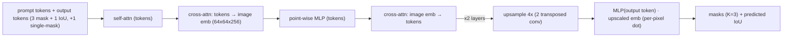
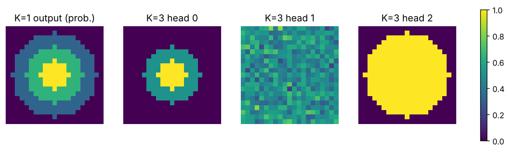
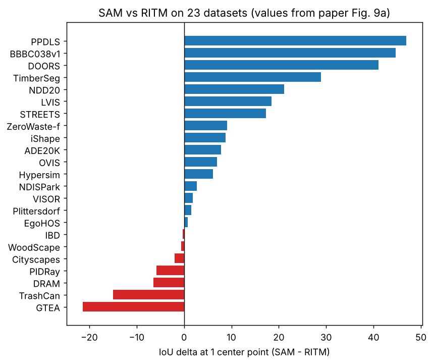

# SAM과 promptable segmentation: 무거운 인코더 1회 + 가벼운 디코더 N회, 그리고 data engine

> 원문: [Segment Anything](https://arxiv.org/abs/2304.02643) — Kirillov, Mintun, Ravi, Mao, Rolland, Gustafson, Xiao, Whitehead, Berg, Lo, Dollár, Girshick (Meta AI Research, FAIR), arXiv 2023-04. 코드·가중치(Apache 2.0)와 SA-1B 데이터셋이 함께 공개된 Meta FAIR의 기술 보고서다(Sec. 1). 이 글은 arXiv HTML v1 전문을 읽고 정리했다. 아래 수치와 표/그림/절 번호는 모두 그 본문 기준이다.

## 왜 나왔나

앞선 세 편(DETR, Deformable attention, Mask2Former)은 모두 "정해진 과제(semantic/instance/panoptic)를 잘 푸는 구조"를 다뤘다. SAM이 던지는 질문은 방향이 다르다. NLP에서 next-token prediction이 사전학습 과제이자 prompt engineering으로 downstream 과제를 푸는 인터페이스가 된 것처럼, **분할에도 그런 과제가 있을까?** (Sec. 1, 2) 논문은 이 계획이 세 가지 질문에 동시에 답해야 성립한다고 말한다.

1. 어떤 **과제**가 zero-shot 일반화를 가능하게 하는가
2. 그 과제에 맞는 **모델 구조**는 무엇인가
3. 그 과제와 모델을 키울 **데이터**는 어디서 오는가

세 번째가 특히 어렵다. CLIP 같은 모델은 웹의 이미지-텍스트 쌍을 그대로 쓰지만, 마스크는 웹에 자연스럽게 널려 있지 않다(Sec. 4). 그래서 논문의 기여는 모델 하나가 아니라 **task–model–data engine이 맞물린 시스템**이다(Fig. 1). 이 글은 앞의 두 가지(과제와 구조)를 수식과 코드로 파고들고, 데이터 쪽은 data engine의 숫자 위주로 다룬다.

<p align="center"></p>

*그림 1. 논문이 제안하는 세 축. (a) 어떤 프롬프트가 와도 유효한 마스크를 돌려주는 promptable segmentation 과제, (b) 이를 푸는 SAM, (c) 모델과 데이터를 함께 키우는 data engine(SA-1B 수집). 아래 절들은 이 세 요소를 하나씩 따라간다. (출처: 논문 Fig. 1, arXiv:2304.02643)*

## 핵심 아이디어

**1) 과제: 모호해도 "유효한 마스크 하나"는 반드시 낸다.** 프롬프트는 전경/배경 점 집합, 대략적인 박스나 마스크, 자유 텍스트 등 "무엇을 분할할지 알려주는 어떤 정보"다(Sec. 2). 사전학습은 interactive segmentation에서 가져온다. 마스크마다 프롬프트 시퀀스(점·박스·이전 마스크)를 시뮬레이션하고 예측을 GT와 비교한다. 다만 기존 interactive segmentation이 "충분한 입력 뒤에 최종적으로 맞으면 된다"였다면, SAM은 **프롬프트가 모호해도 항상 유효한 마스크**를 내도록 학습한다. 이래야 사람이 없는 자동 라벨링(data engine 3단계)에서도 쓸 수 있기 때문이다.

**2) 구조: amortization.** 모델은 세 부품이다(Sec. 3, Fig. 4). 무거운 **image encoder**(이미지당 한 번), 가벼운 **prompt encoder**, 가벼운 **mask decoder**. 이미지 임베딩을 한 번 계산해 두면 프롬프트를 바꿔도 디코더만 다시 돌리면 된다. 논문은 임베딩이 주어졌을 때 prompt encoder와 mask decoder가 **웹 브라우저 CPU에서 약 50ms**에 돈다고 쓴다(Sec. 3). 이 설계의 목적은 "프롬프트당 비용"을 거의 0으로 만들어 실시간 상호작용과 격자 점 프롬프트 수천 개를 가능하게 하는 것이다.

**3) 모호성: 마스크 3개를 동시에 예측하고 최소 loss만 역전파.** 점 하나가 셔츠인지 셔츠 입은 사람인지 알 수 없을 때, 출력이 하나면 모델은 가능한 마스크들의 평균을 학습해 버린다(Sec. 3). 중첩 마스크는 보통 whole/part/subpart 세 단계면 충분하다고 보고 출력 3개 + 각 마스크의 IoU 추정 head를 둔다.

**4) 데이터: model-in-the-loop 3단계.** assisted-manual → semi-automatic → fully automatic으로 가며 모델과 데이터를 같이 키워 11M 이미지, 1.1B 마스크의 SA-1B를 만든다(Sec. 4, 5).

<p align="center"></p>

*그림 2. SAM 개요. 무거운 image encoder가 만든 임베딩을 다양한 프롬프트(점, 박스, 마스크, 텍스트)가 가볍게 질의해 마스크를 내고, 모호한 프롬프트에는 여러 마스크와 신뢰도 점수를 함께 낸다. 왼쪽 인코더는 이미지당 1회, 오른쪽 디코더는 프롬프트당 1회 도는 비대칭 구조라는 점이 핵심이다. (출처: 논문 Fig. 4, arXiv:2304.02643)*

### 구성 요소의 실제 사양 (부록 A)

- **Image encoder**: MAE로 사전학습한 **ViT-H/16**, 14×14 windowed attention + 균등 간격의 global attention 블록 4개(ViTDet 방식). 입력은 1024×1024(리사이즈 후 짧은 변 패딩), 출력은 16배 다운샘플된 **64×64 임베딩**이고 1×1 conv로 256채널, 이어 3×3 conv(각각 LayerNorm).
- **Prompt encoder**: 점 = 위치 인코딩 + (전경/배경) 학습 임베딩. 박스 = 좌상단과 우하단 각각 (위치 인코딩 + 해당 코너 임베딩) 두 토큰. 텍스트 = CLIP 텍스트 인코더. 마스크(dense 프롬프트)는 입력의 1/4 해상도로 받아 stride-2 conv 두 번(채널 4, 16)과 1×1 conv로 256채널로 만든 뒤 **이미지 임베딩에 element-wise로 더한다**. 마스크 프롬프트가 없으면 "no mask" 임베딩을 더한다.
- **Mask decoder**: 임베딩 차원 256, 2층, 8 head. 프롬프트 토큰 + 학습되는 output 토큰(ViT의 [class] 토큰과 유사)을 "tokens"라 부르고, 각 층에서 네 단계를 거친다: (1) token self-attention, (2) token→image cross-attention, (3) token별 MLP(내부 2048), (4) **image→token cross-attention**(이미지 임베딩이 프롬프트 정보를 받는다). 매 attention마다 이미지 임베딩에 위치 인코딩을 더하고 원래 프롬프트 토큰(위치 인코딩 포함)을 다시 더한다. 64×64 이미지 임베딩이 들어가는 cross-attention에서는 q/k/v 채널을 128로 줄여 비용을 낮춘다.
- 2층 이후 이미지 임베딩을 stride-2 transposed conv 두 번으로 4배 업샘플하고, 출력 토큰을 3층 MLP에 통과시켜 **동적 선형 분류기**의 가중치를 만든 뒤 업샘플된 임베딩과 픽셀별 내적으로 마스크를 얻는다(MaskFormer/Mask2Former의 "query 임베딩 · per-pixel 임베딩" 구조와 같은 계보다).



*그림 3. 디코더 한 층의 4단계와 마지막 mask head. image→token 방향 cross-attention이 있어서 이미지 임베딩도 프롬프트별로 갱신된다는 점이 표준 DETR 디코더와 다르다. (직접 그림: 논문 부록 A 및 Fig. 14의 텍스트 설명을 mermaid로 옮김)*

## 수식

논문은 새 수식을 거의 쓰지 않고 학습 절차를 말로 기술한다. 본문과 부록 A의 서술을 식으로 풀어 쓰면 다음과 같다.

**프롬프트당 비용 분해.** 이미지 $`I`$에 대해 $`n`$개의 프롬프트를 처리하는 총 비용은

$$T(I,n)=T_{\text{enc}}(I)+n\cdot T_{\text{dec}}$$

이고, 논문은 디코더가 이미지 인코더 연산량의 **1% 미만**이라고 밝힌다(부록 A, 학습 절차 설명). 그래서 인코더를 아무리 키워도 상호작용 시 지연에는 거의 영향이 없고(이미지당 1회), 학습 때도 한 번의 인코더 forward로 마스크당 11번의 반복 프롬프트를 돌릴 수 있다. 격자 점 $`32\times32=1024`$개를 프롬프트로 쓰는 fully automatic 단계가 가능한 이유도 같다.

**마스크 예측.** 업샘플된 이미지 임베딩 $`F\in\mathbb R^{C'\times H'\times W'}`$(입력의 1/4 해상도)와 출력 토큰 $`k`$를 MLP에 통과시킨 벡터 $`w_k=\mathrm{MLP}(o_k)\in\mathbb R^{C'}`$에 대해

$$\hat m_k(x,y)=\sigma\big(w_k^\top F(x,y)\big),\qquad k=1,\dots,K\ (K=3)$$

$`o_k`$가 $`k`$번째 output 토큰의 최종 임베딩이다. 토큰마다 "동적 선형 분류기" 하나가 생기는 셈이고, 이는 Mask2Former의 mask classification과 같은 형태다.

**모호성: min-over-masks loss.** 프롬프트 $`p`$에 대한 GT가 $`m`$일 때, 예측 마스크 $`K`$개와의 loss 중 **가장 작은 것만** 역전파한다(Sec. 3, 부록 A).

$$\mathcal L_{\text{mask}}=\min_{k\in\lbrace 1,\dots,K\rbrace}\Big(20\thinspace\mathcal L_{\text{focal}}(\hat m_k,m)+\mathcal L_{\text{dice}}(\hat m_k,m)\Big)$$

focal:dice = **20:1**이다(부록 A, MaskFormer/DETR 계열을 따른 비율). 각 마스크의 IoU를 추정하는 head는 MSE로 학습하고 계수 1.0으로 더한다.

$$\mathcal L=\mathcal L_{\text{mask}}+1.0\cdot\big(\widehat{\mathrm{IoU}}_{k^\ast}-\mathrm{IoU}(\hat m_{k^\ast},m)\big)^2,\qquad k^\ast=\arg\min_k(\cdot)$$

$`k^\ast`$는 위에서 선택된 마스크의 인덱스로, 선택된 마스크에 대해서만 IoU 회귀가 이뤄진다고 읽는 것이 자연스럽다(원문은 "IoU 예측과 그 마스크의 GT IoU 사이 MSE"라고만 쓴다). 또 deep supervision(매 디코더 층마다 loss)은 Mask2Former와 달리 **도움이 되지 않았다**고 쓴다(부록 A).

**프롬프트가 2개 이상이면 마스크는 1개.** 모호성이 줄기 때문에 네 번째 output 토큰을 두고 점이 여러 개일 때는 이 토큰의 마스크만 쓴다. 단일 프롬프트에서는 이 4번째 마스크를 돌려주지 않는다(부록 A). 이렇게 해서 degenerate한 3개 마스크에 loss가 낭비되는 것을 피한다.

**interactive 학습 시뮬레이션.** 첫 프롬프트는 같은 확률로 전경 점(GT 마스크 안에서 균일 샘플) 또는 박스(GT의 bounding box에 각 좌표마다 박스 변 길이의 10%를 표준편차로 한 노이즈, 최대 20픽셀)다. 이후 점은 **직전 예측과 GT의 오차 영역에서 균일 샘플**하고, 오차가 false negative면 전경 점, false positive면 배경 점이다. 직전 마스크는 **이진화하지 않은 logit**으로 다음 입력에 dense 프롬프트로 준다. 반복은 총 11회: 첫 프롬프트 1 + 샘플링된 점 8 + 새 정보 없이 마스크만 다듬는 2회(하나는 8회 사이에 무작위로, 하나는 항상 마지막). 8점 이후에는 이득이 줄어들었고 16점까지 시험했다고 한다(부록 A).

**안정성 점수(fully automatic 단계).** 같은 soft mask를 임계값 $`0.5-\delta`$와 $`0.5+\delta`$로 이진화해 얻은 두 마스크의 IoU가 높으면 "안정적"이다(Sec. 4). 부록 B에서는 logit 임계값 0을 기준으로 $`\pm1`$에서 만든 두 마스크의 IoU가 95.0 이상일 때만 남기고, 예측 IoU 88.0 미만과 이미지의 95% 이상을 덮는 마스크도 버린다. 이어 box 기반 NMS(임계 0.7)로 중복을 제거한다.

## 코드

논문의 모호성 처리 핵심(출력 $`K`$개 + min-loss)이 왜 필요한지 numpy만으로 확인하는 장난감 실험이다. 한 점 프롬프트가 가리킬 수 있는 유효한 마스크가 반지름 3/6/9의 중첩 원 3개(subpart/part/whole)이고, 학습 때마다 그중 하나가 무작위로 정답으로 주어진다. 마스크 logit을 직접 파라미터로 두고 BCE로 학습한다(인코더, 디코더는 생략한 **메커니즘 시연용 합성 데이터**이고 논문 수치와 비교할 수 없다). 마지막에는 부록 B의 안정성 점수가 경계가 흐린 마스크를 어떻게 걸러내는지도 본다.

```python
import numpy as np
rng = np.random.default_rng(0)
N = 21; yy, xx = np.mgrid[:N, :N]; r = np.hypot(yy-N//2, xx-N//2)
# 한 점 프롬프트가 가리킬 수 있는 유효한 마스크 3개: subpart / part / whole (중첩 원)
targets = [(r <= R).astype(float) for R in (3, 6, 9)]

def train(K, steps=20000, lr0=0.5):
    logit = rng.normal(0, 0.5, (K, N, N))              # K개 output token이 만드는 마스크 logit
    for i in range(steps):
        lr = lr0*(1-i/steps)+0.01                      # lr decay
        t = targets[rng.integers(3)]                  # 이 프롬프트에 대한 정답은 3개 중 하나(모호함)
        p = 1/(1+np.exp(-logit))
        loss = -(t*np.log(p+1e-9)+(1-t)*np.log(1-p+1e-9)).mean((1, 2))
        k = loss.argmin()                             # min-over-masks: 가장 맞는 마스크만 backprop
        logit[k] -= lr*(p[k]-t)
    return 1/(1+np.exp(-logit))

def iou(a, b): return (a&b).sum()/max((a|b).sum(), 1)
for K in (1, 3):
    p = train(K); m = p > 0.5
    print(f"K={K}: 출력 마스크 면적 =", [int(x.sum()) for x in m], "| 확률이 0.2~0.8 사이인 픽셀 수 =", [int(((x>.2)&(x<.8)).sum()) for x in p])
    best = [max(iou(mk, t.astype(bool)) for mk in m) for t in targets]
    print("   각 유효 마스크와의 best IoU =", [round(float(b), 2) for b in best])
print("정답 면적 =", [int(t.sum()) for t in targets])

# stability score: 논문 부록 B (임계값을 흔들었을 때 두 마스크의 IoU)
def stability(prob, d=0.1): return iou(prob > .5+d, prob > .5-d)
sharp = (r <= 6).astype(float)*0.98 + 0.01
blur = 1/(1+np.exp((r-6)/2.5))                  # 경계가 흐릿한 확률맵
print("stability(sharp)=%.2f stability(blurry)=%.2f" % (stability(sharp), stability(blur)))
```

실제 출력(python 3.11, numpy 2.4, seed 0):

```
K=1: 출력 마스크 면적 = [113] | 확률이 0.2~0.8 사이인 픽셀 수 = [224]
   각 유효 마스크와의 best IoU = [0.26, 1.0, 0.45]
K=3: 출력 마스크 면적 = [113, 225, 253] | 확률이 0.2~0.8 사이인 픽셀 수 = [84, 436, 0]
   각 유효 마스크와의 best IoU = [0.26, 1.0, 1.0]
정답 면적 = [29, 113, 253]
stability(sharp)=1.00 stability(blurry)=0.46
```

읽는 법은 다음과 같다.

- **K=1**: 확률이 0.2~0.8인 "애매한 픽셀"이 224개다. 모델이 세 정답의 가중 평균 확률맵(중심 1.0, 안쪽 고리 약 2/3, 바깥 고리 약 1/3)을 학습했다는 뜻이다. 0.5로 자르면 part 크기(113)가 나와 subpart·whole과는 IoU 0.45까지만 겹친다. **어느 정답에도 정확히 맞지 않는 흐린 확률맵**이 모호성의 부작용이다.
- **K=3**: head 하나(면적 253)는 whole에 정확히 수렴(IoU 1.0)하고, 다른 하나(113)는 subpart와 part의 혼합이다(0.2~0.8 픽셀 84개). **세 번째 head는 한 번도 "승자"가 되지 못해 초기 노이즈 그대로 남았다**(애매한 픽셀 436개). 즉 3개 head가 세 모드를 깔끔하게 하나씩 나눠 가진 것이 아니다. 이 장난감에서 보이는 winner-take-all의 한계(초기화에 따라 죽는 head가 생김)이며, 논문은 이 문제나 그 대응책을 따로 논하지 않으므로, 실제 SAM에서 어떻게 완화되는지는 본문에서 확인하지 못했다. seed를 바꿔 보면 whole과 part를 가진 head 조합이 달라진다(이 글 작성 중 seed 1에서는 [215, 29, 253]).
- **stability**: 경계가 선명한 마스크는 1.00, 경계가 흐릿한 확률맵은 0.46이라 95.0 임계(부록 B)로 쉽게 걸러진다.

## 그림으로 보는 동작

<p align="center"></p>

*그림 4. 모호한 점 프롬프트 하나(초록 원)에 대해 SAM이 낸 유효한 마스크 3개. 열마다 whole / part / subpart에 해당하는 서로 다른 크기의 마스크가 나오며, 이것이 위 코드의 K=3 출력이 노리는 동작이다. (출처: 논문 Fig. 3, arXiv:2304.02643)*

<p align="center"></p>

*그림 5. 위 코드 실험의 확률맵. K=1(맨 왼쪽)은 세 정답의 평균인 동심원 계단 모양으로 흐려지고, K=3에서는 head 2가 whole 마스크로 선명하게 수렴하고 head 0은 subpart+part 혼합, head 1은 승자가 된 적이 없어 노이즈로 남는다. 마지막 head 문제는 이 장난감 설정의 한계다. (직접 그림: sam_ambig 코드의 학습 결과)*

<p align="center"></p>

*그림 6. 텍스트 프롬프트 zero-shot("a wheel")의 정성 결과. 학습 때는 마스크의 CLIP **이미지** 임베딩(면적이 100² 초과인 수동 수집 마스크에서 추출)을 첫 프롬프트로 주고, 추론 때는 CLIP **텍스트** 임베딩으로 바꿔 넣는다. 텍스트 라벨 없이 CLIP의 이미지-텍스트 정렬을 그대로 빌려 쓰는 방식이고, 실패하면 점 하나를 더하면 고쳐진다고 논문은 말한다(Sec. 7.5, 탐색적 결과). (출처: 논문 Fig. 12, arXiv:2304.02643)*

<p align="center"></p>

*그림 7. 단일 중심점 프롬프트로 23개 데이터셋에서 SAM이 기존 최강 단일 점 분할기 RITM을 mIoU 차이로 비교한 값(논문 Fig. 9a를 막대로 옮김). SAM이 16개 데이터셋에서 앞서고(최대 약 +47), GTEA(-21.4), TrashCan(-15.0) 등에서 뒤진다. 논문은 이 차이 일부가 "점 하나가 모호한데 GT는 마스크 하나"라서 생기는 평가 문제라고 설명한다. (직접 그림: 논문 Fig. 9a에 적힌 값)*

## 트레이드오프와 함정

**자동 평가 vs 사람 평가.** 단일 점 평가에서 SAM이 RITM보다 mIoU가 높은 데이터셋은 23개 중 16개다(Fig. 9a). 모호성 때문에 단일 GT가 SAM의 "다른 유효 마스크"를 벌한다는 점을 보이려고 논문은 **oracle**(3개 마스크 중 GT와 가장 잘 맞는 것을 선택) 결과도 낸다. oracle을 쓰면 SAM이 23개 모두에서 RITM을 앞선다. 사람 평가(1~10점)에서는 SAM의 평균이 7~9 구간이고, 자동 지표가 뒤지는 DRAM, IBD에서도 SAM이 더 높게 평가된다(Fig. 9b). 반대로 점 수가 1에서 9로 늘면 방법 간 격차가 줄고, SAM은 매우 높은 IoU 구간에 최적화돼 있지 않다고 인정한다(Fig. 9c). 중심점 대신 무작위 점으로 바꾸면 격차는 오히려 커진다(Fig. 9d).

**단일 출력이 아닌 3출력이 실제로 이긴다.** 모호성을 모르는 ablated 버전(출력 1개)은 사람 평가에서 일관되게 낮고(그래도 RITM보다는 높다, Fig. 9b), object proposal AR에서도 크게 진다. LVIS v1 mask AR@1000(Table 4)에서 SAM은 all 59.3 / small 45.5 / medium 81.6 / large 86.9 / freq. 59.1 / common 63.9 / rare 65.8이고, 단일 출력 SAM은 54.9 / 42.8 / 76.7 / 74.4 / 54.7 / 59.8 / 62.0이다. 반면 ViTDet-H를 proposal로 쓰는 강한 베이스라인은 all 63.0 / small 51.7 / medium 80.8 / large 87.0 / freq. 63.1 / common 63.3 / rare 58.3이다. SAM은 medium, large, common, rare에서 ViTDet-H를 앞서고 small과 freq.에서 진다. 논문은 ViTDet-H가 LVIS 주석 편향을 학습해 유리하다고 해석한다.

**박스를 주면 되지만 AP는 특화 모델에 뒤진다.** ViTDet 박스를 프롬프트로 준 instance segmentation(Table 5): COCO에서 ViTDet-H는 AP 51.0 / APS 32.0 / APM 54.3 / APL 68.9, SAM은 46.5 / 30.8 / 51.0 / 61.7. LVIS v1에서는 ViTDet-H 46.6 / 35.0 / 58.0 / 66.3, SAM 44.7 / 32.5 / 57.6 / 65.5로 격차가 줄어든다. 그런데 사람 평가에서는 SAM이 더 높게 평가된다(Fig. 11). 논문의 해석은 "ViTDet이 COCO·LVIS 마스크의 편향(구멍 없는 단순 폴리곤, modal/amodal 등)을 학습해 AP를 챙긴다"는 것이다. **AP 하나로는 마스크 품질을 말하기 어렵다**는 경고이기도 하지만, 같은 근거로 SAM이 더 낫다고 단정할 수는 없고 사람 평가 표본 규모 등은 부록 E를 봐야 한다.

**엣지 검출 zero-shot(Table 3, BSDS500).** 16×16 격자 점으로 마스크 768개(점당 3개)를 만들고 Sobel로 엣지를 뽑는다. SAM은 ODS .768 / OIS .786 / AP .794 / R50 .928로, HED(.788/.808/.840/.923)에는 못 미치지만 Canny(.600/.640/.580), Felz-Hutt(.610/.640/.560), Sobel(.539) 같은 zero-shot 방법을 크게 앞선다. R50이 높고 AP가 낮은 것은 BSDS500에 없는 합리적인 엣지까지 예측하기 때문이다(주석 편향을 모르니 억제를 못한다).

**데이터와 모델 스케일 (Fig. 13, Sec. 7.6).**
- data engine 단계가 쌓일수록 성능이 오르지만 자동 마스크만으로 학습해도 전 단계를 쓴 것보다 mIoU가 약 0.5 낮을 뿐이다. 수동·반자동 마스크를 10배 oversampling하면 가장 좋지만 학습이 복잡해져 기본값은 자동 마스크만 쓴다.
- 이미지를 0.1M으로 줄이면 크게 떨어지지만 1M(전체의 약 10%, 약 1억 마스크)이면 전체와 비슷하다.
- ViT-B→ViT-H는 크게, ViT-L→ViT-H는 약간만 오른다. 더 키우는 것은 "지금은 효과적이지 않다"고 본다.

**data engine 숫자(Sec. 4, 5).**

| 단계 | 마스크 수 | 이미지 | 마스크당 시간 | 이미지당 마스크 |
|---|---|---|---|---|
| assisted-manual | 4.3M | 120k | 34초 → 14초 | 20 → 44 |
| semi-automatic | +5.9M (누적 10.2M) | 180k | 34초(자동 마스크 제외) | 44 → 72 |
| fully automatic | 1.1B 중 99.1%가 자동 | 11M | 사람 개입 없음 | 평균 약 100 |

fully automatic 단계는 32×32 격자 점 + 2×2, 4×4 확대 crop(각각 16×16, 8×8 격자)으로 마스크 후보를 만들고 필터링한다(부록 B). 품질 검증으로는 500장(약 5만 마스크)에서 전문 라벨러가 자동 마스크를 고친 결과와 비교해 **94%가 IoU 90% 초과, 97%가 75% 초과**였다(기존 연구가 추정한 라벨러 간 일치는 85~91%). 마스크는 자동 생성된 것만 SA-1B에 들어간다.

**알려진 한계(Sec. 8).** 미세한 구조를 놓치고 작은 떨어진 조각을 환각하며, 확대(zoom-in) 방식 방법보다 경계가 덜 또렷하다. 점이 많이 주어지면 전용 interactive 방법이 더 낫다. 무거운 인코더 때문에 전체 파이프라인이 실시간은 아니다(프롬프트당 부분만 실시간). 텍스트→마스크는 탐색 수준이고, semantic·panoptic 분할을 간단한 프롬프트로 구현하는 방법은 불분명하다고 인정한다. 공정성 분석(Table 1, 2)에서 지역·소득 분포는 SA-1B가 COCO/Open Images보다 낫지만 아프리카·저소득 국가는 여전히 과소 대표되고, 사람 분할의 성별·피부색·연령 간 mIoU 차이는 대체로 신뢰구간이 겹친다(older vs middle 제외).

**내 평가.** (a) SAM은 class를 모른다. "마스크는 주지만 이름은 모른다"가 제품화할 때 가장 먼저 막힌다. detector나 CLIP과 붙이는 조합 시스템이 되는 이유다. (b) 무거운 ViT-H 인코더가 병목이라 on-device에서는 인코더를 경량화한 후속 모델들이 필요해진다. (c) 평가 프로토콜이 "단일 중심점 + 단일 GT"라 모호성을 어떻게 다루느냐에 따라 순위가 뒤집힐 수 있다.

## 대표 논문/참고

- **Segment Anything** (Kirillov et al., 2023, arXiv:2304.02643) — 이 글의 원문. 프로젝트 페이지 segment-anything.com에 SA-1B와 코드가 공개돼 있다(Sec. 1).
- **MAE** (He et al., 2021) — SAM 인코더의 사전학습 방식. 이 레포의 2026-11-13 글.
- **Mask2Former / MaskFormer** — 업샘플 임베딩과 쿼리의 내적으로 마스크를 만드는 구조의 계보. 이 레포의 2026-11-16 글.
- **ViTDet** (Li et al., 2022) — windowed attention + 소수의 global attention으로 고해상도 입력을 다루는 방식, SAM 인코더가 따른다(부록 A).
- **RITM** (Sofiiuk et al., 2022), **SimpleClick**, **FocalClick** — 비교 대상 interactive segmentation(Fig. 9).
- **CLIP** (Radford et al., 2021) — 텍스트 프롬프트를 이미지 임베딩 학습만으로 가능하게 한 정렬 공간(Sec. 7.5).
- 다음에 볼 것: DINO/DINOv2(self-supervised feature가 prompt 없이도 객체 구조를 얻는 방식)와 open-vocabulary detection(SAM에 이름을 붙이는 쪽).
