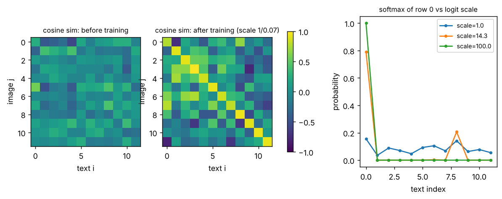
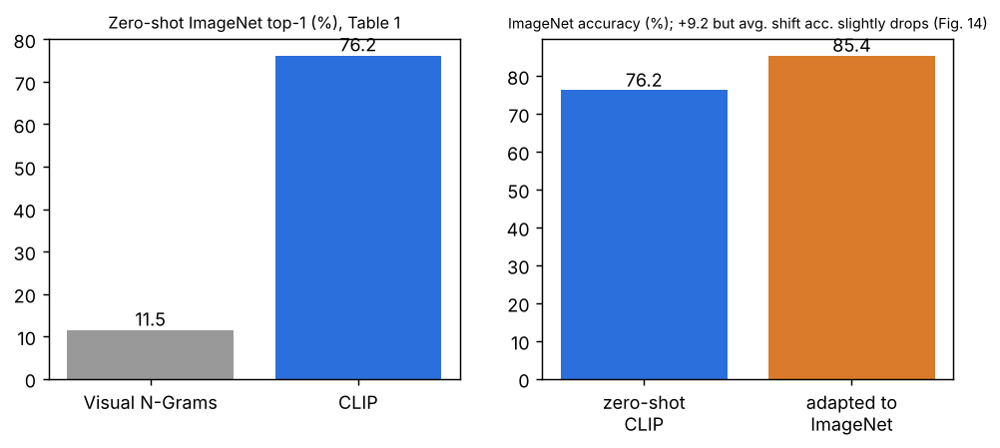

# CLIP: 이미지-텍스트 contrastive 사전학습과 "텍스트로 만드는 분류기"

> 원문: [Learning Transferable Visual Models From Natural Language Supervision](https://arxiv.org/abs/2103.00020) — Radford, Kim, Hallacy, Ramesh, Goh, Agarwal, Sastry, Askell, Mishkin, Clark, Krueger, Sutskever (OpenAI), arXiv 2021-02 (ICML 2021). 이 글은 arXiv HTML 전문을 읽고 정리했다. 이 레포의 2026-11-18 SAM 글이 텍스트 프롬프트를 CLIP 임베딩으로 처리한다는 점이 후속 채택의 한 예다.

## 왜 나왔나

NLP에서는 GPT-3처럼 웹 텍스트로 task-agnostic 사전학습을 하고 프롬프트만 바꿔 zero-shot으로 여러 과제를 푸는 흐름이 이미 자리 잡았다(Sec. 1). 반면 비전은 여전히 ImageNet 같은 크라우드 라벨 데이터로 사전학습하는 것이 표준이었다. 웹 규모의 자연어 감독이 비전에서도 같은 도약을 만들 수 있는가가 논문의 질문이다.

이전 시도들의 한계는 두 가지로 요약된다.

- **라벨 공간이 고정된 softmax 분류기.** Mahajan et al.(Instagram 해시태그), Kolesnikov et al.(BiT)은 각각 1000/18291개 클래스로 감독을 제한했고, 정적 softmax 분류기라 동적 출력(새 클래스)이 없다(Sec. 1). 자연어는 훨씬 넓은 시각 개념을 표현할 수 있는데 그것을 버린 셈이다.
- **규모.** VirTex, ICMLM, ConVIRT 같은 자연어 감독 모델은 10만~20만 장 수준에서 accelerator-days로 학습했다. 이 논문은 4억 쌍(WIT)으로 격차를 메운다.

여기에 **효율** 문제가 겹친다. 처음에는 VirTex처럼 CNN + Transformer로 캡션을 그대로 예측했는데, 6,300만 파라미터 text Transformer(연산량이 ResNet-50 이미지 인코더의 2배)가 같은 텍스트의 bag-of-words를 예측하는 단순 baseline보다 ImageNet zero-shot 학습이 **3배 느렸다**. 캡션의 정확한 단어를 맞히는 일은 같은 이미지에 붙는 설명이 너무 다양해서 어렵다는 게 논문의 진단이다(Sec. 2.3). 그래서 "어떤 텍스트가 이 이미지와 짝인가"만 맞히는 더 쉬운 대리 과제로 바꾸었고, 이것이 BoW 예측 대비 추가로 **4배** 효율 향상을 줬다(Fig. 2).

<p align="center"></p>

*그림 1. CLIP 개요. (1) 배치 안의 이미지-텍스트 쌍에 대해 두 인코더를 contrastive 방식으로 학습, (2) 클래스 이름으로 텍스트를 만들어 임베딩하면 그것이 곧 분류기, (3) 테스트 이미지 임베딩과 가장 유사한 텍스트를 고른다. 본문 수식의 $N\times N$ 유사도 행렬이 왼쪽 그림의 격자다. (출처: 논문 Fig. 1, arXiv:2103.00020)*

## 핵심 아이디어

**1) 목적: 배치 안에서 짝 찾기.** $N$개 (이미지, 텍스트) 쌍이 있을 때 $N\times N$ 조합 중 실제 짝 $N$개의 cosine 유사도는 올리고 나머지 $N^2-N$개는 내린다. 대칭 cross entropy를 쓴다. 논문은 이 batch 구성과 목적함수가 multi-class N-pair loss(Sohn 2016), InfoNCE(Oord et al. 2018)에서 왔고 ConVIRT(Zhang et al. 2020)가 텍스트-이미지로 옮겼다고 밝힌다(Sec. 2.3).

**2) ConVIRT를 일부러 단순화.** 데이터가 커서 과적합 걱정이 없으므로 (Sec. 2.3)
- 인코더는 ImageNet/사전학습 LM 초기화 없이 **from scratch**.
- representation과 임베딩 공간 사이는 SimCLR식 비선형 projection 대신 **선형 projection만**. 효율 차이를 못 봤다고 한다.
- 텍스트에서 문장 하나를 샘플하는 변환은 제거(대부분 한 문장이라서).
- 이미지 augmentation은 **random square crop 하나뿐**.
- 온도 $\tau$는 하이퍼파라미터가 아니라 **log-parameterized scalar로 직접 학습**한다.

**3) 분류기를 텍스트 인코더가 생성한다.** zero-shot 시 클래스 이름들을 텍스트 인코더에 넣어 임베딩하면, 예측층은 "입력과 가중치를 L2 정규화하고 bias가 없으며 온도로 스케일한 multinomial logistic regression"이 된다. 논문은 이를 텍스트 인코더가 선형 분류기 가중치를 만들어내는 **hypernetwork**로 해석한다(Sec. 3.1.2). 학습 한 스텝은 "텍스트로 정의된 클래스 $N$개짜리 분류 과제 하나"를 푸는 것과 같다.

**4) 데이터: WIT 4억 쌍.** 위키피디아에서 100회 이상 등장하는 단어, PMI 높은 bi-gram, 검색량 많은 문서 제목, WordNet synset으로 만든 50만 개 쿼리로 (이미지, 텍스트)를 수집하고 쿼리당 최대 2만 쌍으로 대략 클래스 균형을 맞춘다. 총 단어 수는 GPT-2의 WebText와 비슷하다(Sec. 2.2, 각주 1).

### 인코더와 학습 사양 (Sec. 2.4, 2.5)

- **이미지 인코더**: (a) ResNet-50 변형(ResNet-D, antialiased blur pool, 마지막 global average pooling을 **attention pooling**으로 교체. query가 평균 풀링 표현에 조건화된 단일 층 QKV attention), (b) ViT(patch+position 임베딩 뒤 LayerNorm 추가, 초기화 약간 다름).
- **텍스트 인코더**: 12층, 폭 512, 8 head, 63M 파라미터 Transformer(GPT-2 스타일 수정). lower-case BPE, vocab 49,152, 최대 길이 76. [SOS]/[EOS]로 감싸고 **[EOS] 위치의 최상위 활성**을 layer norm 후 선형 투영한다. causal(masked) self-attention을 쓰는데, 사전학습 LM으로 초기화하거나 LM 보조 목적을 추가할 여지를 남기기 위해서다.
- **스케일링**: ResNet은 폭·깊이·해상도를 EfficientNet 방식으로 균등 증가(RN50x4/x16/x64 = RN50 대비 약 4/16/64배 연산), 텍스트 인코더는 폭만 ResNet 폭 증가에 비례시키고 깊이는 그대로 둔다(성능이 텍스트 인코더 용량에 덜 민감했다고 한다).
- **학습**: ResNet 5개 + ViT 3개(B/32, B/16, L/14), 모두 **32 epoch**. Adam(decoupled weight decay) + cosine schedule, **batch 32,768**, 혼합 정밀도, gradient checkpointing, half-precision Adam 통계, 유사도 계산을 GPU별로 **sharding**(각 GPU는 자기 로컬 배치에 필요한 유사도 부분만 계산). $\tau$는 0.07 상당으로 초기화하고 logit scale이 **100을 넘지 않게 clip**한다(불안정 방지). RN50x64는 V100 592장 18일, 최대 ViT는 V100 256장 12일. ViT-L/14는 336px로 1 epoch 추가 사전학습한 **ViT-L/14@336px**가 최고 성능이라 논문의 "CLIP"은 기본적으로 이 모델이다.

## 수식

배치의 이미지 $x_i$와 텍스트 $t_i$($i=1..N$), 인코더 $f_I, f_T$와 선형 투영 $W_I, W_T$에 대해 정규화된 임베딩은

$$u_i=\frac{W_I f_I(x_i)}{\lVert W_I f_I(x_i)\rVert},\qquad v_j=\frac{W_T f_T(t_j)}{\lVert W_T f_T(t_j)\rVert}$$

이고 유사도 행렬은 $S_{ij}=\exp(\theta)\thinspace u_i^\top v_j$ 이다. 여기서 $\theta=\log(1/\tau)$가 학습되는 스칼라이고 $\exp(\theta)\le 100$으로 clip한다. cosine이 $[-1,1]$이라 그대로 softmax에 넣으면 분포가 너무 평평해지므로 이 스케일이 필요하다.

행 방향(각 이미지에 대해 정답 텍스트 찾기)과 열 방향(각 텍스트에 대해 정답 이미지 찾기)의 cross entropy를 평균한다. 논문 Fig. 3의 numpy식 pseudocode와 같다.

$$\mathcal L=\frac12\Big[\underbrace{-\frac1N\sum_i\log\frac{e^{S_{ii}}}{\sum_j e^{S_{ij}}}}_{\text{image}\to\text{text}}\thickspace\underbrace{-\thickspace\frac1N\sum_j\log\frac{e^{S_{jj}}}{\sum_i e^{S_{ij}}}}_{\text{text}\to\text{image}}\Big]$$

**기울기.** $P^r=\mathrm{softmax}_{\text{row}}(S)$, $P^c=\mathrm{softmax}_{\text{col}}(S)$, $I$를 단위행렬이라 하면

$$\frac{\partial\mathcal L}{\partial S}=\frac{P^r+P^c-2I}{2N}$$

이다. 정답 쌍은 당기고(대각의 $-1$), 같은 행/열의 오답 쌍은 그 softmax 확률만큼 밀어낸다. 아래 코드가 이 식을 그대로 쓴다. 정규화 $u=y/\lVert y\rVert$를 지나는 역전파는 $\partial y=(\partial u-u(u^\top\partial u))/\lVert y\rVert$로 투영된다.

**Zero-shot 분류.** 클래스 $k=1..K$의 이름으로 만든 프롬프트 $t_k$에 대해

$$p(k\mid x)=\frac{\exp\big(e^{\theta}\thinspace u^\top v_k\big)}{\sum_{k'}\exp\big(e^{\theta}\thinspace u^\top v_{k'}\big)}$$

이고 이는 "가중치 $v_k$, bias 0, 입력과 가중치 모두 L2 정규화, 온도 스케일"의 로지스틱 회귀와 같다(Sec. 3.1.2). 텍스트가 분류 헤드의 가중치를 생성하므로 클래스 집합은 추론 시점에 자유롭게 바꿀 수 있다.

**프롬프트 ensemble은 확률이 아니라 임베딩 공간에서.** 여러 템플릿("A photo of a big {label}." 등)에서 얻은 텍스트 임베딩을 평균해 클래스당 벡터 하나로 캐시한다. 그래서 한 번 만들어두면 추론 비용은 템플릿 1개와 같다(Sec. 3.1.4).

## 코드

논문 구조를 장난감 규모로 옮긴 numpy 실험이다. 잠재 개념 $z\in\mathbb R^8$ 하나가 이미지(32차원)와 "캡션"(24차원)으로 서로 다른 선형 사상을 거쳐 렌더링되고, 이미지·텍스트용 선형 인코더 두 개를 위 손실로 학습한다. 클래스 60개 중 **40개로만 학습**하고 학습 때 보지 못한 20개 클래스에서 "텍스트로 만든 분류기"로 zero-shot 정확도를 잰다. logit scale 고정값을 바꿔가며 비교한다.

```python
import numpy as np
rng = np.random.default_rng(0)
dz, di, dt, e = 8, 32, 24, 16
A, B = rng.normal(size=(di, dz)), rng.normal(size=(dt, dz))       # 이미지/텍스트 "렌더링" (서로 다른 모달리티)
centers = rng.normal(size=(60, dz))                               # 60개 개념; 0~39 학습용, 40~59는 학습 때 못 본 클래스
def img(c, n): return (centers[c] + 0.4*rng.normal(size=(n, dz))) @ A.T + 0.3*rng.normal(size=(n, di))
def txt(c):    return centers[c] @ B.T + 0.1*rng.normal(size=(len(c), dt))   # 클래스 이름/캡션

def norm_fwd(x):
    n = np.linalg.norm(x, axis=1, keepdims=True); return x/n, n
def norm_bwd(y, n, dy): return (dy - y*(y*dy).sum(1, keepdims=True))/n

def train(scale, N=32, steps=3000, lr=0.05):
    Wi, Wt = 0.1*rng.normal(size=(di, e)), 0.1*rng.normal(size=(dt, e))
    for s in range(steps):
        c = rng.choice(40, N, replace=False)                      # 배치 안에 같은 개념이 중복되지 않게
        X, T = img(c, N), txt(c)
        I, ni = norm_fwd(X@Wi); Tt, nt = norm_fwd(T@Wt)
        L = scale*I@Tt.T                                          # N x N 유사도 (cosine * 1/tau)
        Pr = np.exp(L - L.max(1, keepdims=True)); Pr /= Pr.sum(1, keepdims=True)   # 행 softmax: image -> text
        Pc = np.exp(L - L.max(0, keepdims=True)); Pc /= Pc.sum(0, keepdims=True)   # 열 softmax: text -> image
        G = (Pr + Pc - 2*np.eye(N))/(2*N)                         # 대칭 cross entropy의 dL/dS
        Wi -= lr*X.T@norm_bwd(I, ni, scale*G@Tt)
        Wt -= lr*T.T@norm_bwd(Tt, nt, scale*G.T@I)
    return Wi, Wt

def zero_shot_acc(Wi, Wt, cls, n=200):
    Tt, _ = norm_fwd(txt(cls)@Wt)                                 # 텍스트 인코더 = 분류기 가중치를 만드는 hypernetwork
    acc = []
    for k, c in enumerate(cls):
        I, _ = norm_fwd(img(np.full(n, c), n)@Wi)
        acc.append(((I@Tt.T).argmax(1) == k).mean())
    return np.mean(acc)

for scale in (1.0, 1/0.07, 100.0):
    Wi, Wt = train(scale)
    print(f"logit scale {scale:6.1f} | seen 40-way {zero_shot_acc(Wi,Wt,np.arange(40)):.3f} | unseen 20-way {zero_shot_acc(Wi,Wt,np.arange(40,60)):.3f} | unseen 60-way {zero_shot_acc(Wi,Wt,np.arange(60)):.3f}")
print("chance: 40-way 0.025, 20-way 0.050, 60-way 0.017")
```

실제 출력(python 3.11, numpy, seed 0, 단일 시드):

```
logit scale    1.0 | seen 40-way 0.942 | unseen 20-way 0.888 | unseen 60-way 0.871
logit scale   14.3 | seen 40-way 0.966 | unseen 20-way 0.919 | unseen 60-way 0.910
logit scale  100.0 | seen 40-way 0.959 | unseen 20-way 0.839 | unseen 60-way 0.817
chance: 40-way 0.025, 20-way 0.050, 60-way 0.017
```

읽는 법은 다음과 같다.

- **학습에서 보지 못한 클래스**를 텍스트만 바꿔서 분류한다(unseen 20-way 0.92, 우연 수준 0.05). 분류 헤드가 학습 대상이 아니라 텍스트 인코더의 출력이라는 점이 zero-shot의 전부다.
- **온도의 영향**: 가장 작은 스케일(1)과 가장 큰 스케일(100) 모두 14.3보다 낮다. 스케일 1에서는 softmax가 평평해 오답 쌍을 충분히 밀어내지 못하고, 100에서는 분포가 극단적으로 뾰족해져(오른쪽 그림) 가장 헷갈리는 소수의 오답에 기울기가 몰려 일반화가 나빠진다. 논문이 $\tau$를 직접 학습하고 100으로 clip한 이유와 같은 방향이지만, 이 장난감은 단일 시드이고 차이가 몇 %p라 **방향성만** 보면 된다.
- 선형 모델에 합성 데이터이므로 절대 수치는 논문과 무관하다. 보여주는 것은 메커니즘(대칭 InfoNCE → 공유 임베딩 공간 → 텍스트로 만든 분류기)뿐이다.

## 그림으로 보는 동작

<p align="center"></p>

*그림 2. 위 코드의 학습 전후 유사도 행렬(12개 개념, 행=이미지, 열=텍스트)과 한 행의 softmax가 logit scale에 따라 달라지는 모습. 학습 전에는 대각선이 구분되지 않고, 학습 후에는 대각선(정답 쌍)이 밝아진다. 오른쪽에서 scale=1은 확률이 평평하고 scale=100은 사실상 one-hot이다. (직접 그림: 위 장난감 실험의 코사인 유사도)*

<p align="center"></p>

*그림 3. 학습된 CLIP이 zero-shot으로 하는 일의 정성 예시. 클래스 목록은 "a photo of a {label}" 같은 문장으로 주고 가장 유사한 문장을 고른다. 분류뿐 아니라 OCR, 지오로컬라이제이션, 감정·행동 인식 같은 과제가 별도 학습 없이 같은 메커니즘으로 풀린다는 논문의 주장(Sec. 3.2)을 보여준다. (출처: 논문 Fig. 21, arXiv:2103.00020)*

<p align="center"></p>

*그림 4. 자연스러운 분포 이동(ImageNetV2, Sketch, YouTube-BB, ImageNet-Vid, ObjectNet, Adversarial, Rendition 7종)에서의 robustness. 점선이 이상적인 모델이고 zero-shot CLIP은 ImageNet 모델들보다 훨씬 위에 있어 "robustness gap"이 최대 75% 줄었다. 오른쪽은 바나나 클래스를 같은 ImageNet 정확도의 ResNet-101과 비교한 예다. (출처: 논문 Fig. 13, arXiv:2103.00020)*

<p align="center"></p>

*그림 5. ImageNet 학습 데이터로 L2 로지스틱 회귀를 맞추면 ImageNet 정확도는 76.2→85.4로 9.2%p 오르지만, 7개 이동 데이터셋의 평균 정확도는 오히려 약간 내려간다(왼쪽). 오른쪽은 데이터셋별 변화로 ImageNetV2만 눈에 띄게 오르고 ImageNet-R −4.7, ObjectNet −3.8, Sketch −2.8, ImageNet-A −1.9 등이 떨어진다. (출처: 논문 Fig. 14, arXiv:2103.00020)*

<p align="center"></p>

*그림 6. 본문에서 인용한 핵심 수치. 왼쪽은 Visual N-Grams의 11.5%에서 CLIP의 76.2%로 오른 zero-shot ImageNet 정확도(Table 1), 오른쪽은 zero-shot과 ImageNet 적응 후의 ImageNet 정확도 차이(Sec. 3.3). 큰 도약과, 그 이득이 분포 이동까지 이어지지는 않는다는 점이 같이 읽힌다. (직접 그림: 논문 Table 1과 Sec. 3.3 수치)*

## 트레이드오프와 함정

**Zero-shot 성능(Table 1, Sec. 3.1.3).** Visual N-Grams 대비 aYahoo 72.4→98.4, ImageNet 11.5→76.2, SUN 23.0→58.5. ImageNet 76.2%는 라벨 128만 장 없이 원본 ResNet-50과 맞먹고 top-5는 95%로 Inception-V4 수준이다. 단 논문 스스로 이것은 통제된 방법 비교가 아니라고 못박는다(데이터 10배, 연산량 100배 이상, 학습 연산 1000배 이상). 같은 YFCC100M으로 학습한 CLIP RN50이 Visual N-Grams의 ImageNet 수치와 비슷했다고 보고한다.

**프롬프트가 곧 하이퍼파라미터.** 클래스 이름만 넣으면 polysemy가 생긴다(ImageNet의 crane은 건설 크레인과 새, Pets의 boxer는 개와 선수). 사전학습 텍스트는 대부분 문장이라 단어 하나는 분포 밖이기도 하다. "A photo of a {label}."만으로 ImageNet +1.3%, 80개 템플릿 ensemble로 추가 +3.5%, 합쳐 약 5%p이고 36개 데이터셋 평균에서도 거의 5점 오른다(Fig. 4). 데이터셋별로 "a type of pet", "a satellite photo of", OCR에는 따옴표 같은 맞춤 프롬프트를 썼다. 즉 완전한 zero-shot이 아니라 사람이 프롬프트를 튜닝한 값이다.

**과제별 편차(Fig. 5, Sec. 3.1.5).** 27개 데이터셋 중 16개에서 ResNet-50 특징 위의 지도 선형 분류기를 이긴다. Stanford Cars, Food101에서는 20%p 이상 앞서고 Flowers102, FGVC Aircraft에서는 10%p 이상 뒤진다. Kinetics700은 +14.5%, UCF101은 +7.7%(동사에 대한 넓은 감독 때문일 것이라는 추측). STL10은 99.3%. 반면 EuroSAT, RESISC45, PatchCamelyon, CLEVRCounts, GTSRB, KITTI Distance 같은 특수·추상 과제는 약하다.

**Zero-shot ≈ few-shot 몇 장.** zero-shot CLIP은 같은 특징 공간에서 4-shot 선형 분류기의 평균 성능과 맞먹고 최고 16-shot에 가깝다(Fig. 6). 동일 특징 공간에서 zero-shot과 같아지려면 데이터셋마다 라벨 예시가 1장 미만에서 184장까지 필요하고 중앙값 5.4, 평균 20.8장이다(Fig. 7). 그러나 zero-shot은 완전 지도 선형 분류기보다 대부분 10~25%p 낮고(Fig. 8) 둘의 상관은 0.82다. 격차가 3%p 이내인 데이터셋은 STL10, CIFAR10, Food101, OxfordPets, Caltech101 5개뿐이다.

**스케일링.** zero-shot 평균 오류율은 5개 ResNet CLIP 모델의 44배 연산 범위에서 log-log 선형이다(Fig. 9). 다만 개별 평가는 훨씬 들쭉날쭉하다. 선형 프로브에서는 CLIP ViT가 CLIP ResNet보다 연산 효율이 약 3배 좋고(Fig. 10), 가장 큰 모델은 12개 데이터셋 평가에서 Noisy Student EfficientNet-L2를 근소하게 앞선다. 27개 데이터셋 평가에서는 모든 CLIP 모델이 연산 효율에서 앞서고 최고 모델의 우위가 2.6%에서 5%로 커진다. 21/27 데이터셋에서 EfficientNet-L2보다 낫다(Fig. 11). 반대로 논문이 추정하는 비용은 **zero-shot으로 전반적인 SOTA에 닿으려면 약 1000배 연산이 더 필요**하다는 것이다(Sec. 6).

**Robustness: 이득은 "분포 특화 데이터를 안 봤기 때문".** zero-shot은 effective robustness를 크게 올리지만 ImageNet에 적응시키면(그림 5) 사라진다. few-shot에서도 shot이 늘수록 이득이 줄어든다(Fig. 15). 논문의 해석은 분포 특화 학습 데이터를 적게 볼수록 robust해지는 대신 그 분포의 성능이 낮아진다는 것이다. 원인이 CLIP, 데이터, ImageNet 중 무엇인지는 확신하지 못한다고 명시한다.

**사람과의 비교(Table 2, Oxford Pets 3669장).** 인간 zero-shot 53.7, one-shot 75.7, two-shot 75.7, zero-shot CLIP 93.5.  CLIP이 인간 zero-shot과 one-shot을 모두 크게 앞서지만, 논문은 인간 few-shot과 모델 few-shot이 정확히 대응하지는 않는다고 각주로 단서를 단다(Sec. 4).

**데이터 오염(Sec. 5).** 35개 평가 데이터셋 중 9개는 탐지된 중복이 전혀 없고, 대부분은 오염이 정확도에 미치는 영향이 통계적으로 유의하지 않다(Fig. 17). 학습 데이터를 사전에 제거하는 대신 Overlap/Clean 분할로 사후 측정하는 방식이다.

**MNIST 함정(Sec. 6).** 렌더링된 텍스트(SST2)는 잘 읽지만 손글씨 MNIST는 zero-shot 88%이고 픽셀 로지스틱 회귀가 이긴다. 사전학습 데이터에 MNIST 같은 이미지가 거의 없다는 것을 의미 기반·근접 중복 검색으로 확인했다. 논문의 표현으로는 CLIP이 취약한 일반화 문제를 푼 것이 아니라 "모든 데이터를 사실상 in-distribution으로 만들기를 바라는" 접근이다.

**한계(Sec. 6).** (1) 출력이 주어진 클래스 후보 안에서 고르는 것으로 제한되며 캡션 생성 같은 자유 출력이 없다. 대조 + 생성 목적의 결합을 향후 과제로 제시한다. (2) 데이터 효율이 좋은 것이 아니라 감독의 양으로 때운다. 12.8B장(32 epoch)을 초당 1장씩 보면 405년이 걸린다. (3) 방법론적 한계: 개발 중 전체 검증셋을 반복 조회했고 27개 평가 데이터셋 선택이 CLIP에 co-adapt되어 있다. (4) 필터링 없는 웹 텍스트라 사회적 편향을 학습한다(Sec. 7).

**내 평가.** (a) 이 논문이 바꾼 것은 손실함수가 아니라 **과제 정의**다. 분류를 "텍스트와의 유사도 검색"으로 재정의해 라벨 공간을 열었다. (b) $N$이 작으면 오답 쌍이 적어 학습 신호가 약하다는 점 때문에 batch 32,768과 shard된 유사도 계산이 시스템적으로 중요하다. 방법이 단순해 보이는 이유는 이런 엔지니어링을 논문 본문 밖에 두었기 때문이다. (c) 이름만 넣으면 안 되고 프롬프트를 튜닝해야 한다는 사실이 이후 prompt learning 연구(CoOp 등)의 동기가 된다. 이 항목은 논문 밖의 내 정리다.

## 대표 논문/참고

- **CLIP** (Radford et al., 2021, arXiv:2103.00020, ICML 2021) — 이 글의 원문.
- **ConVIRT** (Zhang et al., 2020) — 의료 영상에서 이미지-텍스트 대칭 contrastive를 쓴 직접적인 선행 연구(Sec. 2.3).
- **InfoNCE / CPC** (Oord et al., 2018), **N-pair loss** (Sohn, 2016) — 손실의 뿌리.
- **VirTex, ICMLM** — 캡션 예측 방식의 선행 연구. CLIP이 효율 면에서 비교한 대상(Fig. 2).
- **Visual N-Grams** (Li et al., 2017) — zero-shot 전이를 표준 분류 데이터셋에서 처음 측정한 연구(Table 1).
- **Taori et al., 2020** — effective/relative robustness 정의(Sec. 3.3).
- 이 레포의 연결 글: SAM(2026-11-18)은 텍스트 프롬프트에 CLIP 텍스트 인코더를 쓴다.
- 다음에 볼 것: open-vocabulary detection(CLIP의 텍스트 정렬 공간을 검출 헤드에 쓰는 방식), DINO/DINOv2(언어 없이 얻는 self-supervised feature와의 비교), classifier-free guidance와 텍스트 조건 생성.
