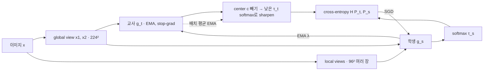
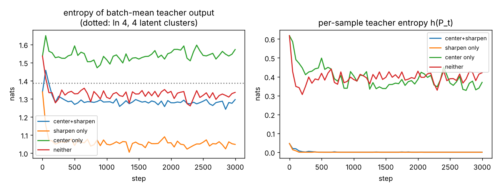
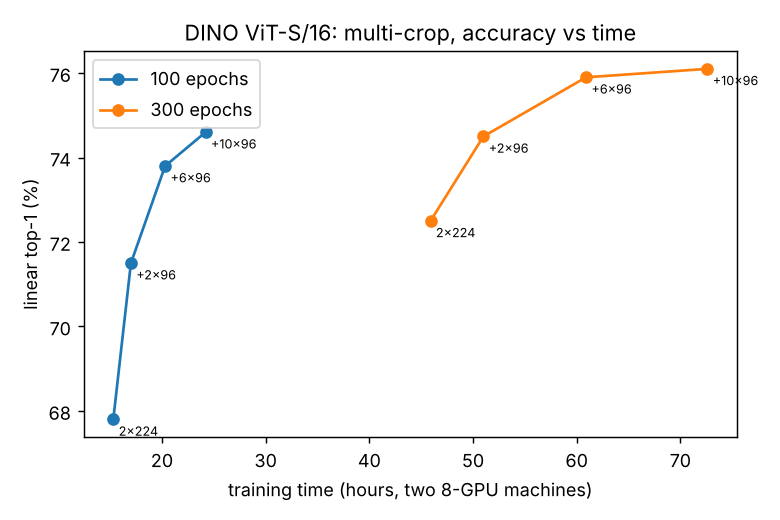

# DINO: self-distillation with no labels, 그리고 self-supervised ViT에서 "나타난" 성질

> 원문: [Emerging Properties in Self-Supervised Vision Transformers](https://arxiv.org/abs/2104.14294) — Caron, Touvron, Misra, Jégou, Mairal, Bojanowski, Joulin (Facebook AI Research, Inria, Sorbonne University), arXiv 2021-04 (ICCV 2021).

## 왜 나왔나

ViT는 NLP의 "대규모 사전학습 → 파인튜닝" 레시피를 가져왔지만, 논문의 진단은 이렇다. ViT는 convnet보다 연산이 무겁고 데이터가 더 필요하며 **features가 convnet에 없는 고유한 성질을 보이지 않는다**(Sec. 1). 저자들은 그 원인을 *supervised* 사전학습에서 찾는다. 이미지 한 장을 수천 개 라벨 중 하나로 줄이는 감독은 풍부한 시각 정보를 버리고, NLP에서 BERT의 마스킹이나 GPT의 언어모델링이 주는 "문장 안에서 만든 풍부한 학습 신호"에 해당하는 것이 없다는 것이다.

기존 self-supervised 방법(SimCLR, MoCo, BYOL, SwAV)은 모두 비슷한 뼈대에 **collapse를 막는 장치**를 각자 다르게 얹는다. contrastive 손실과 큰 배치 또는 memory bank, 클러스터링 제약(Sinkhorn-Knopp), predictor, BatchNorm 등이다(Sec. 2, 3.1). DINO의 목표는 이 장치들을 걷어내고 뼈대만 남긴 단순한 형태가 ViT에서 가장 잘 동작함을 보이는 것이다. 논문은 이를 **라벨 없는 knowledge distillation**으로 해석한다. 그 결과로 (1) 마지막 층 self-attention에 장면의 object layout이 드러나고, (2) 파인튜닝도 선형 분류기도 없이 k-NN만으로 높은 정확도가 나온다.

<p align="center"></p>

*그림 1. 라벨 없이 학습한 8×8 패치 ViT에서 [CLS] 토큰이 마지막 층 여러 head에 걸어 주는 self-attention. 어떤 라벨도 보지 않았는데 attention이 물체 영역을 따라간다. 아래 "그림으로 보는 동작"에서 supervised ViT와 정량 비교한다. (출처: 논문 Fig. 1, arXiv:2104.14294)*

## 핵심 아이디어

**1) 학생과 교사는 구조가 같은 네트워크다.** 같은 아키텍처 $g=h\circ f$ (backbone $f$ = ViT 또는 ResNet, projection head $h$)의 두 벌, 파라미터 $\theta_s$, $\theta_t$를 둔다. 교사는 미리 주어진 큰 모델이 아니라 **학생의 과거로부터 만든다**. 학생에게만 gradient가 흐르고(stop-gradient), 교사는 EMA로 갱신한다. BYOL과 다른 점은 predictor가 없어 두 네트워크가 정확히 같은 구조라는 것, 그리고 MSE가 아닌 **cross-entropy**를 쓴다는 점이다(Sec. 2, 3.1).



*그림 2. DINO의 한 스텝. 교사는 global view 두 장만, 학생은 global + local 전부를 본다. 교사 출력은 center를 빼고 낮은 온도로 sharpen한 뒤 목표 분포가 되고, 학생이 이를 cross-entropy로 맞춘다. 교사는 학생의 EMA다. (직접 그림: 논문 Fig. 2와 Algorithm 1의 구조)*

**2) Multi-crop으로 "local → global" 대응을 만든다.** 한 이미지에서 전체의 50% 넘게 덮는 224² global view 2장과, 작은 영역(50% 미만)을 덮는 96² local view 여러 장을 만든다. **교사에는 global만, 학생에는 전부** 넣는다. 작은 조각만 보고도 큰 장면의 표현을 맞히라는 압박이 object 수준 표현을 만든다는 것이 논문의 해석이다(Sec. 3.1).

**3) Collapse는 centering과 sharpening 둘의 균형으로 막는다.** 교사 출력에서 배치 평균(center)을 빼면 한 차원이 지배하는 collapse를 막지만 균일 분포로 가려는 경향이 생기고, 낮은 교사 온도로 sharpen하면 반대 효과가 난다. 둘을 같이 쓰면 균형이 잡힌다(Sec. 3.1, 5.3). contrastive negative도, queue도, predictor도, BN도 필요 없다.

**4) 교사가 학생보다 좋다.** 학습 내내 EMA 교사가 학생보다 정확하다(Fig. 6 왼쪽). 논문은 이를 지수 감쇠 Polyak-Ruppert averaging, 즉 학습 중에 계속 만드는 모델 앙상블로 해석하고, 학생은 자기보다 나은 목표를 따라가면서 좋아지고 교사는 그 학생에서 다시 만들어진다고 설명한다(Sec. 3.1, 5.2, App. D).

### 구성 요소와 하이퍼파라미터 (Sec. 3.1, 3.2, App. C)

- **Projection head**: 3층 MLP(은닉 2048, GELU) → $\ell_2$ 정규화 → weight-normalized 선형층(출력 $K$). 기본은 $K=65536$, 병목 차원 256. 총 선형층 4개. BN은 어디에도 없다(ViT 전체가 BN-free).
- **ViT**: DeiT 구현, pre-norm. 입력은 $N\times N$ 패치(16 또는 8), [CLS] 토큰 출력에 head를 붙인다. [CLS]는 어떤 라벨에도 연결되지 않는다.
- **교사 EMA** $\lambda$: 0.996 → 1로 cosine schedule. **온도** 학생 $\tau_s=0.1$, 교사 $\tau_t$는 처음 30 epoch 동안 0.04 → 0.07 선형 warm-up.
- **옵티마이저**: AdamW, 배치 1024(ViT-S/16에서 GPU 16장), lr $=0.0005\times$batch/256에 10 epoch warm-up 후 cosine, weight decay 0.04 → 0.4 cosine. augmentation은 BYOL의 color jitter, Gaussian blur, solarization + multi-crop.
- **ViT 구성 (Table 1)**: ViT-S/16은 21M 파라미터·토큰 197·1007 im/s, ViT-S/8은 토큰 785·180 im/s, ViT-B/16은 85M·312 im/s, ViT-B/8은 토큰 785·63 im/s, ResNet-50은 23M·1237 im/s. 패치 크기는 파라미터를 늘리지 않으면서 토큰 수(=연산·메모리)를 4배로 만든다.

## 수식

임의의 입력 $x$에 대해 학생·교사의 출력 $g(x)\in\mathbb R^K$를 온도 softmax로 확률화한다.

$$P_s(x)^{(i)}=\frac{\exp\big(g_{\theta_s}(x)^{(i)}/\tau_s\big)}{\sum_{k=1}^{K}\exp\big(g_{\theta_s}(x)^{(k)}/\tau_s\big)}$$

$\tau_s>0$이 분포의 뾰족함을 정하고, $P_t$도 같은 식에 $\tau_t$를 쓴다. 교사가 고정돼 있다면 knowledge distillation은 학생에 대한 cross-entropy 최소화다. 여기서 $H(a,b)=-\sum_i a_i\log b_i$.

$$\min_{\theta_s} H\big(P_t(x),P_s(x)\big)$$

Multi-crop에서는 교사가 보는 global view $x_1^g,x_2^g$와 학생이 보는 다른 모든 view $V$ 사이의 쌍에 대해 합한다.

$$\min_{\theta_s}\sum_{x\in\lbrace x_1^g,x_2^g\rbrace}\ \sum_{x'\in V,\ x'\neq x} H\big(P_t(x),P_s(x')\big)$$

$x'\ne x$ 조건은 같은 view끼리 맞추는 자명한 쌍을 제외한다. 교사의 갱신과 center는 다음과 같다.

$$\theta_t\leftarrow\lambda\theta_t+(1-\lambda)\theta_s,\qquad c\leftarrow mc+(1-m)\frac1B\sum_{i=1}^{B}g_{\theta_t}(x_i)$$

교사의 실제 목표 분포는 $P_t(x)=\mathrm{softmax}\big((g_{\theta_t}(x)-c)/\tau_t\big)$이다. centering은 교사 로짓에 bias $c$를 더하는 것과 같고, 배치 1차 통계에만 의존하며 EMA로 갱신하므로 배치 크기에 덜 민감하다(Sec. 3.1).

**왜 collapse가 두 종류이고 두 장치가 서로를 상쇄하는가.** cross-entropy를 엔트로피와 KL로 분해한다(Eq. 5).

$$H(P_t,P_s)=h(P_t)+D_{KL}(P_t\,\Vert\,P_s)$$

KL이 0이면 학생이 교사를 완벽히 따라 하는 것인데, 입력과 무관한 상수 출력이어도 KL은 0이 된다. 어떤 종류의 상수인지는 $h(P_t)$가 알려 준다. 한 차원이 지배하면 $h\to0$, 균일 분포이면 $h\to\log K$다. centering은 앞의 것을, sharpening은 뒤의 것을 막는다. 논문 Fig. 7이 이 분해를 따라 각 장치를 하나씩 빼면 KL이 0으로 수렴하면서 엔트로피가 각각 0, $\log K$로 가는 것을 보여 준다(Sec. 5.3).

## 코드

DINO의 핵심 루프만 numpy로 옮긴 장난감이다. 4개 잠재 클러스터에서 샘플을 뽑고 같은 샘플의 두 "view"(가우시안 노이즈)를 만들어, 학생은 view 1을 교사는 view 2를 본다. 네트워크는 선형층 하나($K=8$ 출력)이고, 교사는 EMA, center는 Eq. 4의 EMA, 손실은 교사 목표에 대한 cross-entropy다(softmax cross-entropy의 로짓 기울기는 $(P_s-P_t)/\tau_s$). centering과 sharpening을 켜고 끄며 8개 시드 평균을 본다. 비교용 "sharpening 없음"은 교사 온도를 0.04가 아니라 0.5로 둔 것이다.

```python
import numpy as np

def softmax(z, t):
    z = z / t
    z = z - z.max(1, keepdims=True)
    e = np.exp(z)
    return e / e.sum(1, keepdims=True)

def entropy(p):
    return -(p * np.log(p + 1e-12)).sum(1).mean()

def run(center, tau_t, steps=1500, seed=0, K=8, d=16, n=64, lr=0.05, lam=0.99, m=0.9, tau_s=0.1):
    rng = np.random.default_rng(seed)
    protos = rng.normal(size=(4, d)) * 2.0          # 4 latent "semantic" clusters
    Ws = rng.normal(size=(K, d)) * 0.3              # student: linear map to K logits
    Wt = Ws.copy()                                  # teacher starts as a copy
    c = np.zeros(K)                                 # center
    hist = []
    for s in range(steps):
        lab = rng.integers(0, 4, n)
        base = protos[lab]
        x1 = base + 0.5 * rng.normal(size=(n, d))   # two random "views" of the same sample
        x2 = base + 0.5 * rng.normal(size=(n, d))
        zt = x2 @ Wt.T
        pt = softmax(zt - (c if center else 0), tau_t)       # center + sharpen
        ps = softmax(x1 @ Ws.T, tau_s)
        G = (ps - pt) / tau_s / n                    # d CE / d student logits (teacher = stop-grad)
        Ws -= lr * G.T @ x1
        Wt = lam * Wt + (1 - lam) * Ws               # EMA teacher
        c = m * c + (1 - m) * zt.mean(0)             # EMA center (Eq. 4)
        if s % 50 == 0 or s == steps - 1:
            kl = (pt * (np.log(pt + 1e-12) - np.log(ps + 1e-12))).sum(1).mean()
            hist.append((s, entropy(pt), entropy(pt.mean(0, keepdims=True)), kl))
    return np.array(hist)

if __name__ == "__main__":
    print(f"ln K = {np.log(8):.3f}, ln 4 = {np.log(4):.3f}  (4 latent clusters, K=8 outputs)")
    print(f"{'setting':16s} | h(Pt) per sample | h(mean Pt) over batch | KL(Pt||Ps)")
    for name, center, tau in [("center+sharpen", True, 0.04), ("sharpen only", False, 0.04),
                              ("center only", True, 0.5), ("neither", False, 0.5)]:
        r = np.mean([run(center, tau, seed=s, steps=3000)[-1] for s in range(8)], axis=0)
        print(f"{name:16s} | {r[1]:16.3f} | {r[2]:22.3f} | {r[3]:.3f}")
```

실제 출력(python 3.11, numpy, 시드 8개 평균):

```
ln K = 2.079, ln 4 = 1.386  (4 latent clusters, K=8 outputs)
setting          | h(Pt) per sample | h(mean Pt) over batch | KL(Pt||Ps)
center+sharpen   |            0.000 |                  1.296 | 0.000
sharpen only     |           -0.000 |                  1.048 | 0.000
center only      |            0.370 |                  1.573 | 1.213
neither          |            0.421 |                  1.336 | 0.923
```

읽는 법은 다음과 같다.

- **center + sharpen**: 샘플별 교사 엔트로피가 0(각 샘플에 대해 한 프로토타입을 확신), 배치 평균 엔트로피는 1.30으로 4개 클러스터의 $\ln4=1.386$에 가깝다. 즉 입력마다 다른 확신 있는 출력을 쓴다.
- **sharpen only**: 샘플별로는 똑같이 확신하지만 배치 평균 엔트로피가 1.05로 낮다. 몇몇 차원이 출력을 독차지해 클러스터 구분이 줄어드는 방향의 부분 collapse이고, 이것이 centering이 막는 쪽이다(그림 3 왼쪽).
- **center only / neither**: 샘플별 엔트로피가 0.37~0.42로 남는다. 교사 온도를 높이면 목표가 흐려져 학생이 "확신 있는 분할"을 배우지 못한다.
- **한계**: 선형 모델 하나와 합성 데이터이므로 논문 Fig. 7처럼 "균일 분포 collapse로 KL→0"이 깨끗하게 재현되지는 않는다(center only에서도 균일($\ln8=2.079$)까지 가지 않는다). 위 표의 KL은 학생이 교사를 따라잡았는지 정도만 알려 주므로 읽을 때 주의한다. 이 코드가 보여 주는 것은 메커니즘, 곧 "stop-grad + EMA 교사 + 교사 쪽 center/sharpen"으로 negative 없이 학습이 진행되고 sharpen만으로는 차원이 한쪽으로 쏠린다는 방향뿐이다.

## 그림으로 보는 동작

<p align="center"></p>

*그림 3. 위 코드의 학습 곡선(8시드 평균). 왼쪽: 교사 배치 평균 출력의 엔트로피. sharpen only(주황)가 가장 낮고 center+sharpen(파랑)은 $\ln4$(점선) 근처에 머문다. 오른쪽: 샘플별 엔트로피. 낮은 $\tau_t$를 쓴 두 설정만 0으로 간다. (직접 그림: 위 장난감 실험)*

<p align="center"></p>

*그림 4. ViT-S/8의 마지막 층 [CLS] self-attention을 head별로 그린 예(논문은 head마다 다른 색으로 겹쳐 보여 준다). 서로 다른 head가 서로 다른 물체나 부분(가려진 덤불, 작은 깃발 등)을 맡는다는 설명이다. 480p 입력에서 ViT-S/8은 토큰이 3601개다. (출처: 논문 Fig. 3, arXiv:2104.14294)*

<p align="center"></p>

*그림 5. supervised ViT-S/8(왼쪽)과 DINO ViT-S/8(오른쪽)의 self-attention을 임계값(질량 60%)으로 자른 마스크. 어수선한 장면에서 supervised ViT는 물체에 집중하지 못한다. PASCAL VOC12 검증 이미지에서 GT 마스크와의 Jaccard는 ViT-S/16에서 random 22.0, supervised 27.3, DINO 45.9, ViT-S/8에서 21.8, 23.7, 44.7이다. (출처: 논문 Fig. 4, arXiv:2104.14294)*

<p align="center"></p>

*그림 6. Table 8의 수치. 같은 시간이면 multi-crop을 쓴 쪽이 더 높다. 300 epoch에서 2×224²는 45.9시간에 72.5%인데 2×224²+10×96²는 72.6시간에 76.1%이고, 100 epoch에서 74.6%를 24.2시간에 얻는다. (직접 그림: 논문 Table 8의 수치)*

## 결과

**ImageNet 선형·k-NN 정확도 (Table 2).** 같은 아키텍처 비교에서 DINO는 ResNet-50에서 선형 75.3 / k-NN 67.5로 SwAV(75.3 / 65.7)와 비슷하다. ViT-S에서는 DINO가 77.0 / 74.5로 BYOL(71.4 / 66.6), MoCo-v2(72.7 / 64.4), SwAV(73.5 / 66.3)를 선형에서 +3.5%p, k-NN에서 +7.9%p 앞선다. 같은 ViT-S의 supervised는 79.8이다. 이 설정에서 **k-NN(74.5)이 선형(77.0)과 거의 같은 수준**이라는 점이 논문이 강조하는 emergent 성질이고, ResNet-50이나 다른 self-supervised 방법에서는 나타나지 않는다.

| 모델 | 파라미터 | im/s | 선형 | k-NN |
|---|---|---|---|---|
| Supervised ViT-S | 21M | 1007 | 79.8 | 79.8 |
| DINO ViT-S/16 | 21M | 1007 | 77.0 | 74.5 |
| DINO ViT-B/16 | 85M | 312 | 78.2 | 76.1 |
| DINO ViT-S/8 | 21M | 180 | 79.7 | 78.3 |
| DINO ViT-B/8 | 85M | 63 | 80.1 | 77.4 |
| SCLRv2 RN152w3+SK | 794M | 46 | 79.8 | 73.1 |
| BYOL RN200w2 | 250M | 123 | 79.6 | 73.9 |

아키텍처를 가리지 않은 비교(Table 2 아래)에서는 모델을 키우는 것보다 **패치를 줄이는 효과가 더 크다**. ViT-B/8은 80.1%로, 논문은 이전 최고(SCLRv2)보다 파라미터가 10배 적고 1.4배 빠르다고 적는다.

**검색 (Table 3, 4).** Revisited Oxford/Paris mAP(Medium/Hard)에서 supervised ViT-S/16은 33.5/8.9, 63.0/37.2, DINO ViT-S/16은 41.8/13.7, 63.1/34.4다. 라벨 없이 Google Landmarks v2에서 학습하면 51.5/24.3, 75.3/51.6으로 오르며 off-the-shelf 최고 방법(49.8/18.5, 74.0/52.1)을 대부분 넘어선다. Copydays "strong" copy detection mAP는 supervised ViT-B/16 76.4, DINO ViT-B/16 81.7, DINO ViT-B/8(320²) 85.5이고 MultiGrain(RN50, 800)은 82.5다.

**비디오 객체 분할 (Table 5, DAVIS 2017).** 모델을 학습시키지 않고 프레임 사이 nearest neighbor로만 푼다. 평균 $(\mathcal J\&\mathcal F)_m$은 supervised ViT-S/8 66.0, DINO ViT-S/16 61.8, ViT-B/16 62.3, ViT-S/8 69.9, ViT-B/8 71.4다. 밀집 과제에서는 8×8 패치가 훨씬 낫다(ViT-B에서 +9.1). 이 모델은 밀집 과제를 위해 설계되지도 학습되지도 않았지만 STC(Kinetics, RN18) 67.6보다 높다.

**전이 (Table 6, 파인튜닝 top-1).** ViT-S/16에서 supervised → DINO는 CIFAR10 99.0 → 99.0, CIFAR100 89.5 → 90.5, iNat18 70.7 → 72.0, iNat19 76.6 → 78.2, Flowers 98.2 → 98.5, Cars 92.1 → 93.0, ImageNet 79.9 → 81.5. ViT-B/16에서는 ImageNet 81.8 → 82.8이고 iNat18은 73.2 → 72.6으로 유일하게 낮다.

## Ablation에서 알 수 있는 것

**구성 요소 (Table 7, ViT-S/16 300 epoch, k-NN / 선형).**

| 변형 | k-NN | 선형 |
|---|---|---|
| DINO (momentum, multi-crop, CE, predictor 없음) | 72.8 | 76.1 |
| momentum 제거 | 0.1 | 0.1 |
| + Sinkhorn-Knopp | 72.2 | 76.0 |
| multi-crop 제거 | 67.9 | 72.5 |
| CE 대신 MSE | 52.6 | 62.4 |
| + predictor | 71.8 | 75.6 |
| BYOL | 66.6 | 71.4 |
| MoCo-v2 | 62.0 | 71.6 |
| SwAV | 64.7 | 71.8 |

- 모멘텀 없이는 학습이 붕괴한다(0.1). 다른 collapse 방지 장치를 더해야 한다(SwAV 행). 모멘텀이 있으면 Sinkhorn-Knopp는 효과가 거의 없다(72.2 vs 72.8).
- **multi-crop이 큰 몫**이다(−4.9 k-NN). **cross-entropy가 MSE보다** 훨씬 좋다(72.8 vs 52.6). predictor를 붙여도 이득이 없는데(71.8) BYOL에서는 필수 요소다.

**패치 크기 (Fig. 5).** 5×5, 8×8, 16×16 패치에서 k-NN 성능은 패치가 작을수록 좋아지고, 파라미터는 그대로다. 대신 처리량이 떨어져 8×8은 180 im/s, 5×5는 44 im/s다(ViT-S).

**교사 선택 (Fig. 6).** 학생 복사본이나 직전 iteration 학생을 교사로 쓰면 수렴하지 않는다(0.1). 직전 epoch 학생을 쓰면 collapse하지 않고 66.6, 모멘텀 교사는 72.8이다.

**centering/sharpening 파라미터 (App. D).** center 갱신 계수 $m$은 0 / 0.9 / 0.99에서 69.1 / 69.7 / 69.4로 둔감하지만 0.999에서는 collapse한다(0.1). 교사 온도 $\tau_t$는 0이면 43.9, 0.02에서 66.7, 0.04에서 69.6이고 0.06 이상에서는 고정 온도로 두면 collapse한다. 0.04 → 0.07 warm-up이면 69.7로 안정적이다. 즉 sharpening이 충분히 날카롭지 않으면 안 되고, 높은 온도는 낮게 시작해 올리면 견딘다.

**Projection head (App. C).** $\ell_2$ 병목이 있으면 선형층 수를 2, 3, 4개로 늘릴수록 62.2, 68.0, 69.3으로 오르지만, 병목이 없으면 3층에서 62.9였다가 4층에서 0.1로 무너진다. 병목이 깊은 head의 학습을 안정시킨다. 출력 차원 $K$는 1024에서 67.8, 4096에서 69.3, 65536에서 69.7로 커질수록 좋다. BN을 head에 넣어도 69.7 → 68.6으로 오히려 약간 나쁘다.

**계산량과 배치 (Table 8, 9).** ViT-S/16을 8-GPU 2대에서 학습하면 multi-crop은 시간 대비 정확도를 올린다. 300 epoch에서 2×224²는 45.9시간·9.3G 메모리·72.5%, 2×224²+10×96²는 72.6시간·15.4G·76.1%다. 100 epoch에서는 15.3시간 67.8%에서 24.2시간 74.6%로 오른다. 6개에서 10개로 늘릴 때의 이득은 긴 학습에서 +0.2%p로 줄어든다. 전체적으로 서버 2대로 3일 안팎 학습해 선형 76.1%를 얻는다. 배치 크기는 128, 256, 512, 1024에서 k-NN이 57.9, 59.1, 59.6, 59.9로 완만하게 변하고(100 epoch, multi-crop 없이), 배치 8로 50 epoch를 돌렸을 때 35.2%다.

**멀티크롭이 모든 방법에 도움이 되지는 않는다(App. E).** 2×224²에서 2×224²+6×96²로 갈 때 선형 정확도는 DINO 72.5 → 75.9, SwAV 68.5 → 71.8, MoCo-v2 71.6 → 73.4로 오르지만 BYOL은 71.4 → 64.8로 **떨어진다**. 크롭 스케일 범위의 경계 $s$는 0.3 근처가 최적이다(0.08에서 65.6, 0.24에서 69.7, 0.32에서 69.8, 0.48에서 69.5). 논문은 SwAV가 쓰던 0.14보다 크다고 적는다.

## 트레이드오프와 함정

- **분할 성질은 DINO만의 것이 아니다(App. D).** 마스크 품질(Jaccard)은 BYOL 47.8, SwAV 46.8, MoCo-v2 46.3으로 DINO(45.9)와 비슷하다. layout이 attention에 드러나는 것은 **self-supervised ViT 전반의 성질**이고, DINO만의 고유한 점은 이 단순한 구성으로 k-NN까지 좋아진다는 것이다.
- **패치 크기와 처리량이 정면으로 맞교환이다.** 가장 좋은 수치는 8×8 패치 모델이고 그 비용은 토큰 수 4배(785 토큰, ViT-B/8은 63 im/s)다.
- **안정성이 하이퍼파라미터에 걸려 있다.** $m=0.999$나 $\tau_t>0.06$ 고정에서는 collapse하고, BYOL 실험에서 보이듯 multi-crop 같은 요소는 방법마다 다르게 작용한다.
- **multi-crop은 메모리를 더 쓴다.** 9.3G → 15.4G(Table 8).
- **데이터와 격차.** 사전학습은 ImageNet-1k 위에서 이뤄졌고 논문 스스로 비정제 대규모 이미지로의 확장을 미래 과제로 남긴다(Sec. 6). 선형 평가에서 supervised ViT-S(79.8)에는 ViT-S/16 기준으로 아직 못 미친다. "BERT 같은 ViT"는 증거 단계라는 것이 논문의 조심스러운 결론이다.

## 대표 논문/참고

- DINO(이 글): [arXiv:2104.14294](https://arxiv.org/abs/2104.14294) — 코드는 facebookresearch/dino.
- 뼈대의 출처: BYOL(momentum 교사 + 자기 증류), SwAV(multi-crop, prototype 층의 head 설계), Mean Teacher(EMA 교사 해석).
- 이 레포의 2026-11-13 MAE 글(마스킹 기반 self-supervised)과 비교해 읽으면 "self-distillation"과 "복원" 계열의 대비가 보인다. 2026-11-20 CLIP 글은 텍스트 감독이라는 또 다른 경로다.
- 이어 볼 주제: DINOv2는 DINO의 이 틀을 대규모 큐레이션 데이터로 확장한 후속 연구다. 별도 글에서 무엇이 달라졌는지 다룰 만하다.
