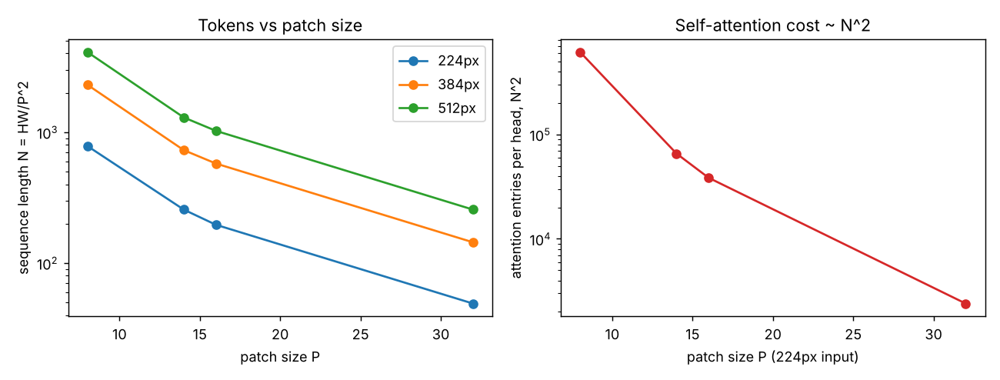
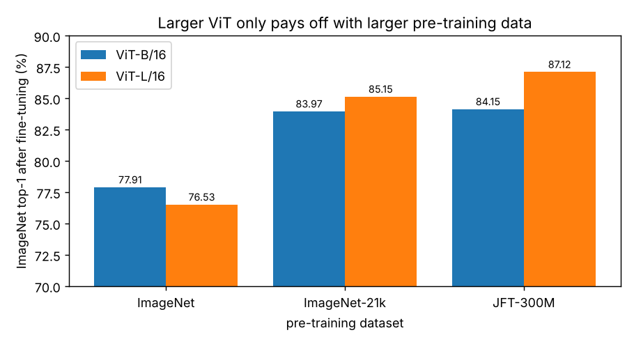

# ViT: 이미지를 16×16 "단어"로 자르고, inductive bias 대신 데이터 규모로 푸는 법

> 원문: [An Image is Worth 16x16 Words: Transformers for Image Recognition at Scale](https://arxiv.org/abs/2010.11929) — Dosovitskiy, Beyer, Kolesnikov, Weissenborn, Zhai, Unterthiner, Dehghani, Minderer, Heigold, Gelly, Uszkoreit, Houlsby (Google Research, Brain Team), arXiv 2020-10 (ICLR 2021).

## 왜 나왔나

NLP에서는 Transformer를 거대 코퍼스로 사전학습하고 작은 태스크에 파인튜닝하는 레시피가 100B 파라미터 규모까지 포화 없이 확장되고 있었다. 반면 비전은 여전히 convnet(ResNet 계열)이 지배했다(Sec. 1). 비전에 self-attention을 넣으려는 시도는 많았지만 두 갈래로 막혀 있었다.

- **픽셀 단위 전역 attention**은 비용이 픽셀 수의 제곱이라 실제 해상도에서 불가능하다(Sec. 2).
- 그래서 나온 **지역 이웃 attention, Sparse Transformer, 블록/축(axial) attention**은 이론적으로 효율적이지만 특수한 attention 패턴이라 하드웨어 가속기에서 효율적으로 구현하기가 복잡하다. 논문은 이런 모델이 "현대 가속기에서 아직 효과적으로 스케일되지 않았다"고 진단한다(Sec. 1, 2).

가장 가까운 선행 연구인 Cordonnier et al. (2020)은 2×2 패치를 추출해 전체 self-attention을 얹는다. 구조는 거의 같지만 패치가 2×2 픽셀이라 작은 해상도에만 쓸 수 있고, "대규모 사전학습이 순정 Transformer를 SOTA CNN과 맞먹게 만든다"는 것까지는 보이지 못했다(Sec. 2).

ViT의 선택은 반대 방향이다. attention을 이미지에 맞게 바꾸지 않고, **이미지를 Transformer가 먹는 형태(토큰 시퀀스)로 바꾼다**. 그러면 NLP의 확장 가능한 아키텍처와 효율적 구현을 거의 그대로 쓸 수 있다(Sec. 3). 대가는 inductive bias다. 논문은 ImageNet 규모에서는 같은 크기 ResNet보다 몇 %p 낮다는 점을 숨기지 않고, "large scale training trumps inductive bias"라는 가설을 14M~300M 장 사전학습으로 검증한다(Sec. 1).

## 핵심 아이디어

**1) 패치 = 토큰.** 이미지 $`\mathbf x\in\mathbb R^{H\times W\times C}`$를 $`P\times P`$ 패치로 잘라 평탄화해 $`\mathbf x_p\in\mathbb R^{N\times(P^2 C)}`$를 만든다. $`N=HW/P^2`$가 곧 Transformer의 시퀀스 길이다. 224×224에 $`P=16`$이면 $`N=196`$이다. 패치마다 학습되는 선형 사영 하나로 $`D`$차원에 넣는 것이 전부다(Sec. 3.1).

<p align="center"></p>

*그림 1. ViT 전체 구조. 이미지를 고정 크기 패치로 자르고, 선형 임베딩 + 위치 임베딩을 더한 시퀀스 앞에 학습 가능한 [class] 토큰을 붙여 표준 Transformer encoder에 넣는다. [class] 토큰의 출력이 이미지 표현 $`\mathbf y`$가 된다. (출처: 논문 Fig. 1, arXiv:2010.11929)*

**2) Transformer는 거의 그대로.** pre-LN 블록(LN은 매 블록 앞, residual은 뒤)이고, MLP는 GELU를 쓰는 2층이다. 모델 크기는 BERT 설정을 따르고 Huge를 추가했다(Table 1: Base 12층·D=768·MLP 3072·12 heads·86M, Large 24층·1024·4096·16 heads·307M, Huge 32층·1280·5120·16 heads·632M).

**3) 공간 구조는 최소한만 주입한다.** CNN은 locality, 2D 이웃 구조, translation equivariance가 모든 층에 박혀 있다. ViT에서 지역적이고 equivariant한 것은 MLP 층뿐이고 self-attention은 전역이다. 2D 구조를 쓰는 곳은 (a) 처음 이미지를 패치로 자를 때와 (b) 파인튜닝에서 해상도가 바뀔 때 위치 임베딩을 보간할 때, 딱 두 군데다. 위치 임베딩은 초기화 시 2D 위치 정보가 전혀 없고, 패치 사이의 공간 관계는 처음부터 학습해야 한다(Sec. 3.1).

**4) 선택적 변형: hybrid.** 원시 패치 대신 CNN feature map에서 토큰을 뽑는다. 패치 크기를 1×1로 두면 feature map을 펴서 그대로 $`D`$차원으로 사영하는 것과 같다(Sec. 3.1).

### 세부 사항 (Sec. 3, 4.1, App. B)

- **[class] 토큰과 head**: BERT처럼 앞에 붙이고 마지막 층의 해당 위치 상태를 표현으로 쓴다. 사전학습 시 head는 은닉층 1개짜리 MLP, 파인튜닝 시에는 선형층 1개다. 파인튜닝에서는 사전학습 head 전체를 떼어 내고 **zero-init** $`D\times K`$ 선형층을 붙인다(Sec. 3.2, App. B.1.1).
- **위치 임베딩**: 표준 학습형 1D 임베딩(raster 순서). 2D-aware 변형에서 유의미한 이득이 없었다(App. D.4).
- **옵티마이저**: 모든 모델(ResNet 포함)을 Adam($`\beta_1=0.9,\beta_2=0.999`$), 배치 4096, **weight decay 0.1**로 사전학습. weight decay 0.1은 모든 모델의 transfer에 도움이 됐다고 한다. 선형 warmup과 linear decay. JFT 사전학습 base LR은 ViT-B는 $`8\cdot10^{-4}`$, L/32는 $`6\cdot10^{-4}`$, L/16은 $`4\cdot10^{-4}`$(App. B.1, Table 3).
- **파인튜닝**: SGD momentum 0.9, 배치 512, cosine decay, weight decay 없음, grad clipping 1. 해상도는 기본 384(ImageNet 최종 결과는 ViT-L/16 512, ViT-H/14 518에 Polyak averaging 0.9999)(Sec. 4.1, Table 4).
- **고해상도 파인튜닝**: 패치 크기는 그대로 두므로 시퀀스가 길어지고, 사전학습된 위치 임베딩은 원래 이미지에서의 위치에 맞춰 **2D 보간**한다(Sec. 3.2).
- **모델 표기**: ViT-L/16은 Large에 패치 16. 시퀀스 길이가 $`P^2`$에 반비례하므로 패치가 작을수록 비싸다(Sec. 4.1).

## 수식

논문의 Eq. 1~4가 모델 전체다.

$$\mathbf z_0=[\mathbf x_{class};\mathbf x_p^1\mathbf E;\mathbf x_p^2\mathbf E;\cdots;\mathbf x_p^N\mathbf E]+\mathbf E_{pos},\quad \mathbf E\in\mathbb R^{(P^2C)\times D},\ \mathbf E_{pos}\in\mathbb R^{(N+1)\times D}$$

- $`\mathbf x_p^i\in\mathbb R^{P^2C}`$는 $`i`$번째 평탄화 패치, $`\mathbf E`$는 패치 공통의 선형 사영(=stride $`P`$, kernel $`P`$ convolution과 같은 연산), $`\mathbf x_{class}`$는 학습되는 [class] 임베딩, $`\mathbf E_{pos}`$는 $`N+1`$개 위치(class 포함) 각각의 학습 벡터다. 위치 정보는 오직 이 덧셈으로만 들어간다.

$$\mathbf z'_\ell=\mathrm{MSA}\big(\mathrm{LN}(\mathbf z_{\ell-1})\big)+\mathbf z_{\ell-1},\qquad \mathbf z_\ell=\mathrm{MLP}\big(\mathrm{LN}(\mathbf z'_\ell)\big)+\mathbf z'_\ell,\qquad \ell=1\ldots L$$

$$\mathbf y=\mathrm{LN}\big(\mathbf z_L^0\big)$$

- 각 블록은 pre-LN + residual이다. $`\mathbf z_L^0`$은 마지막 층에서 0번 위치([class])의 상태이고 이것이 분류기에 들어간다.

**비용을 숫자로 보자.** self-attention의 head당 attention 행렬은 $`N\times N`$이고 $`N=HW/P^2`$이므로 attention 비용은 $`P^{-4}`$에 비례한다. 위 구조의 "inductive bias가 얼마나 약한가"는 다음 성질로 정확히 표현된다.

1. 패치 사영 $`\mathbf E`$는 모든 패치에 같은 가중치를 쓰므로 **패치 격자 단위의** 이동에는 equivariant하다. 그러나 1픽셀 이동은 패치 내용을 바꾸므로 equivariant하지 않다. CNN은 층마다 stride가 쌓여도 작은 이동에 대한 equivariance를 근사적으로 유지하지만, ViT는 첫 층에서 이미 패치 경계로 격자화된다.
2. 위치 임베딩이 없으면 attention은 토큰 순열에 대해 equivariant하다. 즉 패치를 "bag"으로 본다(App. D.4의 "No Pos. Emb."). 공간 구조는 오직 $`\mathbf E_{pos}`$에서 학습으로 얻는다.

## 코드

위 세 성질과 해상도 변경 시 위치 임베딩 보간을 numpy로 확인한다. (1) 패치화 + 선형 사영이 stride-$`P`$ convolution과 동일한지, (2) 위치 임베딩이 없을 때 순열 equivariance가 성립하는지, (3) 이동 equivariance가 패치 크기 단위에서만 성립하는지, (4) $`14\times14\to24\times24`$ 2D 보간(224px→384px, $`P=16`$)과 시퀀스 길이 변화를 본다.

```python
import numpy as np
rng = np.random.default_rng(0)

def patchify(x, P):                      # x: (H,W,C) -> (N, P*P*C), raster order (Eq. 1 의 x_p)
    H, W, C = x.shape
    return (x.reshape(H//P, P, W//P, P, C).transpose(0, 2, 1, 3, 4).reshape(-1, P*P*C))

def conv_stride(x, Wk, P):               # kernel P x P, stride P 의 convolution (구현상 같은 연산)
    H, W, C = x.shape
    out = np.zeros((H//P, W//P, Wk.shape[-1]))
    for i in range(H//P):
        for j in range(W//P):
            out[i, j] = x[i*P:(i+1)*P, j*P:(j+1)*P].reshape(-1) @ Wk
    return out.reshape(-1, Wk.shape[-1])

def softmax(a): a = a - a.max(-1, keepdims=True); e = np.exp(a); return e / e.sum(-1, keepdims=True)

def attn(z, Wq, Wk, Wv):                 # 단일 head self-attention (전역)
    q, k, v = z @ Wq, z @ Wk, z @ Wv
    return softmax(q @ k.T / np.sqrt(q.shape[1])) @ v

H = W = 32; C = 3; P = 8; D = 16
x = rng.normal(size=(H, W, C)); E = rng.normal(size=(P*P*C, D)) * 0.1
Wq, Wk_, Wv = (rng.normal(size=(D, D)) * 0.3 for _ in range(3))
N = (H//P) * (W//P)
print(f"N = HW/P^2 = {N} tokens, attention matrix {N}x{N}")
print("1) patch embedding == stride-P conv:", np.allclose(patchify(x, P) @ E, conv_stride(x, E, P)))

# 2) position embedding 이 없으면 patch 순서를 바꿔도 출력이 (같은 순서로) 바뀔 뿐: permutation-equivariant
z = patchify(x, P) @ E; perm = rng.permutation(N)
print("2) no pos-emb: attn(perm(z)) == perm(attn(z)):", np.allclose(attn(z[perm], Wq, Wk_, Wv), attn(z, Wq, Wk_, Wv)[perm]))
pos = rng.normal(size=(N, D))
print("   with pos-emb (자리 고정, patch 만 섞음):", np.allclose(attn(z[perm] + pos, Wq, Wk_, Wv), attn(z + pos, Wq, Wk_, Wv)[perm]))

# 3) 이동 equivariance: patch 경계(P 픽셀)로 이동하면 토큰이 그대로 이동, 1 픽셀이면 토큰 값이 달라짐
t_P = patchify(np.roll(x, P, axis=1), P) @ E; t_0 = patchify(x, P) @ E
g = lambda t: t.reshape(H//P, W//P, D)
print("3) shift by P px  -> tokens just shift:", np.allclose(g(t_P), np.roll(g(t_0), 1, axis=1)))
t_1 = patchify(np.roll(x, 1, axis=1), P) @ E
print("   shift by 1 px  -> tokens just shift:", np.allclose(g(t_1), np.roll(g(t_0), 1, axis=1)),
      f"(mean |diff| = {np.abs(g(t_1) - np.roll(g(t_0), 1, axis=1)).mean():.3f})")

# 4) fine-tuning 해상도 변경: 2D 위치 임베딩 보간 (bilinear, 14x14 -> 24x24 = 224px/16 -> 384px/16)
def interp2d(pe, new):                   # pe: (g,g,D)
    g_ = pe.shape[0]; ys = np.linspace(0, g_-1, new); out = np.zeros((new, new, pe.shape[2]))
    for a, y in enumerate(ys):
        for b, xx in enumerate(ys):
            y0, x0 = int(np.floor(y)), int(np.floor(xx)); y1, x1 = min(y0+1, g_-1), min(x0+1, g_-1)
            wy, wx = y-y0, xx-x0
            out[a, b] = (pe[y0, x0]*(1-wy)*(1-wx) + pe[y0, x1]*(1-wy)*wx + pe[y1, x0]*wy*(1-wx) + pe[y1, x1]*wy*wx)
    return out
# 거리 구조가 있는 가짜 학습된 임베딩: 14x14 격자 위의 매끄러운 함수
g0 = 14; yy, xx = np.meshgrid(np.linspace(0, 1, g0), np.linspace(0, 1, g0), indexing="ij")
pe = np.stack([np.sin(3*yy), np.cos(3*xx), yy*xx, yy-xx], -1)
big = interp2d(pe, 24)
print("4) pos-emb 14x14 -> 24x24:", big.shape, " 모서리 값 보존:", np.allclose(big[0, 0], pe[0, 0]) and np.allclose(big[-1, -1], pe[-1, -1]))
for res, p in [(224, 16), (384, 16), (224, 32), (224, 14)]:
    n = (res // p) ** 2
    print(f"   res={res} P={p:2d}: N={n:4d} tokens, attention entries/head/layer = {n*n:,}")
```

실제 출력(python 3.11, numpy):

```
N = HW/P^2 = 16 tokens, attention matrix 16x16
1) patch embedding == stride-P conv: True
2) no pos-emb: attn(perm(z)) == perm(attn(z)): True
   with pos-emb (자리 고정, patch 만 섞음): False
3) shift by P px  -> tokens just shift: True
   shift by 1 px  -> tokens just shift: False (mean |diff| = 1.494)
4) pos-emb 14x14 -> 24x24: (24, 24, 4)  모서리 값 보존: True
   res=224 P=16: N= 196 tokens, attention entries/head/layer = 38,416
   res=384 P=16: N= 576 tokens, attention entries/head/layer = 331,776
   res=224 P=32: N=  49 tokens, attention entries/head/layer = 2,401
   res=224 P=14: N= 256 tokens, attention entries/head/layer = 65,536
```

- **1)** 패치 임베딩은 곧 kernel=stride=$`P`$ convolution이다. ViT 구현이 첫 층을 `Conv2d(kernel=P, stride=P)`로 쓰는 이유다. "convolution이 없다"는 말은 반복 적용되는 지역 연산이 없다는 뜻이지 첫 층 연산이 특별하다는 뜻이 아니다.
- **2)** 위치 임베딩이 없으면 패치를 섞어도 출력이 같은 순서로 섞일 뿐이다(bag of patches). 위치 임베딩을 자리에 고정하고 패치만 섞으면 출력이 달라지므로 모델이 순서를 인식한다.
- **3)** 패치 크기만큼 옮기면 토큰이 그대로 이동하지만 1픽셀 옮기면 토큰 값 자체가 바뀐다(평균 차이 1.49). 이것이 CNN의 연속적인 translation equivariance와의 차이다.
- **4)** 해상도를 224→384로 올리면 $`N`$이 196→576, attention 항목이 38,416→331,776($`\approx 8.6\times`$)이 된다. 그림 2가 이 관계를 보여 준다. 합성 임베딩에서 모서리 값이 보존되는 것만 확인한 장난감이므로, 실제 모델의 보간이 의미를 유지하는지는 논문 실험(Sec. 3.2, 4.5)에 의존한다.

<p align="center"></p>

*그림 2. 패치 크기에 따른 시퀀스 길이 $`N=HW/P^2`$(왼쪽)와 224px 입력의 head당 attention 항목 수 $`N^2`$(오른쪽). 패치 32에서 16으로 줄이면 토큰이 4배, attention 항목은 16배가 된다. 이것이 "작은 패치 = 더 정확하지만 더 비싼" 트레이드오프의 출처다(Sec. 4.1). (직접 그림: $`N=HW/P^2`$ 공식)*

## 그림으로 보는 동작

### 데이터가 적으면 CNN, 많으면 ViT (Sec. 4.3)

<p align="center"></p>

*그림 3. ImageNet linear 5-shot 정확도 대 JFT 사전학습 샘플 수(9M/30M/90M/300M). 작은 서브셋에서는 ResNet이 낫고, 데이터가 늘수록 ViT가 추월한다. 같은 연산량에서 ViT-B/32는 ResNet50보다 약간 빠르지만 9M 서브셋에서는 훨씬 나쁘고 90M+에서는 더 낫다. (출처: 논문 Fig. 4, arXiv:2010.11929)*

논문은 이를 "합성곱 inductive bias는 작은 데이터셋에서 유용하지만, 큰 데이터셋에서는 관련 패턴을 데이터에서 직접 학습하는 것으로 충분하고 오히려 이롭다"고 해석한다. 서브셋 실험에서는 추가 정규화 없이 같은 하이퍼파라미터를 쓰고 early stopping만 했다. 즉 정규화 효과가 아니라 모델의 본질적 성질을 보려는 설계다(Sec. 4.3).

<p align="center"></p>

*그림 4. 논문 Table 5의 ImageNet 행(384 해상도 파인튜닝, Polyak averaging 없음). ImageNet만으로 사전학습하면 ViT-L/16(76.53)이 ViT-B/16(77.91)보다 낮고, ImageNet-21k에서는 85.15 대 83.97, JFT-300M에서는 87.12 대 84.15로 큰 모델의 이득이 커진다. (직접 그림: 논문 Table 5의 수치)*

### 모델이 학습한 것 (Sec. 4.5)

<p align="center"></p>

*그림 5. 왼쪽: ViT-L/32 첫 선형 임베딩 필터의 주성분. 패치 내부 미세 구조를 표현하는 그럴듯한 기저처럼 보인다. 오른쪽: 위치 임베딩 사이의 cosine 유사도. 가까운 패치일수록 임베딩이 비슷하고, 같은 행/열끼리 유사한 행-열 구조가 나타난다. 초기화에는 2D 정보가 없었으므로 2D 토폴로지를 학습으로 얻은 것이다. (출처: 논문 Fig. 7 왼쪽·가운데, arXiv:2010.11929)*

이것이 2D-aware 위치 임베딩이 이득이 없는 이유로 제시된다(Sec. 4.5, App. D.4). 또 attention distance(attention 가중 평균 거리, CNN의 receptive field에 해당)를 보면 일부 head는 가장 낮은 층에서도 이미지 대부분을 보고, 다른 head는 낮은 층에서 일관되게 아주 국소적이다. 이 국소 head는 hybrid(앞에 ResNet을 둔 모델)에서는 덜 두드러진다. 즉 앞단 convolution이 하는 일을 ViT가 일부 head로 스스로 만든다는 해석이다. 깊어질수록 거리는 증가한다(Fig. 7 오른쪽, App. D.7).

<p align="center"></p>

*그림 6. 출력 토큰에서 입력 공간으로의 attention(Attention Rollout: ViT-L/16의 모든 head 평균 attention을 층별로 재귀 곱셈). 모델이 분류에 의미 있는 영역에 attention을 둔다. (출처: 논문 Fig. 6, App. D.8, arXiv:2010.11929)*

## 트레이드오프와 함정

**결과 (Table 2, 파인튜닝 정확도, 3회 평균).**

| | ViT-H/14 (JFT) | ViT-L/16 (JFT) | ViT-L/16 (I21k) | BiT-L (ResNet152x4) | Noisy Student (EfficientNet-L2) |
|---|---|---|---|---|---|
| ImageNet | **88.55** | 87.76 | 85.30 | 87.54 | 88.4/88.5* |
| ImageNet ReaL | **90.72** | 90.54 | 88.62 | 90.54 | 90.55 |
| CIFAR-100 | **94.55** | 93.90 | 93.25 | 93.51 | – |
| Oxford-IIIT Pets | **97.56** | 97.32 | 94.67 | 96.62 | – |
| VTAB (19 tasks) | **77.63** | 76.28 | 72.72 | 76.29 | – |
| TPUv3-core-days | 2.5k | 0.68k | 0.23k | 9.9k | 12.3k |

(*Touvron et al. (2020)의 개선 결과.) ViT-L/16(JFT)은 같은 데이터로 학습한 BiT-L을 모든 데이터셋에서 이기거나 비기면서(ImageNet ReaL은 90.54로 동률) 사전학습 연산은 0.68k 대 9.9k TPUv3-core-days다. 다만 논문 스스로 연산 효율은 아키텍처뿐 아니라 스케줄, 옵티마이저, weight decay에도 좌우되므로 통제된 비교는 Sec. 4.4에서 따로 한다고 단서를 단다.

- **같은 연산량이면 ViT가 낫다 (Sec. 4.4, Fig. 5).** JFT에서 ResNet 7종, ViT 6종, hybrid 5종을 비교한 결과 ViT는 같은 성능에 **약 2~4배 적은 연산**을 쓴다. hybrid는 작은 예산에서 ViT를 약간 앞서지만 큰 모델에서 차이가 사라진다. 저자들은 "합성곱 지역 특징 처리가 모든 크기에서 도움이 될 것으로 기대했기 때문에 의외"라고 적는다. 시험한 범위에서 ViT는 포화 조짐이 없었다.
- **데이터 요구량이 진짜 함정이다.** ImageNet만 쓰면 ViT는 비슷한 크기의 BiT보다 낮고(그림 4), 정규화(weight decay, dropout, label smoothing)를 조정해도 큰 모델이 이득을 못 본다. 또한 ViT는 비슷한 연산의 ResNet보다 작은 데이터에서 더 과적합한다(Sec. 4.3).
- **실측 속도.** TPUv3에서 ViT의 추론 속도는 비슷한 ResNet과 비슷하고, 해상도에 따른 $`N^2`$ 증가는 가장 큰 모델·가장 큰 해상도에서만 겨우 나타난다. 코어당 들어가는 최대 배치는 큰 ViT가 ResNet보다 크다(App. D.5, Fig. 12). 즉 FLOPs 이론이 실제 병목과 다를 수 있다.
- **해상도 상향은 거의 공짜가 아니다.** 패치를 고정하고 해상도를 올리면 토큰이 늘어 attention이 $`N^2`$으로 비싸진다(그림 2). 이것이 이후 계층형/윈도우 모델(Swin 등)이 나온 동기와 연결된다.
- **ViT 규모 조정 (App. D.2, Fig. 8).** 8층·D=1024·MLP 2048·패치 32 기준으로 각 차원을 늘린 결과, **깊이 확장이 가장 큰 개선**이지만 16층 이후 수익 체감이 보이고, **폭 확장은 가장 작은 효과**, 패치를 줄이는 것은 파라미터 증가 없이 꾸준한 개선을 준다.

### Ablation에서 알 수 있는 것

**위치 임베딩 (App. D.4, Table 8, ViT-B/16, ImageNet 5-shot linear).**

| 방식 | 입력 앞에만(기본) | 매 층 | 매 층(공유) |
|---|---|---|---|
| 없음 | 0.61382 | – | – |
| 1D | 0.64206 | 0.63964 | 0.64292 |
| 2D | 0.64001 | 0.64046 | 0.64022 |
| 상대(relative) | 0.64032 | – | – |

위치 정보가 아예 없을 때만 크게 떨어지고(0.614 vs 0.640 안팎), 1D/2D/상대/삽입 위치 사이의 차이는 약 0.003 이내로 거의 없다. 저자들의 추측은 입력이 픽셀이 아닌 **패치 수준**(예: 224×224가 아니라 14×14)이라 공간 관계를 학습하기가 어떤 인코딩에서도 똑같이 쉽다는 것이다. 다만 학습된 유사도 패턴 자체는 하이퍼파라미터에 따라 달라진다(Fig. 10).

**[class] 토큰 vs 전역 평균 풀링 (App. D.3, Fig. 9).** 처음에는 GAP + 선형 분류기가 매우 나빴지만, 원인은 [class] 토큰이나 GAP이 아니라 **다른 학습률이 필요했기 때문**이었다. 학습률을 맞추면 둘이 비슷하다. NLP 설계를 그대로 가져온 것은 단순함을 위한 선택이었다.

**ResNet에 Adam (App. D.1, Table 7).** JFT 사전학습에서 ResNet50은 평균 89.33(Adam) 대 88.79(SGD), ResNet152x2는 94.01 대 93.72로 Adam이 평균적으로 낫다. 그래서 비교의 공정성을 위해 ResNet도 Adam으로 학습했다.

**Axial attention (App. D.6, Fig. 13).** 축 방향 attention을 쓴 Axial-ViT-B/32, B/16은 ViT-B보다 정확도가 높지만 연산이 더 든다. 블록마다 행/열 attention 2개와 추가 MLP가 들어가기 때문이다. AxialResNet은 정확도/연산 trade-off는 괜찮아 보이지만 구현이 TPU에서 매우 느려 대규모 실험에 쓰지 못했다. 효율적 attention은 이론 FLOPs보다 구현 친화성이 더 중요하다는 논문의 출발점과 일치한다.

**Self-supervision (Sec. 4.6, App. B.1.2).** BERT식 masked patch prediction(패치 임베딩 50%를 오염: 80% [mask], 10% 다른 패치, 10% 유지, 패치의 3bit 평균 색 512클래스를 예측)으로 ViT-B/16이 ImageNet 79.9%를 얻어 from scratch보다 2% 높지만 supervised 사전학습보다는 4% 낮다. 저자들은 contrastive 사전학습은 향후 과제로 남긴다.

## 대표 논문/참고

- **원 논문**: Dosovitskiy et al., ViT (arXiv 2010.11929, ICLR 2021).
- **관련 선행 연구**: Cordonnier et al. 2020(2×2 패치 + self-attention), Carion et al. 2020(DETR: CNN 뒤에 Transformer), image GPT(픽셀 생성 사전학습, 선형 probe 최대 72%), BiT(Kolesnikov et al. 2020), Noisy Student(Xie et al. 2020).
- **이 로그의 연결**: ViT의 낮은 inductive bias와 큰 데이터 의존은 [DINO](2026-11-22.md)(라벨 없는 self-distillation으로 ViT의 객체 구조 attention), [MAE](../papers/2026-11-13.md)(masked patch 복원으로 ViT 사전학습), [Swin](../papers/2026-11-19.md)(window attention으로 해상도 확장), [DETR](2026-11-12.md)(Transformer를 detection에) 같은 후속 글에서 각각 다른 방향으로 풀린다.

### 내 생각

- "대규모 데이터가 inductive bias를 대체한다"는 결론은 데이터가 JFT-300M 같은 내부 데이터일 때의 이야기다. 공개 데이터인 ImageNet-21k에서도 ViT-L/16이 85.30을 얻는다는 점이 재현 가능성의 근거다.
- 위치 임베딩 ablation은 "2D 구조를 잘 인코딩해야 한다"는 직관을 깨는 결과인데, 패치 수준 격자가 14×14로 작기 때문이라는 저자들의 설명은 추측으로만 제시된다. 해상도가 훨씬 커지는 설정에서 같은 결론이 유지되는지는 이 논문만으로는 알 수 없다.
- 저자들이 남긴 과제(detection/segmentation 적용, 자기지도 사전학습, 추가 스케일링)는 이후의 DETR 계열, MAE, DINO가 각각 맡게 된다.
