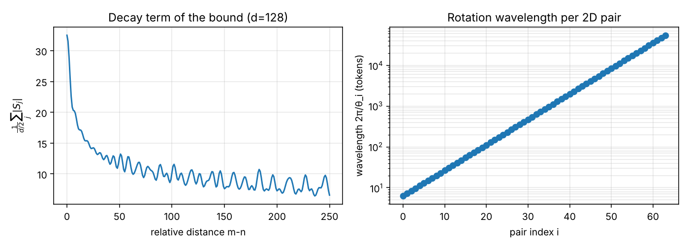
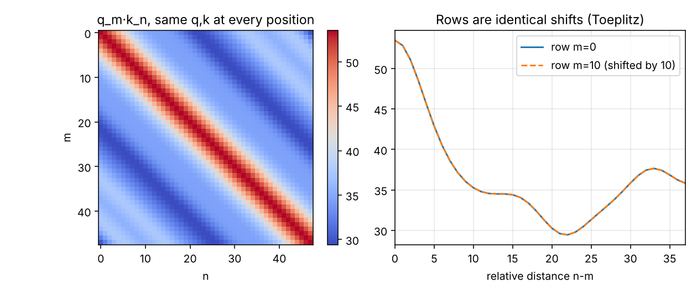

# RoPE: 위치를 "더하지" 않고 q·k를 "회전"시켜 상대 위치만 남기는 법

> 원문: [RoFormer: Enhanced Transformer with Rotary Position Embedding](https://arxiv.org/abs/2104.09864) — Jianlin Su, Yu Lu, Shengfeng Pan, Ahmed Murtadha, Bo Wen, Yunfeng Liu (Zhuiyi Technology), arXiv 2021-04 (Neurocomputing 2024 게재).

## 왜 나왔나

Transformer의 self-attention은 토큰 순서에 대해 위치 불가지(position-agnostic)이므로 위치 정보를 어떤 식으로든 넣어야 한다(Sec. 1). 기존 방법은 크게 두 갈래였다.

- **절대 위치**: 임베딩에 $`\boldsymbol p_i`$를 **더한** 뒤 $`W_q,W_k,W_v`$를 통과시킨다(Eq. 3). $`\boldsymbol p_i`$는 BERT/GPT처럼 학습되는 벡터이거나 Vaswani의 사인/코사인(Eq. 4)이다. 학습형은 최대 길이 $`L`$이 구조에 박힌다.
- **상대 위치**: attention logit을 전개한 4개 항(Eq. 6) 가운데 위치가 들어간 항을 상대 위치 $`\tilde{\boldsymbol p}_{m-n}`$으로 바꾸거나(Transformer-XL, Eq. 7; DeBERTa, Eq. 10), 학습형 bias $`b_{i,j}`$를 더한다(T5, Eq. 8). Shaw et al.은 거리를 $`\mathrm{clip}(m-n,r_{\min},r_{\max})`$로 잘라 쓴다(Eq. 5).

논문의 진단은 이렇다. 이 방법들은 **모두 "위치 정보를 컨텍스트 표현에 더한다"는 분해에서 출발**해 attention 전개식의 항을 이리저리 고친 것이다(Sec. 2.3). 그 결과 (1) 상대 위치가 attention 내부의 별도 항/별도 파라미터로 붙어 구조가 복잡해지고, (2) 위치 정보가 $`\boldsymbol q^\top \boldsymbol k`$ 안에서 곱 형태로 깔끔히 드러나지 않으므로 $`\phi(\boldsymbol q)^\top\varphi(\boldsymbol k)`$로 분해되는 **linear attention과 양립하지 않는다**(Sec. 1, 3.3).

RoPE는 질문을 뒤집는다. "무엇을 더할까"가 아니라 **"$`\boldsymbol q_m^\top \boldsymbol k_n`$이 $`m-n`$에만 의존하도록 요구하면 $`f_q,f_k`$는 어떤 함수여야 하는가"**를 푼다(Eq. 11). 그 해가 회전이다.

## 핵심 아이디어

1. **요구 조건을 먼저 쓴다.** 위치 $`m`$의 query, 위치 $`n`$의 key에 대해
$$\langle f_q(\boldsymbol x_m,m),\ f_k(\boldsymbol x_n,n)\rangle = g(\boldsymbol x_m,\boldsymbol x_n,m-n)$$
이 성립해야 한다(Eq. 11). 내적이 절대 위치가 아니라 상대 위치만 본다는 뜻이다.
2. **해는 위치에 비례하는 각도로 돌리는 것이다.** $`d=2`$에서 $`f_{\lbrace q,k\rbrace}(\boldsymbol x_m,m)=(W_{\lbrace q,k\rbrace}\boldsymbol x_m)e^{im\theta}`$, 즉 사영된 벡터를 2D 평면에서 $`m\theta`$만큼 회전시키면 된다(Eq. 12, 13). 두 벡터를 각각 $`m\theta`$, $`n\theta`$ 돌리면 둘 사이의 각도 차는 $`(m-n)\theta`$이므로 내적에는 $`m-n`$만 남는다.
3. **고차원은 2차원 쌍으로 쪼갠다.** $`d`$차원을 $`d/2`$개의 2D 부분공간으로 나누고, 쌍마다 서로 다른 주파수 $`\theta_i=10000^{-2(i-1)/d}`$로 회전시킨다(Eq. 14, 15). 사인/코사인 위치 인코딩과 같은 주파수 사다리를 쓰지만, **더하는 대신 곱(회전)으로** 넣는 것이 차이다(Sec. 2.2, 3.2.2).
4. **위치는 $`q,k`$에만 들어간다.** $`v`$에는 회전을 걸지 않는다. 위치는 attention 가중치(누가 누구를 보나)에만 영향을 주고, 값 벡터는 그대로다. 그리고 회전은 직교변환이라 노름을 바꾸지 않는다(Sec. 3.2.2).

<p align="center"></p>

*그림 1. RoPE의 구현. 사영된 query/key를 인접한 두 차원씩 묶어 2D 벡터로 보고, 토큰 위치 $`m`$에 비례한 각도 $`m\theta_i`$로 회전시킨다. 쌍마다 $`\theta_i`$가 다르다. (출처: 논문 Fig. 1, arXiv:2104.09864)*

## 수식

**2D 도출 (Sec. 3.4.1).** 위치가 없는 상태의 벡터를 $`\boldsymbol q=f_q(\boldsymbol x_q,0)`$, $`\boldsymbol k=f_k(\boldsymbol x_k,0)`$로 두는 초기 조건(Eq. 22)을 걸고, $`f`$와 $`g`$를 극좌표 $`R e^{i\Theta}`$로 분해한다(Eq. 23). 내적 조건에서 반지름과 각도가 분리된다(Eq. 24).

$$R_q(\boldsymbol x_q,m)\thinspace R_k(\boldsymbol x_k,n)=R_g(\boldsymbol x_q,\boldsymbol x_k,n-m),\qquad \Theta_k(\boldsymbol x_k,n)-\Theta_q(\boldsymbol x_q,m)=\Theta_g(\boldsymbol x_q,\boldsymbol x_k,n-m)$$

- $`m=n`$을 넣고 초기 조건(Eq. 25)을 쓰면 $`R_q(\boldsymbol x_q,m)R_k(\boldsymbol x_k,m)=\Vert\boldsymbol q\Vert\Vert\boldsymbol k\Vert`$이므로 반지름은 위치와 무관하게 고정된다. 즉 **노름은 위치에 안 바뀐다.**
- 각도 식에서 $`m=n`$이면 $`\Theta_k(\boldsymbol x_k,m)-\Theta_q(\boldsymbol x_q,m)=\theta_k-\theta_q`$이다. 이는 $`\Theta_q(\boldsymbol x_q,m)-\theta_q=\Theta_k(\boldsymbol x_k,m)-\theta_k`$가 내용 $`\boldsymbol x`$와 무관한 위치만의 함수임을 뜻하고, 상대 위치 조건을 다시 쓰면 이 함수가 $`m`$의 등차수열 $`m\theta`$여야 한다. 결과가 Eq. 12이다.

$$f_q(\boldsymbol x_m,m)=(W_q\boldsymbol x_m)e^{im\theta},\quad f_k(\boldsymbol x_n,n)=(W_k\boldsymbol x_n)e^{in\theta},\quad g=\mathrm{Re}\big[(W_q\boldsymbol x_m)(W_k\boldsymbol x_n)^{*}e^{i(m-n)\theta}\big]$$

- $`\theta`$는 0이 아닌 사전 설정 상수, $`(\cdot)^{*}`$는 켤레복소수, $`\mathrm{Re}`$는 실수부다. 켤레가 들어가므로 두 위상이 **뺄셈**으로 합쳐져 $`(m-n)\theta`$가 된다.

**일반형 (Eq. 14~16).** $`d`$가 짝수일 때

$$f_{\lbrace q,k\rbrace}(\boldsymbol x_m,m)=R^d_{\Theta,m}W_{\lbrace q,k\rbrace}\boldsymbol x_m,\qquad \Theta=\lbrace\theta_i=10000^{-2(i-1)/d},\ i=1,\dots,d/2\rbrace$$

$`R^d_{\Theta,m}`$은 $`2\times2`$ 회전 블록 $`\begin{pmatrix}\cos m\theta_i&-\sin m\theta_i\cr \sin m\theta_i&\cos m\theta_i\end{pmatrix}`$을 대각에 놓은 블록대각 행렬이다(Eq. 15). 그러면 attention logit은

$$\boldsymbol q_m^\top\boldsymbol k_n=(R^d_{\Theta,m}W_q\boldsymbol x_m)^\top(R^d_{\Theta,n}W_k\boldsymbol x_n)=\boldsymbol x_m^\top W_q^\top R^d_{\Theta,n-m}W_k\boldsymbol x_n,\qquad R^d_{\Theta,n-m}=(R^d_{\Theta,m})^\top R^d_{\Theta,n}$$

(Eq. 16). 회전의 전치는 역회전이고 같은 블록 안의 회전은 각도가 더해지므로 $`(R_m)^\top R_n=R_{n-m}`$이다. 이것이 "절대 위치 $`m,n`$을 각각 인코딩했는데 결과에는 $`n-m`$만 남는" 이유다. $`R^d_\Theta`$는 직교행렬이라 안정적이다(Sec. 3.2.2).

**효율적 구현 (Eq. 34).** $`R^d_{\Theta,m}`$은 희소하므로 행렬곱 대신 원소별 연산으로 쓴다.

$$R^d_{\Theta,m}\boldsymbol x=\begin{pmatrix}x_1\cr x_2\cr \vdots\cr x_{d-1}\cr x_d\end{pmatrix}\otimes\begin{pmatrix}\cos m\theta_1\cr \cos m\theta_1\cr \vdots\cr \cos m\theta_{d/2}\cr \cos m\theta_{d/2}\end{pmatrix}+\begin{pmatrix}-x_2\cr x_1\cr \vdots\cr -x_d\cr x_{d-1}\end{pmatrix}\otimes\begin{pmatrix}\sin m\theta_1\cr \sin m\theta_1\cr \vdots\cr \sin m\theta_{d/2}\cr \sin m\theta_{d/2}\end{pmatrix}$$

$`\otimes`$는 원소별 곱이다. 비용은 $`O(d)`$이고 추가 파라미터가 없다. cos/sin 테이블은 위치별로 미리 계산해 두면 된다.

**long-term decay (Sec. 3.3, 3.4.3).** 쌍 단위로 보면 logit은

$$\mathrm{Re}\Big[\sum_{i=0}^{d/2-1}\boldsymbol q_{[2i:2i+1]}\boldsymbol k^{*}_{[2i:2i+1]}\thinspace e^{i(m-n)\theta_i}\Big]$$

(Eq. 35). $`h_i=\boldsymbol q_{[2i:2i+1]}\boldsymbol k^{*}_{[2i:2i+1]}`$, $`S_j=\sum_{i<j}e^{i(m-n)\theta_i}`$로 두고 Abel 변환을 하면 합이 $`-\sum_i S_{i+1}(h_{i+1}-h_i)`$가 되고(Eq. 36), 크기는

$$\Big|\sum_i \cdots\Big|\le\Big(\max_i|h_{i+1}-h_i|\Big)\sum_{i}|S_{i+1}|$$

로 위에서 눌린다(Eq. 37). 논문은 $`\theta_i=10000^{-2i/d}`$일 때 $`\frac{1}{d/2}\sum|S_j|`$가 상대 거리 $`m-n`$이 커질수록 줄어든다고 보인다(Fig. 2). 낮은 인덱스 쌍은 빨리 돌아 위상이 흩어지고, 이 합이 서로 상쇄되는 것이다. 주의: 이것은 **상한(bound)의 한 인자가 줄어든다**는 주장이지 모든 $`\boldsymbol q,\boldsymbol k`$에서 logit이 단조감소한다는 뜻이 아니다.

**linear attention과의 결합 (Eq. 19).** softmax 없이 $`\phi(\boldsymbol q_m)^\top\varphi(\boldsymbol k_n)`$ 꼴이면 비음수 함수 출력에 회전을 곱한다.

$$\mathrm{Attn}_m=\frac{\sum_n\big(R^d_{\Theta,m}\phi(\boldsymbol q_m)\big)^\top\big(R^d_{\Theta,n}\varphi(\boldsymbol k_n)\big)\boldsymbol v_n}{\sum_n\phi(\boldsymbol q_m)^\top\varphi(\boldsymbol k_n)}$$

분모는 0으로 나누는 위험을 피하려 회전 없이 둔다. 분자에는 음수 항이 생기므로 가중치가 엄밀한 확률은 아니지만 중요도는 모델링할 수 있다고 논문은 주장한다(Sec. 3.3). 더하는 방식이면 이 분해가 깨지지만, 회전은 노름을 보존하고 $`m`$, $`n`$이 각각 한쪽에만 붙으므로 키-값 합을 먼저 계산하는 $`O(N)`$ 구조가 유지된다.

## 코드

위 성질 다섯 가지를 numpy로 확인한다: (1) Eq. 34의 원소별 구현이 Eq. 15의 블록대각 행렬곱과 같은지, (2) logit이 $`m-n`$에만 의존하는지, (3) 노름 보존, (4) 같은 벡터의 상대 거리별 점수, (5) Eq. 37 상한의 인자 $`\frac{1}{d/2}\sum_j|S_j|`$ 값.

```python
import numpy as np
rng = np.random.default_rng(0)
d = 64
theta = 10000.0 ** (-2 * np.arange(d // 2) / d)   # theta_i = 10000^{-2(i-1)/d}

def rope(x, m):
    """Eq.34: x*cos + rotate_pair(x)*sin (pairs (x1,x2),(x3,x4),...)"""
    ang = np.repeat(m * theta, 2)
    xr = np.empty_like(x); xr[0::2] = -x[1::2]; xr[1::2] = x[0::2]
    return x * np.cos(ang) + xr * np.sin(ang)

def rot_matrix(m):
    R = np.zeros((d, d))
    for i, t in enumerate(theta):
        c, s = np.cos(m * t), np.sin(m * t); a = 2 * i
        R[a:a+2, a:a+2] = [[c, -s], [s, c]]
    return R

q, k = rng.normal(size=d), rng.normal(size=d)
# 1) sparse-form == dense matrix form
print("eq34 vs eq15 max err:", np.abs(rope(q, 7) - rot_matrix(7) @ q).max())
# 2) score depends only on m-n
for m, n in [(10, 4), (110, 104), (1010, 1004)]:
    print(f"m={m:5d} n={n:5d} m-n=6  score={rope(q, m) @ rope(k, n):.6f}")
# 3) norm preserved (orthogonal)
print("norm q:", np.linalg.norm(q).round(4), " norm R q:", np.linalg.norm(rope(q, 999)).round(4))
# 4) same q,k content: score vs relative distance
for r in [0, 1, 4, 16, 64, 256]:
    print(f"rel dist {r:4d}: q^T R_r k = {rope(q, r) @ k:+.3f}")
# 4b) q = k (same vector): score as function of relative distance
print("q=k  r=0,1,4,16,64,256,1024:", [round(float(rope(q, r) @ q), 1) for r in (0, 1, 4, 16, 64, 256, 1024)])
# 5) paper Eq.37 bound term: mean_j |S_j|
def mean_S(r):
    S = np.cumsum(np.exp(1j * r * theta)); return np.abs(S).mean()
print("mean|S_j| @ r=0,10,100,1000:", [round(float(mean_S(r)), 2) for r in (0, 10, 100, 1000)])
```

실제 출력:

```
eq34 vs eq15 max err: 0.0
m=   10 n=    4 m-n=6  score=-10.680889
m=  110 n=  104 m-n=6  score=-10.680889
m= 1010 n= 1004 m-n=6  score=-10.680889
norm q: 7.3153  norm R q: 7.3153
rel dist    0: q^T R_r k = -9.701
rel dist    1: q^T R_r k = -8.519
rel dist    4: q^T R_r k = -9.188
rel dist   16: q^T R_r k = -8.873
rel dist   64: q^T R_r k = -5.730
rel dist  256: q^T R_r k = -4.817
q=k  r=0,1,4,16,64,256,1024: [53.5, 52.9, 45.6, 34.0, 30.6, 29.2, 13.5]
mean|S_j| @ r=0,10,100,1000: [16.5, 8.81, 7.47, 4.09]
```

읽는 법:

- 1~3번은 식 그대로다. 절대 위치 10/110/1010에서 같은 상대 거리 6이면 점수가 소수 여섯째 자리까지 같다. 위치 임베딩을 더하는 방식에서는 보통 이런 불변성이 정확히 성립하지 않는다.
- 4번(무관한 $`\boldsymbol q,\boldsymbol k`$)은 거리에 따라 **단조롭지 않다**. 내용이 서로 다르면 어떤 거리에서 점수가 오르내리는지는 벡터에 달려 있다. 반면 4b(같은 벡터)는 53.5에서 13.5로 대체로 줄어든다. 즉 decay는 "내용이 비슷할수록 가까운 위치를 선호하는 경향"으로 읽어야지, 모든 쌍의 점수가 거리에 따라 감소한다는 보장은 아니다.
- 5번은 Eq. 37의 인자이며 거리 0→1000에서 16.5→4.09로 줄어든다($`d=64`$).

## 그림으로 보는 동작

<p align="center"></p>

*그림 2. 논문의 long-term decay 그림. 상대 거리 $`m-n`$이 커질수록 Eq. 37의 상한에 들어가는 $`\frac{1}{d/2}\sum|S_j|`$가 줄어든다. 줄어드는 곡선이 보이지만 진동이 남는다는 점도 함께 본다. (출처: 논문 Fig. 2, arXiv:2104.09864)*

<p align="center"></p>

*그림 3. 왼쪽: Eq. 37의 인자 $`\frac{1}{d/2}\sum_j|S_j|`$를 $`d=128`$, $`\theta_i=10000^{-2i/d}`$로 직접 계산한 것. 가까운 거리에서 빠르게 줄고 이후 진동하며 완만해진다. 오른쪽: 쌍 인덱스별 회전 파장 $`2\pi/\theta_i`$. 약 6토큰에서 약 5만 토큰까지 로그 스케일로 퍼져 있어, 앞쪽 쌍은 가까운 거리를 세밀하게, 뒤쪽 쌍은 먼 거리를 거칠게 구분한다. (직접 그림: 논문의 $`\theta_i`$ 정의와 Eq. 35~37)*

<p align="center"></p>

*그림 4. 모든 위치에 같은 $`\boldsymbol q,\boldsymbol k`$를 놓았을 때의 $`\boldsymbol q_m^\top\boldsymbol k_n`$ 행렬(왼쪽)은 대각선을 따라 값이 일정한 Toeplitz 구조이고, 행 $`m=0`$과 행 $`m=10`$을 10칸 밀면 곡선이 일치한다(오른쪽). Eq. 16의 "$`m-n`$에만 의존"이 눈으로 보이는 형태다. (직접 그림: 위 코드의 rope(), $`d=64`$, $`\boldsymbol q=\boldsymbol k`$)*

<p align="center"></p>

*그림 5. BERT 사전학습의 MLM loss. sinusoidal 절대 위치를 RoPE로 바꾼 RoFormer가 같은 학습 스텝에서 더 빨리 수렴한다. batch 64, 최대 길이 512, 100k step, AdamW, lr 1e-5 설정(Sec. 4.2). (출처: 논문 Fig. 3 왼쪽, arXiv:2104.09864)*

<p align="center"></p>

*그림 6. Enwik8에서 char 단위 12층 Performer(768차원, 12 head, 길이 1024)의 학습 loss. RoPE를 넣으면 더 빨리, 더 낮게 수렴한다. linear attention에도 상대 위치를 붙일 수 있다는 Eq. 19의 실증이다(Sec. 4.4). (출처: 논문 Fig. 3 오른쪽, arXiv:2104.09864)*

## 트레이드오프와 함정

**논문이 보여 준 숫자 (Sec. 4).**

| 실험 | 결과 |
|---|---|
| WMT14 En→De BLEU (Table 1) | Transformer-base 27.3 → RoFormer 27.5 |
| GLUE (Table 2), BERT vs RoFormer | MRPC 88.9 / 89.5, SST-2 93.5 / 90.7, QNLI 90.5 / 88.0, STS-B 85.8 / 87.0, QQP 71.2 / 86.4, MNLI(m/mm) 84.6/83.4 / 80.2/79.8 |
| CAIL2019-SCM 정확도 (Table 5, 검증/테스트) | BERT-512 64.13/67.77, WoBERT-512 64.07/68.10, RoFormer-512 64.13/68.29, RoFormer-1024 66.07/69.79 |

- **이득이 크지 않다.** 번역은 +0.2 BLEU이고, GLUE 6개 중 MRPC, STS-B, QQP는 오르지만 SST-2, QNLI, MNLI는 내려간다. 논문은 "6개 중 3개에서 크게 앞선다"고 쓰지만, 같은 표에서 3개는 졌다. QQP의 +15.2점은 눈에 띄나 다른 태스크와 방향이 엇갈려 위치 인코딩의 효과로 단정하기 어렵다. 여기서 시사하는 것은 "성능 도약"이 아니라 **수렴 속도, 선형 attention 호환성, 길이 일반화 같은 구조적 성질**이다.
- **길이 효과는 교란이 있다.** Table 5의 WoBERT는 512 길이만 있고 RoFormer-1024와 직접 비교되는 행이 없다. 입력이 길어지는 이득이 RoPE 때문인지(절대 위치 임베딩은 512 이후가 학습되지 않음) 확인하려면 같은 길이의 절대/상대 위치 베이스라인이 더 필요하다. Table 4의 다단계 사전학습(길이 128~1536, 정확도 63.4%~67.4%)도 길이가 길수록 정확도가 오름을 보이지만 단계마다 데이터 순서와 step 수가 달라 깔끔한 비교는 아니다.
- **decay는 상한의 성질이다.** 위 코드 4번과 그림 3에서 보듯 진동이 있고, 논문도 Sec. 4.5.5에서 decay가 기존 방식에도 있는데 왜 장문에서 더 좋은지 믿을 만한 설명을 아직 찾지 못했고, 다른 위치 인코딩보다 왜 빨리 수렴하는지도 충분히 설명하지 못한다고 한계를 적는다.
- **파장 한계.** 가장 느린 쌍의 파장이 수만 토큰이어도(그림 3) 학습 길이 안에서는 그 쌍이 한 바퀴를 못 돈다. 즉 **학습 때 본 각도 범위 밖의 각도**가 추론에서 나오면 logit 분포가 달라진다. 이 때문에 학습 길이를 넘는 외삽은 자연스럽게 보장되지 않는다(논문 실험은 이를 직접 측정하지 않는다).
- **구현 함정.** 인접 쌍 $`(x_1,x_2),(x_3,x_4)`$로 묶는 방식(원 논문, Eq. 34)과 앞 절반/뒤 절반을 짝짓는 방식은 가중치 순서가 달라 서로 호환되지 않는다. 체크포인트를 옮길 때 head 차원의 배치를 반드시 맞춰야 한다. 또 $`q,k`$에만 적용하고 $`v`$에는 적용하지 않는다.
- **KV cache와의 궁합.** key를 회전시킨 뒤 캐시하면 이후 step에서 다시 회전할 필요가 없고, 새 query만 자기 위치로 회전하면 된다. 추가 파라미터가 없고 $`O(d)`$ 원소별 연산이라 오버헤드가 작다.

## 대표 논문/참고

- RoFormer (이 논문): 회전 기반 상대 위치, linear attention 호환(Sec. 3).
- Vaswani et al. 2017 (사인/코사인, Eq. 4), Shaw et al. 2018 (상대 위치 임베딩, Eq. 5), Transformer-XL (Eq. 7), T5 (상대 bias, Eq. 8), DeBERTa (Eq. 10): RoPE가 비교한 선행 방법.
- 이후 흐름: ALiBi는 위치 임베딩 없이 attention logit에 거리 비례 선형 bias를 더해 외삽을 노리는 방식이다. LLaMA, GPT-NeoX, PaLM 등 주요 공개 LLM이 RoPE를 채택했고, 이후 Position Interpolation(위치 $`m`$을 학습 길이 비율로 줄여 각도를 학습 범위 안에 유지)과 NTK-aware/YaRN(주파수 base를 조정)이 RoPE의 길이 확장 방법으로 쓰인다. 위 "파장 한계"가 이 계열이 풀려는 문제다.
- 같이 볼 것: FlashAttention(커널 안에서 RoPE를 융합), MQA/GQA(KV cache 크기와 RoPE 적용 위치), MLA처럼 RoPE를 분리해 적용하는 변형.
