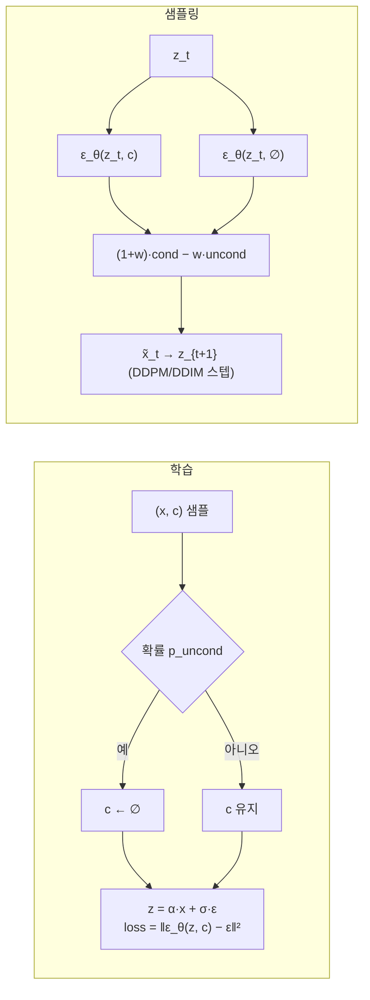
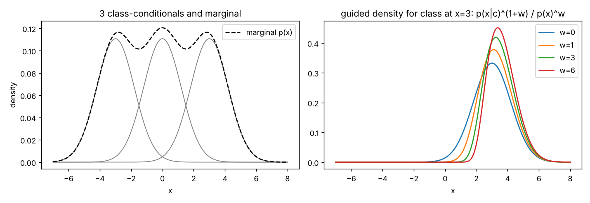
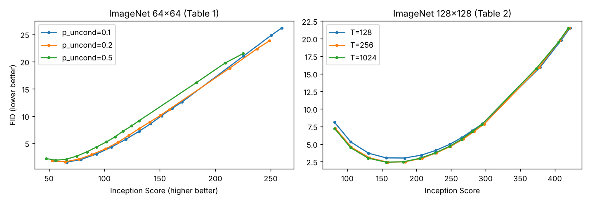

# Classifier-Free Guidance: 분류기 없이 "조건부 − 무조건부" 방향으로 밀어 fidelity와 diversity를 맞바꾸는 법

> 원문: [Classifier-Free Diffusion Guidance](https://arxiv.org/abs/2207.12598) — Jonathan Ho, Tim Salimans (Google Research, Brain team), arXiv 2022-07 (NeurIPS 2021 Workshop on Deep Generative Models and Downstream Applications에 단편 버전 발표).

## 왜 나왔나

GAN의 truncation(BigGAN)이나 flow의 low-temperature 샘플링은 "다양성을 줄이는 대신 샘플 하나하나의 품질을 올리는" 손잡이다. 확산 모델에서는 이 손잡이가 없었다. 점수(score)를 그냥 키우거나 역과정의 노이즈 분산을 줄이는 단순한 시도는 흐릿하고 품질 낮은 샘플만 만들었다(Sec. 3).

Dhariwal & Nichol의 **classifier guidance**가 이 손잡이를 처음 만들었다. 노이즈가 낀 $`z_\lambda`$에서 학습한 분류기 $`p_\theta(c\mid z_\lambda)`$의 입력 기울기를 score에 섞는다(Sec. 3.1). 하지만 저자들은 세 가지가 불편하다고 지적한다(Sec. 1).

- 별도의 **분류기를 노이즈 데이터로 따로 학습**해야 하므로 학습 파이프라인이 복잡해지고, 사전학습된 일반 분류기를 꽂을 수 없다.
- 샘플링이 "분류기를 속이는 기울기 공격(adversarial attack)"처럼 보인다. 그렇다면 FID/IS 같은 **분류기 기반 지표**가 오르는 것은 분류기를 속였기 때문일 수 있다.
- 분류기 기울기로 샘플을 미는 것은 GAN 학습과 비슷한 구석이 있고, GAN이 원래 이 지표들에서 강하다.

그래서 질문은 이렇다. **분류기 없이도 guidance가 가능한가?** 답이 classifier-free guidance(CFG)이고, 이후 GLIDE·Imagen·Stable Diffusion 같은 텍스트-이미지 모델에서 사실상 기본 샘플링 설정으로 쓰이게 된 기법이다.

## 핵심 아이디어

1. **하나의 네트워크로 조건부와 무조건부를 같이 학습한다.** 학습 중 조건 $`c`$를 확률 $`p_{\text{uncond}}`$로 null 토큰 $`\varnothing`$으로 바꿔서 넣는다. 무조건부 모델은 $`\epsilon_\theta(z_\lambda)=\epsilon_\theta(z_\lambda,c=\varnothing)`$이다(Alg. 1). 파라미터는 늘지 않는다.
2. **샘플링에서 두 예측을 외삽한다.** 매 스텝
$$\tilde\epsilon_\theta(z_\lambda,c)=(1+w)\thinspace\epsilon_\theta(z_\lambda,c)-w\thinspace\epsilon_\theta(z_\lambda)$$
로 score를 바꿔 쓴다(Eq. 6, Alg. 2). $`w=0`$이면 원래 조건부 모델이고, $`w`$가 클수록 "조건부 예측에서 무조건부 예측을 뺀 방향"으로 더 멀리 간다.
3. **직관.** guidance는 샘플의 무조건부 likelihood를 **낮추고** 조건부 likelihood를 **높인다**(Sec. 5). "이 클래스답다"가 아니라 "다른 클래스와 구별되는 특징이 뚜렷하다"를 향해 간다. 논문은 무조건부 likelihood를 음의 score 항으로 낮추는 방식이 이전에 탐구되지 않았다고 지적한다.
4. **암묵적 분류기.** Bayes 규칙으로 $`p^i(c\mid z_\lambda)\propto p(z_\lambda\mid c)/p(z_\lambda)`$를 만들면 그 기울기가 곧 두 score의 차이다. 즉 CFG는 "생성 모델을 뒤집어 얻은 분류기"로 classifier guidance를 하는 것과 닮았다. 단, 닮았을 뿐 같지는 않다(아래 수식 절).



*그림 1. 학습은 조건 드롭아웃 한 줄, 샘플링은 같은 네트워크를 조건 유무로 두 번 부르는 한 줄이 전부다. 별도의 분류기도, 분류기 기울기도 등장하지 않는다. (직접 그림: 논문 Alg. 1, Alg. 2)*

## 수식

**배경 (Sec. 2).** 연속시간 variance-preserving 전방 과정은
$$q(z_\lambda\mid x)=\mathcal N(\alpha_\lambda x,\sigma_\lambda^2 I),\qquad \alpha_\lambda^2=\frac{1}{1+e^{-\lambda}},\quad \sigma_\lambda^2=1-\alpha_\lambda^2$$
이다(Eq. 1). $`\lambda=\log(\alpha_\lambda^2/\sigma_\lambda^2)`$는 log SNR이고 전방 과정은 $`\lambda`$가 줄어드는 방향이다. 모델은 $`\epsilon`$-예측으로 $`x_\theta(z_\lambda)=(z_\lambda-\sigma_\lambda\epsilon_\theta(z_\lambda))/\alpha_\lambda`$를 만들고 다음 손실로 학습한다(Eq. 5).
$$\mathbb E_{\epsilon,\lambda}\big[\Vert\epsilon_\theta(z_\lambda)-\epsilon\Vert_2^2\big],\qquad z_\lambda=\alpha_\lambda x+\sigma_\lambda\epsilon$$
이는 여러 노이즈 스케일에서의 denoising score matching이라, $`\epsilon_\theta(z_\lambda)\approx-\sigma_\lambda\nabla_{z_\lambda}\log p(z_\lambda)`$이다. 즉 $`\epsilon`$ 예측은 부호와 $`\sigma_\lambda`$ 배율을 뺀 score다. 조건부 모델은 입력에 $`c`$를 추가하기만 하면 된다.

**Classifier guidance (Sec. 3.1).**
$$\tilde\epsilon_\theta(z_\lambda,c)=\epsilon_\theta(z_\lambda,c)-w\thinspace\sigma_\lambda\nabla_{z_\lambda}\log p_\theta(c\mid z_\lambda)\approx-\sigma_\lambda\nabla_{z_\lambda}\big[\log p(z_\lambda\mid c)+w\log p_\theta(c\mid z_\lambda)\big]$$
이 score는 근사적으로 $`\tilde p_\theta(z_\lambda\mid c)\propto p_\theta(z_\lambda\mid c)\thinspace p_\theta(c\mid z_\lambda)^w`$에서 샘플링하는 것에 해당한다. 분류기가 정답 라벨에 높은 확률을 주는 데이터가 가중되고, 그 대가로 다양성이 준다.

**CFG의 유도 (Sec. 3.2).** 정확한 score $`\epsilon^*(z_\lambda,c)`$, $`\epsilon^*(z_\lambda)`$가 있다고 하자. 암묵적 분류기의 기울기는
$$\nabla_{z_\lambda}\log p^i(c\mid z_\lambda)=-\frac{1}{\sigma_\lambda}\big[\epsilon^*(z_\lambda,c)-\epsilon^*(z_\lambda)\big]$$
이다. 이를 classifier guidance 식의 $`\nabla\log p(c\mid z)`$ 자리에 넣으면
$$\tilde\epsilon^*(z_\lambda,c)=\epsilon^*(z_\lambda,c)+w\big[\epsilon^*(z_\lambda,c)-\epsilon^*(z_\lambda)\big]=(1+w)\thinspace\epsilon^*(z_\lambda,c)-w\thinspace\epsilon^*(z_\lambda)$$
이고, 이것이 Eq. 6의 모양이다. 풀어 쓰면 guided 분포는
$$\tilde p(z_\lambda\mid c)\propto p(z_\lambda\mid c)\Big[\frac{p(z_\lambda\mid c)}{p(z_\lambda)}\Big]^{w}=\frac{p(z_\lambda\mid c)^{1+w}}{p(z_\lambda)^{w}}$$
이다. 분자의 지수 $`1+w`$가 조건부 분포를 뾰족하게 만들고(저온도 효과), 분모의 $`p(z_\lambda)^{w}`$가 클래스에 공통인 영역을 깎는다. 여기서 각 항은 이렇게 읽는다.

- $`w`$: guidance 강도. $`w=0`$이면 비guided 조건부 모델. 논문의 표기에서는 $`w=1`$이 "조건부 score의 2배에서 무조건부 1배를 뺌"이다.
- $`\epsilon_\theta(z_\lambda,c)-\epsilon_\theta(z_\lambda)`$: "이 조건이 score를 어떻게 바꾸는가"의 추정치. 이것이 암묵적 분류기 기울기 역할을 한다.

**주의: Eq. 6은 어떤 분류기의 기울기도 아니다.** 위 유도는 정확한 score일 때만 성립한다. 실제 $`\epsilon_\theta`$는 제약 없는 신경망 출력이라 **보존적 벡터장(어떤 스칼라 퍼텐셜의 기울기)이 아니므로**, $`\epsilon_\theta(z,c)-\epsilon_\theta(z)`$가 일반적으로 어떤 분류기의 기울기도 되지 않는다(Sec. 3.2). 또 생성 모델을 Bayes 규칙으로 뒤집은 분류기는 모델이 틀렸을 때(misspecification) 일관성이 보장되지 않고, 판별 모델이 보통 더 낫다는 선행 결과도 있다(Sec. 3.2). 그래서 이 방법이 잘 작동한다는 근거는 이론이 아니라 실험이다.

**샘플링 (Alg. 2).** $`\lambda_1=\lambda_{\min}<\dots<\lambda_T=\lambda_{\max}`$에서 $`z_1\sim\mathcal N(0,I)`$로 시작해 매 스텝
$$\tilde x_t=\frac{z_t-\sigma_{\lambda_t}\tilde\epsilon_t}{\alpha_{\lambda_t}},\qquad z_{t+1}\sim\mathcal N\big(\tilde\mu_{\lambda_{t+1}\mid\lambda_t}(z_t,\tilde x_t),\ (\tilde\sigma^2_{\lambda_{t+1}\mid\lambda_t})^{1-v}(\sigma^2_{\lambda_t\mid\lambda_{t+1}})^{v}\big)$$
을 적용한다(Eq. 3, 4). $`v`$는 분산을 두 극단 사이에서 로그 보간하는 상수 하이퍼파라미터다(64×64 모델은 $`v=0.3`$, 128×128은 $`v=0.2`$). 논문은 이 자리에 DDIM 같은 다른 샘플러를 써도 된다고 적는다.

## 코드

1차원에 클래스 3개($`\mu=-3,0,3`$, 표준편차 1.2)를 두고, **정확한** score만으로 CFG를 직접 확인한다. (a) CFG score가 $`\nabla\log[p(x\mid c)\,p^i(c\mid x)^w]`$와 일치하는지(정확한 score일 때의 유도), (b) 분류기 없이 CFG score만으로 Langevin 샘플링을 했을 때 샘플이 어떻게 바뀌는지를 본다.

```python
import numpy as np

mus, sig = np.array([-3.0, 0.0, 3.0]), 1.2          # 3 classes on a line, p(c)=1/3, p(x|c)=N(mu_c, sig^2)
npdf = lambda x, m: np.exp(-0.5 * ((x - m) / sig) ** 2) / (sig * np.sqrt(2 * np.pi))

def score_c(x, k):                                   # exact score of p(x|c=k)
    return -(x - mus[k]) / sig ** 2

def score_u(x):                                      # exact score of p(x) = (1/3) sum_k p(x|k)
    ps = np.stack([npdf(x, m) for m in mus]); sc = np.stack([-(x - m) / sig ** 2 for m in mus])
    return (ps * sc).sum(0) / ps.sum(0)

def guided(x, k, w):                                 # paper Eq.6 written on scores: (1+w)*cond - w*uncond
    return (1 + w) * score_c(x, k) - w * score_u(x)

k = 2                                                # target class: mean +3, its neighbour sits at 0
# (a) identity: guided score == grad_x log[ p(x|c) * p_i(c|x)^w ],  p_i(c|x) = p(x|c)/(3 p(x))
x0, w, h = np.array([1.0, 2.5, 4.0]), 3, 1e-5
f = lambda x: np.log(npdf(x, mus[k])) + w * np.log(npdf(x, mus[k]) / sum(npdf(x, m) for m in mus))
print("guided score :", np.round(guided(x0, k, w), 4))
print("numeric grad :", np.round((f(x0 + h) - f(x0 - h)) / (2 * h), 4))

# (b) sample with Langevin dynamics on the guided score; no classifier anywhere
rng = np.random.default_rng(0)
for w in [0, 1, 3, 6]:
    x = rng.normal(size=20000) * 3
    for _ in range(3000):
        x = x + 0.01 * guided(x, k, w) + np.sqrt(0.02) * rng.normal(size=x.shape)
    post = npdf(x, mus[k]) / sum(npdf(x, m) for m in mus)       # implicit classifier p(c=k|x)
    print(f"w={w}: mean={x.mean():.2f} std={x.std():.2f}  mean p(c|x)={post.mean():.3f}  P(x<1.5)={np.mean(x < 1.5):.4f}")
```

실제 출력:

```
guided score : [ 6.0404  1.0396 -0.6604]
numeric grad : [ 6.0404  1.0396 -0.6604]
w=0: mean=3.01 std=1.20  mean p(c|x)=0.848  P(x<1.5)=0.1051
w=1: mean=3.27 std=1.04  mean p(c|x)=0.908  P(x<1.5)=0.0350
w=3: mean=3.48 std=0.95  mean p(c|x)=0.945  P(x<1.5)=0.0056
w=6: mean=3.64 std=0.89  mean p(c|x)=0.964  P(x<1.5)=0.0008
```

읽는 법:

- (a)는 정확한 score일 때 "두 score의 외삽 = 분류기 항을 가중한 guidance"라는 유도를 수치로 확인한 것이다. 실제 신경망에서는 이 등식이 성립한다는 보장이 없다는 점을 잊지 말자.
- (b)에서 $`w`$를 키우면 표준편차가 1.20 → 0.89로 줄고(**다양성 감소**), 샘플이 이웃 클래스(0)에서 멀어지며 평균이 3.01 → 3.64로 밀린다. 이웃 쪽 꼬리($`x<1.5`$)에 있는 샘플 비율은 10.5% → 0.08%로 급감한다. 암묵적 분류기가 "내 클래스가 맞다"고 보는 확률도 0.848 → 0.964로 오른다. 이것이 IS가 올라가고 다양성이 줄어드는 메커니즘의 축소판이다.
- 평균이 클래스 중심(3)을 지나 바깥쪽으로 밀리는 것도 눈여겨보자. guidance는 "클래스 중심으로 모으기"가 아니라 "다른 클래스에서 멀어지기"이므로, 데이터 밀도가 낮은 가장자리 방향으로 치우친다.

## 그림으로 보는 동작

<p align="center"></p>

*그림 2. 논문의 2D 장난감 예. 가우시안 3개가 각각 한 클래스이고, 왼쪽부터 비guided 주변분포, 그 오른쪽은 guidance 강도를 올린 각 클래스의 guided 조건부 분포다. 강도가 커질수록 질량이 다른 클래스에서 먼 쪽으로 밀리고 작은 영역에 모인다. 그림 3의 1차원 계산과 같은 현상이다. (출처: 논문 Fig. 2, arXiv:2207.12598)*

<p align="center"></p>

*그림 3. 1차원 장난감에서 $`\tilde p\propto p(x\mid c)^{1+w}/p(x)^{w}`$를 직접 계산한 것. 왼쪽: 클래스 3개의 조건부 분포와 주변분포. 오른쪽: $`w=0,1,3,6`$일 때 오른쪽 클래스의 guided 분포. $`w`$가 클수록 폭이 줄고 봉우리가 이웃 클래스 반대쪽(오른쪽)으로 이동한다. 코드 출력의 표준편차 감소와 평균 이동과 일치한다. (직접 그림: 위 수식을 계산한 결과)*

<p align="center"></p>

*그림 4. 128×128 ImageNet 샘플. 왼쪽은 비guided, 오른쪽은 $`w=3.0`$. 논문은 강한 guidance에서 색이 포화되는 경향이 보인다고 적는다. 같은 시드에서 시작한 샘플이라 구도는 비슷하되 대상이 더 뚜렷해지는 것을 비교할 수 있다. (출처: 논문 Fig. 3, arXiv:2207.12598)*

<p align="center"></p>

*그림 5. 128×128에서 $`w=4.0`$(FID 21.53, IS 421.03)인 강한 guidance 샘플. 같은 클래스(malamute) 샘플의 변이가 거의 사라지고 품질 지표 IS만 가장 높은 구간이다. 아래 표에서 보듯 이 구간은 FID가 이미 나빠진 영역이다. (출처: 논문 Fig. 7(c), arXiv:2207.12598)*

<p align="center"></p>

*그림 6. 논문 Table 1(64×64, $`p_{\text{uncond}}`$별)과 Table 2(128×128, 샘플링 스텝 $`T`$별)의 수치를 그대로 옮겨 그린 FID–IS 곡선. 점은 $`w`$를 0부터 4까지 훑은 값이다. $`w`$가 작을 때 FID가 먼저 내려가다 반등하고, IS는 $`w`$에 따라 계속 오른다. 왼쪽에서는 $`p_{\text{uncond}}=0.5`$가 전 구간에서 아래(나쁜) 쪽이고, 오른쪽에서는 세 $`T`$ 곡선이 거의 겹친다. (직접 그림: 논문 Table 1, 2의 보고 수치)*

## 트레이드오프와 함정

**FID/IS 트레이드오프는 $`w`$로 조절된다.** 논문은 $`w\in\lbrace0,0.1,\dots,4\rbrace`$를 스윕하고 샘플 5만 장으로 FID/IS를 계산했다. 가장 좋은 FID는 작은 $`w`$($`0.1`$ 또는 $`0.3`$)에서, 가장 좋은 IS는 큰 $`w`$($`\ge4`$)에서 나오고, 그 사이에서는 $`w`$를 올릴수록 IS가 오르고 FID가 나빠지는 명확한 트레이드오프가 나타난다(Sec. 4.1).

| 64×64 ($`p_{\text{uncond}}=0.1`$) | FID ↓ | IS ↑ |
|---|---|---|
| $`w=0.0`$ (비guided) | 1.8 | 53.71 |
| $`w=0.1`$ | 1.55 | 66.11 |
| $`w=0.3`$ | 3.03 | 92.8 |
| $`w=1.0`$ | 12.6 | 170.1 |
| $`w=3.0`$ | 24.83 | 250.4 |
| $`w=4.0`$ | 26.22 | 260.2 |

*(Table 1. 참고: ADM 2.07 FID, CDM 1.48 FID / 67.95 IS)*

| 128×128 ($`T=256`$) | FID ↓ | IS ↑ |
|---|---|---|
| $`w=0.0`$ (비guided) | 7.27 | 82.45 |
| $`w=0.3`$ | 2.43 | 158.47 |
| $`w=1.0`$ | 7.86 | 297.98 |
| $`w=4.0`$ | 21.53 | 421.03 |

*(Table 2. 비교: BigGAN-deep 5.7 FID / 124.5 IS, BigGAN-deep max-IS 25 / 253, CDM 3.52 / 128.8, LOGAN 3.36 / 148.2, ADM-G 2.97 FID)*

- 128×128에서 $`w=0.3`$의 FID 2.43은 classifier-guided ADM-G의 2.97보다 낫고, $`w=4.0`$에서는 BigGAN-deep의 max-IS 설정(25 / 253)을 FID와 IS 양쪽에서 앞선다(21.53 / 421.03). 논문은 128×128 결과가 문헌상 최고라고 적는다(Sec. 4.1).
- 64×64에서 비guided 모델의 FID(1.8)가 $`w=0.1`$에서 1.55로 개선되고, 그 뒤로는 나빠진다. **"IS가 높다 = 좋다"가 아니다.** $`w`$를 키우면 샘플이 클래스 원형에 몰려 FID가 나빠지고 다양성이 줄어든다. 지표 최대화와 실제 사용성 사이에 간극이 있다.

**$`p_{\text{uncond}}`$는 작아도 충분하다 (Sec. 4.2).** $`0.1, 0.2, 0.5`$를 400K 스텝 동안 비교했을 때 $`0.5`$가 FID/IS 전선 전체에서 일관되게 나쁘고, $`0.1`$과 $`0.2`$는 거의 같다. 예를 들어 $`w=0`$에서 FID는 1.8 / 1.8 / 2.21이다. 무조건부 과제에 모델 용량을 조금만 써도 guidance에 쓸 만한 score가 나온다는 뜻이고, 논문은 classifier guidance에서도 작은 분류기로 충분하다는 보고와 닮았다고 말한다.

**비용: 스텝당 forward가 2회다.** 조건부와 무조건부를 각각 계산해야 한다. 128×128 실험에서 $`T=128/256/1024`$를 비교하면 $`T=256`$이 품질과 속도의 균형점이고(Sec. 4.3), 예를 들어 $`w=0.3`$에서 FID가 3.04 / 2.43 / 2.43이다. 다만 ADM-G도 약 256스텝이라는 점에서 $`T=256`$으로 비교하면 우리 쪽이 forward를 두 번 쓰므로, 논문은 공정한 비교는 $`T=128`$이고 그 설정에서는 ADM-G보다 FID가 나쁘다고 솔직히 적는다. 조건을 네트워크 후반에만 주입하면 앞부분 계산을 공유할 수 있으리라는 가능성도 언급만 하고 미룬다(Sec. 5).

**다양성 손실의 사회적 비용.** 논문은 fidelity를 올리는 guidance가 과소대표된 데이터 부분을 더 지우는 쪽으로 작용할 수 있다고 경고한다(Sec. 5).

**내가 덧붙이는 함정.**

- 무조건부 분기가 약하면(조건 드롭이 너무 적거나 학습이 덜 되면) 차이 벡터 $`\epsilon(z,c)-\epsilon(z)`$가 노이즈가 되고, $`w`$배로 증폭되므로 샘플이 깨진다. 이 논문은 $`p_{\text{uncond}}`$를 0.1~0.5 범위에서만 확인했다.
- 포화된 색(그림 4)에서 보이듯 $`w`$가 크면 분포 바깥으로 외삽한다. 이 논문의 실험은 클래스 조건과 낮은 해상도(64, 128)뿐이므로, 텍스트 조건이나 고해상도에서 쓰는 최적 $`w`$는 별도로 찾아야 한다.
- 샘플러가 바뀌면(DDIM 등) 같은 $`w`$에서도 효과가 달라질 수 있다. 논문의 모든 수치는 위 Alg. 2의 ancestral 샘플러 기준이다.

## 대표 논문/참고

- Ho & Salimans, *Classifier-Free Diffusion Guidance* (arXiv:2207.12598) — 본 문서의 원문.
- Dhariwal & Nichol, *Diffusion Models Beat GANs on Image Synthesis* (arXiv:2105.05233) — classifier guidance와 ADM-G.
- Ho, Jain, Abbeel, *Denoising Diffusion Probabilistic Models* (arXiv:2006.11239) — $`\epsilon`$-예측 손실의 기반.
- Song et al., *Score-Based Generative Modeling through SDEs* (arXiv:2011.13456) — 연속시간 정식화와 score 해석.
- Ho et al., *Cascaded Diffusion Models* (arXiv:2106.15282) — 논문에서 비교한 CDM.
- 이후 연결: 텍스트 조건 확산 모델(GLIDE, Imagen, Latent Diffusion 계열)이 이 방식으로 조건 드롭아웃과 두 번의 forward를 쓰는 샘플링을 채택했고, 비용 문제는 guidance distillation 같은 후속 연구가 다룬다. 이 부분은 이 논문 밖의 내용이다.
