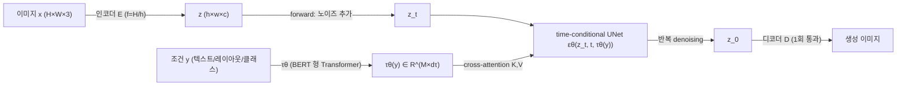
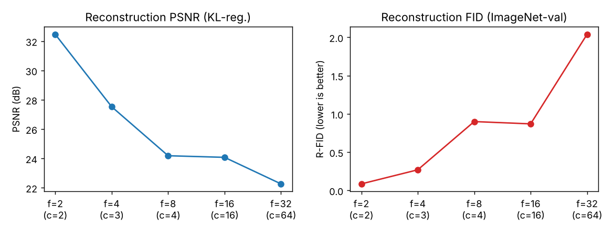

# High-Resolution Image Synthesis with Latent Diffusion Models (LDM)

- 링크: https://arxiv.org/abs/2112.10752
- 저자: Robin Rombach, Andreas Blattmann, Dominik Lorenz, Patrick Esser, Björn Ommer (LMU Munich & IWR Heidelberg, Runway ML)
- 발표: arXiv 2021-12 (v2 2022-04-13), CVPR 2022

> 왜 이 논문인가: Stable Diffusion의 기반이 된 방법으로, 이후 거의 모든 오픈 텍스트-이미지 모델이 "VAE 잠재공간 + 확산 모델 + cross-attention 조건화" 구조를 따른다. 이번 실행 환경에서는 Semantic Scholar API가 차단되어 인용 수를 직접 확인하지 못했다. CVPR 2022 게재와 Stable Diffusion과의 관계는 논문 본문이 아니라 내가 알고 있는 사실이며, 본문 분석은 arXiv HTML v2 전문(약 13.5만 자)을 기준으로 했다.

## 한 줄 요약
픽셀 공간에서 직접 확산시키지 말고, **지각적으로 동등한 저차원 잠재공간(autoencoder, 다운샘플 f=4~8)에서 확산 모델을 학습**하면 학습·추론 비용이 크게 줄고, cross-attention으로 텍스트·레이아웃 등 임의의 조건을 넣을 수 있다.

## 문제 설정
- 당시 고해상도 합성은 수십억 파라미터의 autoregressive Transformer(DALL-E 류)가 주도했고, GAN은 다양성이 큰 데이터로 확장하기 어려웠다 (Sec. 1).
- 확산 모델(DM)은 likelihood 기반이라 mode collapse나 학습 불안정이 없고 파라미터 공유로 효율적이지만, **mode-covering 특성 때문에 지각되지 않는 미세 디테일을 모델링하는 데 용량과 연산을 과하게 쓴다.** reweighted 목적식이 초기 denoising 스텝을 줄여 이를 완화하지만, 학습과 추론 모두 여전히 RGB 고차원 공간에서 반복 평가해야 한다.
- 구체적 비용: 가장 강력한 DM은 학습에 150~1000 V100-일이 들고(ADM), 50k 샘플 생성에 A100 한 장으로 약 5일이 걸린다 (Sec. 1). 연구 접근성과 탄소 발자국 문제로 이어진다.
- 기존 two-stage 접근(VQ-VAE, VQGAN+Transformer, DALL-E)은 autoregressive 모델을 돌리려고 **공격적인 압축**(예: DALL-E f=8의 R-FID 32.01, VQGAN f=16의 PSNR 19.9)을 해야 해서 재구성 품질이 상한이 되고, 압축을 줄이면 시퀀스 길이 때문에 연산이 폭발한다. latent를 1D로 펴서 모델링하므로 공간 구조도 버린다 (Sec. 2, 3.1).
- 잠재공간과 prior를 **동시에** 학습하는 LSGM 같은 방식은 재구성과 생성 사이의 가중치 조절이 까다롭다 (Sec. 2).

논문의 진단(Fig. 2): 학습은 대략 두 단계로 나뉜다. (1) 고주파 디테일을 버리는 **perceptual compression**, (2) 의미적 구성을 배우는 **semantic compression**. 비트의 대부분은 (1)에 해당하는 비지각적 정보인데, 픽셀 공간 DM은 gradient와 backbone 평가를 모든 픽셀에서 수행한다.

*그림 1. rate-distortion 곡선으로 본 학습의 두 단계. 대부분의 비트는 지각되지 않는 디테일(perceptual compression)에 쓰이고, 생성 모델이 배워야 할 부분은 의미 압축이다. LDM은 앞 단계를 별도의 가벼운 autoencoder에 맡긴다. (출처: 논문 Fig. 2, arXiv:2112.10752)*

## 방법
핵심은 압축 단계와 생성 단계를 **명시적으로 분리**하는 것이다. 자동인코더는 한 번만 학습해 여러 DM 학습·다른 태스크에 재사용한다 (Sec. 3).

*그림 2. LDM 파이프라인. 논문 Fig. 3(concat 또는 cross-attention 조건화)과 Sec. 3.1~3.3의 설명을 바탕으로 직접 그린 도식이다. UNet은 잠재공간 z에서만 동작하고, 픽셀 공간으로 가는 것은 마지막 디코더 한 번뿐이다. (직접 그림: 논문 Sec. 3 설명 기반 mermaid)*

### 3.1 Perceptual compression (1단계 autoencoder)
- 이미지 $x\in\mathbb R^{H\times W\times 3}$를 인코더 $\mathcal E$가 $z=\mathcal E(x)\in\mathbb R^{h\times w\times c}$로 보내고, 디코더 $\mathcal D$가 $\tilde x=\mathcal D(z)$를 복원한다. 다운샘플 비율 $f=H/h=W/w=2^m$.
- 학습 손실은 **perceptual loss + patch 기반 adversarial 목적**의 조합이다(VQGAN 계열). L1/L2만 쓰면 흐려지는데, 패치 discriminator가 국소적 사실감을 강제한다 (Sec. 3.1). 전체 목적식(Appendix G, Eq. 25):

$$L_{\text{Autoencoder}}=\min_{\mathcal E,\mathcal D}\max_{\psi}\Big(L_{rec}(x,\mathcal D(\mathcal E(x)))-L_{adv}(\mathcal D(\mathcal E(x)))+\log D_\psi(x)+L_{reg}(x;\mathcal E,\mathcal D)\Big)$$

  $L_{rec}$는 재구성, $L_{adv}$는 adversarial, $D_\psi$는 패치 discriminator, $L_{reg}$는 잠재공간 분산을 억제하는 정규화다.
- latent의 분산이 임의로 커지지 않도록 두 가지 정규화를 쓴다.
  - **KL-reg.**: VAE처럼 표준 정규분포로 향하는 KL 페널티. 가중치는 약 $10^{-6}$로 매우 작게 둔다.
  - **VQ-reg.**: 디코더 안에 vector quantization 층을 흡수 (VQGAN에서 양자화를 디코더로 옮긴 형태). 코드북 크기를 크게 잡는다.
  - 둘 다 아주 약한 정규화만 쓰므로 재구성이 충실하다. 이것이 LSGM과의 차이다 (contribution iii).
- **latent가 2차원 공간 구조를 유지**하기 때문에 이후 UNet이 컨볼루션으로 이를 활용할 수 있다. 1D 순서를 임의로 정하던 autoregressive 방식과 다른 점이다.

*그림 3. 다운샘플 비율 f에 따른 autoencoder 재구성 품질 (OpenImages로 학습, ImageNet-val 평가, KL-reg. 모델). f가 커질수록 PSNR이 떨어지고 R-FID가 나빠진다. f=4~8 부근이 효율과 충실도의 타협점이다. (직접 그림: 논문 Table 8의 KL 모델 값 — f=2 (c=2) 32.47/0.086, f=4 (c=3) 27.53/0.27, f=8 (c=4) 24.19/0.90, f=16 (c=16) 24.08/0.87, f=32 (c=64) 22.27/2.04)*

### 3.2 Latent Diffusion Models (2단계)
픽셀 공간 DM의 단순화 목적식은 (Eq. 1)

$$L_{DM}=\mathbb E_{x,\epsilon\sim\mathcal N(0,1),t}\Big[\|\epsilon-\epsilon_\theta(x_t,t)\|_2^2\Big]$$

이고, $t$는 $\lbrace 1,\dots,T\rbrace$에서 균등 샘플링한다. 즉 DM은 동일 가중치의 denoising autoencoder $\epsilon_\theta(x_t,t)$ 열이다. LDM은 입력을 $x_t$ 대신 잠재 $z_t$로 바꾼다 (Eq. 2).

$$L_{LDM}:=\mathbb E_{\mathcal E(x),\epsilon\sim\mathcal N(0,1),t}\Big[\|\epsilon-\epsilon_\theta(z_t,t)\|_2^2\Big]$$

- backbone $\epsilon_\theta(\circ,t)$는 time-conditional UNet이다. forward 과정은 고정이므로 학습 중 $z_t$는 $\mathcal E$로 얻은 $z$에 노이즈를 섞어 바로 만든다.
- 샘플링은 $p(z)$에서 뽑은 $z$를 **디코더 한 번**으로 이미지로 바꾼다.
- 이득: (i) 의미적으로 중요한 비트에 집중, (ii) 저차원이라 연산이 훨씬 효율적이다. 또 UNet을 주로 **2D 컨볼루션**으로 구성할 수 있어 이미지 특유의 inductive bias를 살린다. 이는 고압축 이산 latent 위에서 attention 기반 Transformer를 쓴 선행 연구와 대비된다 (Sec. 3.2).
- 부록 B의 배경: 확산 모델은 $q(x_t|x_0)=\mathcal N(x_t\mid\alpha_t x_0,\sigma_t^2\mathbb I)$, SNR$(t)=\alpha_t^2/\sigma_t^2$로 지정되고, ELBO가 시간 스텝별 KL의 합으로 분해된다 (Eq. 4~9).

### 3.3 Conditioning: cross-attention
조건부 분포 $p(z|y)$를 위해 조건 denoiser $\epsilon_\theta(z_t,t,y)$를 학습한다. 입력 $y$(텍스트 등)는 도메인별 인코더 $\tau_\theta$가 $\tau_\theta(y)\in\mathbb R^{M\times d_\tau}$로 바꾸고, UNet 중간층에 cross-attention으로 연결한다.

$$\text{Attention}(Q,K,V)=\text{softmax}\!\left(\frac{QK^\top}{\sqrt d}\right)\cdot V,\quad Q=W_Q^{(i)}\varphi_i(z_t),\ K=W_K^{(i)}\tau_\theta(y),\ V=W_V^{(i)}\tau_\theta(y)$$

- $\varphi_i(z_t)\in\mathbb R^{N\times d_\epsilon^i}$는 UNet $i$번째 층의 평탄화된 중간 표현. $W_Q,W_K,W_V$는 학습 가능한 투영.
- 조건부 학습 목적식 (Eq. 3):

$$L_{LDM}:=\mathbb E_{\mathcal E(x),y,\epsilon\sim\mathcal N(0,1),t}\Big[\|\epsilon-\epsilon_\theta(z_t,t,\tau_\theta(y))\|_2^2\Big]$$

  $\tau_\theta$와 $\epsilon_\theta$를 **함께** 최적화한다.
- 공간적으로 정렬된 조건(저해상도 이미지, 시맨틱 맵, 마스크)은 cross-attention 없이 **입력에 concat**한다 (Sec. 4.3.2, Fig. 3).

### 구현 디테일 (Appendix E)
- UNet은 ADM의 "ablated UNet"에서 self-attention 층을 **얕은 Transformer**로 교체한다. 블록은 self-attention → 위치별 MLP → cross-attention을 번갈아 쌓고 $T$블록을 둔다 (Table 16). MLP와 cross-attention을 빼면 원래 UNet과 같다.
- $\tau_\theta$를 timestep에도 조건화하면 표현력이 늘지만 추론이 느려져 시도하지 않았다고 한다.
- 텍스트: BERT 토크나이저 + Transformer, 시퀀스 길이 77, 깊이 $N$=32, 차원 1280 (Table 17). 레이아웃: 박스를 $(l,b,c)$ 튜플(좌상단 $l$, 우하단 $b$는 이산화, 클래스 $c$)로 인코딩, 시퀀스 길이 92, 깊이 16, 차원 512. 클래스 조건 모델도 cross-attention이며 $\tau_\theta$는 512차원 임베딩 하나다.
- 학습 하이퍼파라미터 예 (Table 12, 무조건 LDM): 확산 스텝 1000, linear noise schedule, CelebA-HQ f=4, 274M 파라미터, 채널 224, 배치 48, lr 9.6e-5, 410k iteration, A100 한 장.
- 잠재 **리스케일링** (Appendix G): 첫 배치의 성분별 표준편차 $\hat\sigma$로 $z\leftarrow z/\hat\sigma$를 해 단위 분산으로 맞춘다. 큰 해상도의 컨볼루션 샘플링에서 신호 대 잡음비(SNR)가 결과를 좌우하기 때문이다 (Sec. 4.3.2, App. D.1).

## 실험 설정
- 무조건 생성: CelebA-HQ, FFHQ, LSUN-Churches, LSUN-Bedrooms (256×256), 지표는 FID, Precision/Recall (Table 1).
- 클래스 조건: ImageNet 256×256. FID, IS, Precision/Recall (Table 3, 10).
- 텍스트-이미지: LAION-400M으로 1.45B 파라미터 KL-reg. LDM-8을 학습, MS-COCO 256×256 검증셋에서 평가 (Table 2). 샘플은 DDIM 200~250 스텝, classifier-free guidance 사용.
- 레이아웃-이미지: OpenImages 학습 후 COCO 파인튜닝 (Table 9).
- 초해상도: SR3 프로토콜의 bicubic ×4 (64→256), ImageNet. 사용자 연구 포함 (Table 4, 5).
- 인페인팅: Places, LaMa 프로토콜 (Table 6, 7).
- 압축 비율 분석(Sec. 4.1): LDM-$f$, $f\in\lbrace 1,2,4,8,16,32\rbrace$ (LDM-1은 픽셀 DM). A100 한 장, 동일 학습 스텝, 동일 파라미터 수로 통제. FID는 5k 샘플로 계산한다.
- 베이스라인: ADM, StyleGAN2, ProjectedGAN, ImageBART, VQGAN+Transformer, GLIDE, Make-A-Scene, CogView, LAFITE, SR3, LaMa, CoModGAN 등.

## 결과

### 압축 비율과 학습/샘플링 효율 (Sec. 4.1, Fig. 6, 7)
- (i) $f\in\lbrace 1,2\rbrace$은 학습 진행이 느리고, (ii) 너무 큰 $f$(예: LDM-32)는 적은 학습 후 품질이 정체한다. $f\in\lbrace 4\text{–}16\rbrace$이 균형이 좋다.
- 2M 스텝 후 **픽셀 기반 LDM-1과 LDM-8의 FID 격차는 38**이다 (Sec. 4.1).
- 샘플링 속도 대비 FID(Fig. 7)에서 LDM-4~8이 LDM-1보다 훨씬 낮은 FID와 더 높은 처리량을 낸다. ImageNet처럼 복잡한 데이터는 압축을 줄여야(작은 $f$) 품질이 유지된다.

*그림 4. 클래스 조건 ImageNet LDM의 학습 스텝(2M)에 따른 FID. 픽셀 LDM-1은 훨씬 느리게 수렴하고 LDM-32는 일찍 정체하며, LDM-4~16이 좋다. 본문의 "FID 격차 38" 수치의 근거다. (출처: 논문 Fig. 6, arXiv:2112.10752)*

*그림 5. ImageNet에서 압축 비율별 FID 대 샘플링 속도. 마커는 DDIM 스텝 수 {10,20,50,100,200}이다. 점선은 200 스텝 FID로, LDM-4~8이 강함을 보여준다. (출처: 논문 Fig. 7 오른쪽, arXiv:2112.10752)*

### 무조건 이미지 생성 (Table 1, 256×256, FID↓)
| 데이터 | 방법 | FID | Prec. | Recall |
|---|---|---|---|---|
| CelebA-HQ | DC-VAE | 15.8 | - | - |
| CelebA-HQ | VQGAN+T. (k=400) | 10.2 | - | - |
| CelebA-HQ | PGGAN | 8.0 | - | - |
| CelebA-HQ | LDM-4 (500 steps) | 5.11 | 0.72 | 0.49 |
| FFHQ | ImageBART | 9.57 | - | - |
| FFHQ | StyleGAN2 (Table 18) | 3.8 | - | - |
| FFHQ | LDM-4 (200 steps) | 4.98 | 0.73 | 0.50 |
| LSUN-Churches | StyleGAN2 | 3.86 | - | - |
| LSUN-Churches | LDM-8* (200 steps) | 4.02 | 0.64 | 0.52 |
| LSUN-Bedrooms | ADM | 1.90 | 0.66 | 0.51 |
| LSUN-Bedrooms | ProjectedGAN | 1.52 | 0.61 | 0.34 |
| LSUN-Bedrooms | LDM-4 (200 steps) | 2.95 | 0.66 | 0.48 |

(∗: KL-reg. 잠재공간. CelebA-HQ LDM-4 행과 FFHQ StyleGAN2 행은 Table 18 기준 값이다.) 본문은 CelebA-HQ에서 **FID 5.11로 새 SOTA**이며 LSGM도 앞선다고 쓴다. LSUN-Bedrooms에서는 ADM과 가깝지만(2.95 vs 1.90) 파라미터는 절반, 학습 자원은 4배 적다고 한다 (Sec. 4.2). GAN 대비 Precision/Recall이 일관되게 좋은 점은 likelihood 학습의 mode-covering 장점이라고 해석한다.

### 클래스 조건 ImageNet 256×256 (Table 3)
| 방법 | FID↓ | IS↑ | Prec.↑ | Recall↑ | 파라미터 |
|---|---|---|---|---|---|
| BigGAN-deep | 6.95 | 203.6 | 0.87 | 0.28 | 340M |
| ADM (250 DDIM) | 10.94 | 100.98 | 0.69 | 0.63 | 554M |
| ADM-G | 4.59 | 186.7 | 0.82 | 0.52 | 608M |
| LDM-4 (250 DDIM) | 10.56 | 103.49 | 0.71 | 0.62 | 400M |
| LDM-4-G (cfg s=1.5) | **3.60** | **247.67** | 0.87 | 0.48 | 400M |

LDM-4-G가 ADM-G보다 FID와 IS가 좋고 파라미터는 더 적다. 부록 Table 10에서 LDM-8은 395M 파라미터로 FID 17.41(2.9M step, batch 64), classifier guidance를 쓴 LDM-8-G는 8.11이다. 학습 4.8M step으로 늘리면 LDM-8은 15.51, LDM-8-G는 7.76이다.

### 연산량 비교 (Table 18, 학습 V100-일 환산: A100 ×2.2)
- ImageNet: ADM-G (250 step) 학습 962 V100-일(생성기 916 + classifier 46), 처리량 0.07 samples/s. LDM-8-G (100 step, 2.9M) 91 V100-일, 처리량 1.93 samples/s.
- LSUN-Bedrooms: ADM(1000 step) 232 V100-일, 0.03 samples/s vs LDM-4 (200 step, 1.9M) 60/55 V100-일, 1.07 samples/s.
- FFHQ: StyleGAN2 32.13 V100-일(FID 3.8) vs LDM-4 26 V100-일(FID 4.98).
- 즉 SOTA에 근접한 품질을 훨씬 적은 연산으로 낸다. 다만 ImageNet에서 LDM-4 (batch 1200, 178K step)는 271 V100-일로, 압축을 줄이면 비용이 다시 늘어난다.

### 텍스트-이미지 (Table 2, MS-COCO 256×256)
| 방법 | FID↓ | IS↑ | 파라미터 |
|---|---|---|---|
| CogView | 27.10 | 18.20 | 4B |
| LAFITE | 26.94 | 26.02 | 75M |
| GLIDE* | 12.24 | - | 6B |
| Make-A-Scene* | 11.84 | - | 4B |
| LDM-KL-8 | 23.31 | 20.03 | 1.45B |
| LDM-KL-8-G* (cfg s=1.5) | 12.63 | 30.29 | 1.45B |

classifier-free guidance를 쓰면 GLIDE·Make-A-Scene과 같은 수준이면서 파라미터는 훨씬 적다 (Sec. 4.3.1). 위 표에서 guidance 없는 LDM-KL-8은 23.31로 GLIDE/Make-A-Scene보다 나쁘다는 점에 주의해야 한다.

 

*그림 6. LAION으로 학습한 LDM-8(KL) 1.45B 모델의 사용자 프롬프트 샘플. 왼쪽 프롬프트는 'A street sign that reads "Latent Diffusion"', 오른쪽은 'A painting of a squirrel eating a burger'. 200 DDIM 스텝, η=1.0, guidance s=10.0으로 생성했다. (출처: 논문 Fig. 5, arXiv:2112.10752)*

### 레이아웃-이미지 (Table 9, FID↓)
| 방법 | COCO 256 | OpenImages 256 | OpenImages 512 |
|---|---|---|---|
| LostGAN-V2 | 42.55 | - | - |
| OC-GAN | 41.65 | - | - |
| SPADE | 41.11 | - | - |
| VQGAN+T | 56.58 | 45.33 | 48.11 |
| LDM-8 (100 steps) | 42.06 (COCO 스크래치) | - | - |
| LDM-4 (200 steps) | 40.91 (OpenImages→COCO 파인튜닝) | 32.02 | 35.80 |

### 초해상도 ×4 (Table 5, ImageNet-val 256², Sec. 4.4)
| 방법 | FID↓ | IS↑ | PSNR↑ | SSIM↑ | 파라미터 |
|---|---|---|---|---|---|
| Image Regression | 15.2 | 121.1 | 27.9 | 0.801 | 625M |
| SR3 | 5.2 | 180.1 | 26.4 | 0.762 | 625M |
| LDM-4 (100 steps) | 2.8† / 4.8‡ | 166.3 | 24.4 | 0.69 | 169M |
| LDM-4 big (100 steps) | 2.4† / 4.3‡ | 174.9 | 24.7 | 0.71 | 552M |
| LDM-4 (50 steps, guiding) | 4.4† / 6.4‡ | 153.7 | 25.8 | 0.74 | 184M |

(†는 validation split, ‡는 train split 특징으로 계산한 FID.) FID는 SR3보다 좋지만 IS는 SR3가 높다. PSNR/SSIM은 단순 regression이 가장 높은데, 저자는 이 지표들이 사람의 지각과 맞지 않고 흐릿함을 선호한다고 설명한다. 사용자 연구(Table 4)에서 LDM-SR 대 픽셀 베이스라인은 70.6% 대 29.4%로 LDM-SR이 선호된다 (Task 2). Fig. 10 설명: LDM-SR은 질감이 사실적이고 SR3는 미세 구조의 일관성이 더 좋다.

일반 용도의 **LDM-BSR**은 bicubic 대신 다양한 열화 파이프라인(JPEG 압축, 센서 노이즈 등)으로 학습해 임의의 입력을 1024²로 올린다 (App. D.6.1). 고정된 bicubic 열화로 학습한 모델은 그 전처리를 따르지 않는 이미지에 일반화하지 못한다고 한다.

### 인페인팅 (Table 6, 7, Places, Sec. 4.5)
Table 6 (인페인팅 효율, 파라미터 수 고정):

| 모델 | 학습 throughput (samples/s) | 샘플링 @256 | 샘플링 @512 | 시간/epoch | FID@2k (epoch 6) |
|---|---|---|---|---|---|
| LDM-1 (first stage 없음) | 0.11 | 0.26 | 0.07 | 20.66 | 24.74 |
| LDM-4 (KL, w/ attn) | 0.32 | 0.97 | 0.34 | 7.66 | 15.21 |
| LDM-4 (VQ, w/ attn) | 0.33 | 0.97 | 0.34 | 7.04 | 14.99 |
| LDM-4 (VQ, w/o attn) | 0.35 | 0.99 | 0.36 | 6.66 | 15.95 |

픽셀 DM 대비 **최소 2.7배 속도 향상, FID는 최소 1.6배 개선**이라고 본문이 요약한다.

Table 7 (512×512 crop 30k, FID↓ / LPIPS↓; 40–50% 마스크 vs 전체):

| 방법 | 40-50% FID | 40-50% LPIPS | 전체 FID | 전체 LPIPS |
|---|---|---|---|---|
| LDM-4 (big, w/ ft) | **9.39** | 0.246 | **1.50** | 0.137 |
| LDM-4 (big, w/o ft) | 12.89 | 0.257 | 2.40 | 0.142 |
| LDM-4 (w/ attn) | 11.87 | 0.257 | 2.15 | 0.144 |
| LDM-4 (w/o attn) | 12.60 | 0.259 | 2.37 | 0.145 |
| LaMa (재계산) | 12.31 | 0.243 | 2.23 | 0.134 |
| CoModGAN | 10.4 | 0.26 | 1.82 | 0.15 |

LDM이 FID는 LaMa보다 좋지만 LPIPS는 약간 높다. 저자는 LaMa가 하나의 결과만 내어 평균적인 이미지로 수렴하는 반면 LDM은 다양한 결과를 내기 때문이라고 해석한다. 사용자 연구(Table 4)에서 LDM 68.1% 대 LaMa 31.9%(Task 2).

 

*그림 7. 객체 제거 인페인팅 예시. 왼쪽이 입력, 오른쪽이 big, w/ ft 인페인팅 모델의 결과로, Table 7에서 FID 9.39/1.50을 낸 모델이다. (출처: 논문 Fig. 11, arXiv:2112.10752)*

### 해상도 일반화 (Sec. 4.3.2)
256²로 학습한 모델이 공간 조건(시맨틱 맵, 저해상도 이미지, 마스크)이 있을 때는 **컨볼루션 방식으로 메가픽셀(~1024²)까지** 확장된다. 시맨틱 합성은 256² (384²에서 crop)로 학습했고 512×1024 생성이 가능했다 (Fig. 9). 이때 latent 스케일(SNR)이 결과를 크게 바꾸며, 리스케일링과 classifier-free guidance를 함께 쓰면 텍스트 조건 LDM-KL-8-G로 256² 초과 이미지를 직접 합성할 수 있다 (Fig. 13).

## Ablation에서 알 수 있는 것
1. **다운샘플 비율 f** (Sec. 4.1, Fig. 6, 7): f=1,2는 느리고, f=32는 품질 상한이 낮다. f=4~16 권장, 특히 LDM-4/8이 최적. 복잡한 데이터(ImageNet)는 작은 f가 필요하다. 교훈: perceptual compression을 얼마나 autoencoder에 맡길지가 효율과 품질을 정하는 하이퍼파라미터다. 학습 후 FID 격차 38(LDM-1 대 LDM-8)이 그 크기다.
2. **autoencoder 재구성 품질** (Table 8, 그림 3): f=4 VQ 모델의 R-FID 0.58, PSNR 27.43이고 KL 모델은 R-FID 0.27, PSNR 27.53. f=8 KL은 0.90/24.19. 압축을 줄일수록 재구성이 좋아진다. 비교 대상으로 Fig. 1은 DALL-E(f=8) R-FID 32.01/PSNR 22.8, VQGAN(f=16) R-FID 4.98/PSNR 19.9를 든다. 교훈: 확산 모델이 공간 구조를 활용하므로 약한 압축에서도 연산이 감당된다.
3. **KL 대 VQ 정규화** (Sec. 4, Table 6, 8): VQ 잠재공간에서 학습한 LDM이 재구성은 약간 뒤져도 샘플 품질이 더 좋은 경우가 있다. 인페인팅에서 VQ(w/ attn) FID@2k 14.99, KL 15.21로 비슷하다. 교훈: 재구성 지표가 곧 생성 품질은 아니다.
4. **first stage의 attention 유무** (Table 6): 제거하면 FID@2k가 15.95로 조금 나빠지지만 학습/샘플링이 약간 빠르고 고해상도 디코딩 시 GPU 메모리가 줄어든다. big 모델에서 attention을 쓴 UNet은 256²와 512² 샘플 품질에 차이가 생겼고, 512²에서 0.5 epoch 파인튜닝으로 해결했다 (Table 7: FID 12.89 → 9.39).
5. **latent 리스케일링** (App. D.1, Fig. 15): 성분별 표준편차로 나눈 latent가 고해상도 컨볼루션 샘플링에서 더 낫다.
6. **픽셀 베이스라인과 직접 비교** (Table 4, Fig. 20): SR에서 같은 학습 스텝 뒤 LDM이 픽셀 DM보다 사용자 선호 70.6%.
7. **guidance** (Table 2, 3): classifier-free guidance가 LDM-KL-8 FID를 23.31 → 12.63, ImageNet LDM-4 FID를 10.56 → 3.60으로 끌어내린다. 단 Recall이 0.62 → 0.48로 줄어 다양성과 정밀도를 맞바꾼다.

## 한계와 비판적으로 보기
논문이 직접 밝힌 한계 (Sec. 5):
- 샘플링은 여전히 순차적이라 **GAN보다 느리다**.
- 정밀도가 중요한 작업에서는 f=4 autoencoder의 **재구성 능력이 병목**일 수 있다. 초해상도가 이 점에서 이미 제약을 받는다고 추정한다.
- 사회적 영향: 비용 절감이 접근성을 높이지만 딥페이크, 허위정보 생성, 학습 데이터 노출, 데이터 편향 증폭의 위험도 커진다. 적대적 학습과 likelihood 학습을 합친 2단계 구조가 데이터를 얼마나 왜곡하는지는 열린 질문이라고 쓴다.

내가 보는 한계:
- 2단계 학습이라 end-to-end 최적이 아니다. autoencoder가 고정되면 decoder의 잔여 아티팩트(작은 텍스트, 얼굴 디테일 등)를 diffusion이 고칠 수 없다.
- 텍스트-이미지 평가는 MS-COCO FID 중심이고, 순수 LDM(guidance 없음) 수치(23.31)는 GLIDE/Make-A-Scene보다 나빠서 "guidance 포함 비교"에 크게 의존한다. 베이스라인별 guidance 설정과 샘플링 스텝이 달라 엄밀한 동일 조건 비교는 아니다.
- 초해상도의 PSNR/SSIM은 regression 모델보다 낮고, 저자는 지표 자체의 문제로 돌리지만 정량적 충실도에서는 손해가 있다.
- 인페인팅의 LPIPS 열세 해석(LaMa가 평균 이미지로 수렴)은 가설일 뿐 별도 검증은 없다.
- 압축 비율 분석은 FID 5k 샘플 기반(Sec. E.3)이라 노이즈가 있다.

## 내 생각 / 더 볼 것
- 이 논문의 실질적 기여는 "확산 모델의 비용 구조를 어디서 줄일지"를 정확히 짚은 것이다. perceptual compression은 가볍고 한 번만 학습하면 되는 autoencoder로, semantic compression은 확산 모델로 분담한다는 분업이 이후 표준이 되었다.
- 후속 연구로 알려진 방향(논문 본문 밖의 내 지식): Stable Diffusion 공개 모델(OpenCLIP/CLIP 텍스트 인코더로 BERT 대체), UNet을 Transformer로 바꾼 DiT, 더 나은 VAE 학습, 확산 단계를 줄이는 distillation·consistency 계열, ControlNet·LoRA 같은 조건화/미세조정, flow matching 기반 학습. 이 로그에서 이어서 볼 만한 주제: classifier-free guidance(이 논문에서 FID를 크게 좌우), DDIM 등 빠른 sampler, DiT와 flow matching.
- 직접 해볼 것: f와 채널 수 c를 바꿔 R-FID와 생성 FID의 관계를 재현하고, latent 리스케일 유무가 고해상도 샘플링에 미치는 영향을 확인해 보기.
