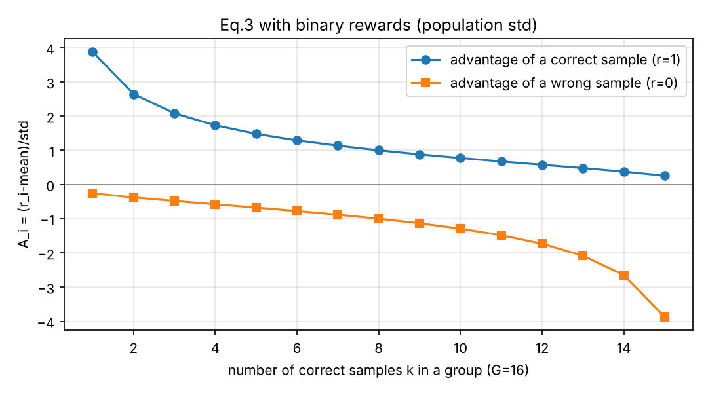
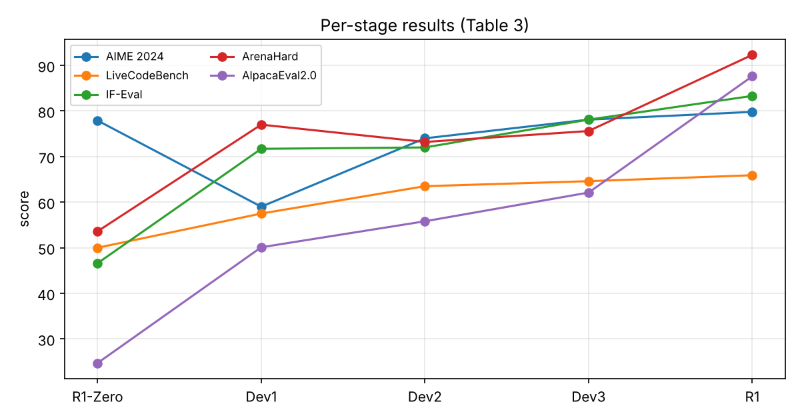
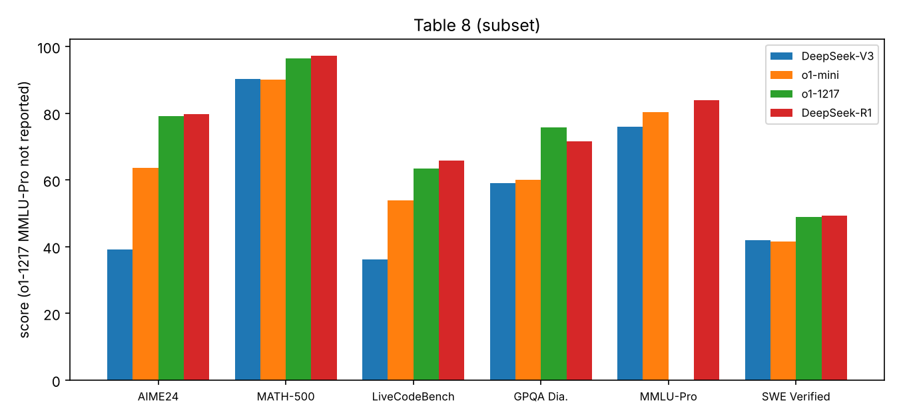
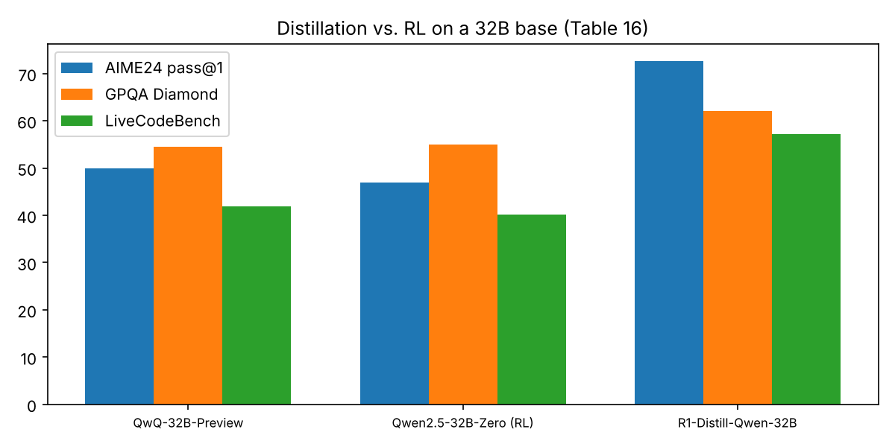

# DeepSeek-R1: Incentivizing Reasoning Capability in LLMs via Reinforcement Learning

- 링크: https://arxiv.org/abs/2501.12948
- 저자: DeepSeek-AI (Daya Guo, Dejian Yang, Haowei Zhang 외 다수)
- 발표: arXiv 2025-01-22 (v2 2026-01-04), Nature 645, 633–638 (2025) (arXiv 메타데이터의 journal_ref 기준)

> 왜 이 논문인가: Nature에 게재된 DeepSeek 기술 보고서로, "정답 검증 가능한 보상 + GRPO"만으로 긴 chain-of-thought 추론이 생긴다는 것을 보여 이후 오픈 reasoning 모델 흐름(검증 가능 보상 RL, 800K 증류 레시피)을 만든 논문이다.

## 한 줄 요약
SFT 없이 base 모델(DeepSeek-V3-Base)에 **규칙 기반 정답 보상(accuracy + format)만으로 GRPO를 대규모로 돌리면** 긴 CoT, 자기 검증, 반성("wait")이 스스로 생기고 AIME 2024 pass@1이 15.6%→77.9%로 오른다(R1-Zero). 가독성·언어 혼합·범용성 문제는 cold-start SFT → 추론 RL → 800K rejection-sampling SFT → 범용 RL의 4단계 파이프라인(R1)으로 해결하고, 같은 800K 데이터로 소형 모델에 증류하면 RL을 직접 돌리는 것보다 훨씬 좋다.

## 문제 설정
- CoT 프롬프팅(Wei et al. 2022, Kojima et al. 2022)과 post-training의 다단계 추론 궤적 학습이 성능을 올렸지만 **사람이 쓴 추론 궤적에 의존**한다. 이는 확장이 어렵고 인지적 편향을 들여오며, 모델이 사람의 사고 방식을 모방하도록 묶어 성능 상한이 사람 예시에 묶인다 (Sec. 1).
- 저자들의 가설: 사람이 정한 추론 패턴이 탐색을 제한하므로, **SFT를 건너뛰고** 최종 정답의 정오만 보상으로 주는 RL이 새로운 추론 능력을 더 잘 끌어낸다 (Sec. 1).
- 하지만 순수 RL 모델(R1-Zero)에는 문제가 있다. 가독성이 낮고, 영어·중국어가 한 CoT 안에서 섞이며, 규칙 기반 RL이 추론 과제에만 맞춰져 있어 작문·오픈 도메인 QA 같은 범용 영역은 약하다 (Sec. 1, 3). R1은 이를 보완한 모델이다.
- PPO의 비용 문제: 긴 CoT에서는 부분 응답만 보고 최종 보상을 예측하는 value model을 학습하기 어렵다. 중간에 반성·수정이 일어나 앞부분 내용이 나중에 뒤집히기 때문이다 (Supplementary A.3).

## 방법

```mermaid
flowchart LR
  B["DeepSeek-V3-Base"] -->|"규칙 보상 GRPO만 (SFT 없음)"| Z["R1-Zero"]
  Z -->|"고온(1.0) 샘플링 + 정답/가독성 필터 + V3로 정리 + 사람 검수"| C["cold-start 수천 개 long CoT"]
  B -->|"cold-start SFT"| D1["R1-Dev1"]
  C --> D1
  D1 -->|"RL 1단계 (규칙 보상 + 언어 일관성 보상)"| D2["R1-Dev2"]
  D2 -->|"rejection sampling 약 600K 추론 + 약 200K 비추론, SFT 2~3 epoch"| D3["R1-Dev3"]
  D3 -->|"RL 2단계 (규칙 + 보상모델 + 언어 보상)"| R["DeepSeek-R1"]
  R -->|"800K 샘플로 SFT만"| S["Distill-Qwen/Llama 1.5B~70B"]
```

*그림 1. DeepSeek-R1의 다단계 파이프라인. 논문 Fig. 2와 Sec. 3, Supplementary B.3 서술을 바탕으로 직접 그린 도식이며, Dev1~Dev3은 논문이 명명한 중간 체크포인트다. (직접 그림: 논문 Sec. 3 설명 기반 mermaid)*

### 2.1 GRPO (Group Relative Policy Optimization)
질문 $`q`$마다 옛 정책 $`\pi_{\theta_{old}}`$에서 $`G`$개 출력 $`\lbrace o_1,\dots,o_G\rbrace`$를 뽑고 다음을 최대화한다 (Eq. 1):

$$\mathcal J_{GRPO}(\theta)=\mathbb E\Big[\tfrac1G\sum_{i=1}^{G}\Big(\min\big(\tfrac{\pi_\theta(o_i|q)}{\pi_{\theta_{old}}(o_i|q)}A_i,\ \mathrm{clip}\big(\tfrac{\pi_\theta(o_i|q)}{\pi_{\theta_{old}}(o_i|q)},1-\varepsilon,1+\varepsilon\big)A_i\big)-\beta\thinspace\mathbb D_{KL}(\pi_\theta\Vert\pi_{ref})\Big)\Big]$$

$$\mathbb D_{KL}(\pi_\theta\Vert\pi_{ref})=\tfrac{\pi_{ref}(o_i|q)}{\pi_\theta(o_i|q)}-\log\tfrac{\pi_{ref}(o_i|q)}{\pi_\theta(o_i|q)}-1\quad(\text{Eq. 2})$$

$$A_i=\frac{r_i-\mathrm{mean}(\lbrace r_1,\dots,r_G\rbrace)}{\mathrm{std}(\lbrace r_1,\dots,r_G\rbrace)}\quad(\text{Eq. 3})$$

- $`\varepsilon`$는 PPO식 clip 비율, $`\beta`$는 KL 계수, $`\pi_{ref}`$는 참조 정책이다. KL 항은 Schulman의 비편향 추정량 형태이다.
- **핵심은 advantage**다. value model 없이, 같은 질문의 그룹 보상으로 표준화한다. 그룹 안에서 상대적으로 좋은 응답만 양의 advantage를 받는다.
- PPO와의 차이 두 가지 (Supp. A.3): (1) PPO는 GAE로 value model(정책과 비슷한 크기)을 학습해야 해서 메모리·연산 부담이 크다. (2) PPO는 토큰별 KL 페널티를 보상에 더해 누적 KL을 벌하므로 **응답 길이 증가를 암묵적으로 억제**할 수 있지만, GRPO는 KL을 손실에 직접 더한다.
- 논문은 응답당 보상이 하나이고 토큰마다 같은 $`A_i`$가 적용된다고 직접 쓰지는 않는다. 이 해석은 식에서 읽은 내 정리다(식에서 $`A_i`$는 응답 $`o_i`$ 단위).

*그림 2. 이진 보상(정답 1/오답 0)에서 Eq. 3이 만드는 advantage. 그룹 16개 중 정답이 k개일 때 정답 샘플은 $`\sqrt{(1-p)/p}`$, 오답은 $`-\sqrt{p/(1-p)}`$를 받는다($`p=k/16`$). 정답이 드문 어려운 문제일수록 정답 샘플의 양의 신호가 커지고, 거의 다 맞히는 쉬운 문제에서는 틀린 샘플이 큰 음의 신호를 받는다. 모든 샘플이 같은 보상이면 advantage는 0이다. (직접 그림: Eq. 3에서 모집단 표준편차를 가정해 계산한 값이며 논문이 표준편차 종류를 명시하지는 않는다)*

### 2.2 보상 설계와 템플릿
- 보상은 **규칙 기반**이다. Accuracy: 수학은 지정 형식(예: box) 안의 최종 답을 규칙으로 비교, 코드는 컴파일러와 테스트 케이스로 채점. Format: 추론을 `<think>...</think>`, 답을 `<answer>...</answer>`에 넣게 한다. 두 보상은 같은 가중치로 합한다 (Eq. 4, Sec. 2.2).
- 수학 보상은 정답 일치 1, 아니면 0이다. 증명 문제는 정오 판정이 어려워 제외했다 (Supp. B.3.1).
- **신경망 보상모델은 추론 과제에 쓰지 않는다.** 대규모 RL에서 reward hacking에 취약하고 재학습 비용·복잡도가 크기 때문이다 (Sec. 2.2).
- 학습 템플릿(Table 1)은 "생각 과정을 먼저 쓰고 답을 쓰라"는 구조만 강제하고 내용(반성하라, 단계적으로 풀라 등)은 일체 지시하지 않는다. 자연스러운 진화를 관찰하기 위해서이다.

### 2.3 R1-Zero 학습 설정
- 학습률 3e-6, KL 계수 0.001, 샘플링 온도 1, 질문당 16개 출력. 최대 길이는 8.2k step 이전 32,768 토큰, 이후 65,536 토큰이며 이 시점에 성능과 응답 길이가 크게 뛴다. 총 10,400 step(약 1.6 epoch).
- step당 32개 고유 질문 × 16 = 배치 512. 400 step마다 참조 모델을 최신 정책으로 교체. rollout 하나가 8,192개 출력을 만들고 16개 mini-batch로 쪼개 **inner epoch 1회**만 학습한다 (Sec. 2.1).
- 참조 정책을 주기적으로 교체하는 이유: 수천 step 동안 정책이 초기 참조에서 크게 멀어지므로 탐색 범위와 안정성을 맞추기 위함이다 (Supp. A.3).
- RL 데이터(Table 4): 수학 26K, 코드 17K(알고리즘 문제, 별도로 8K 버그 수정 문제도 포함), STEM 22K(객관식), 논리 15K(코드-IO 변환 퍼즐, 암호, 지브라 퍼즐, 24 게임 등), 일반 66K(도움됨/무해성, 모델 보상).

### 3. R1의 4단계 (Fig. 2)
1. **Cold start**: R1-Zero에서 온도 1.0으로 여러 궤적을 뽑아 정답·읽기 쉬운 형식만 남긴다(수학은 sympy로 비교, 반복·언어 혼합 규칙 필터). DeepSeek-V3로 추론과 요약을 정리하고 "생각 과정을 질문과 같은 언어로 번역하라"고 지시한 뒤 사람이 다시 검수한다. 수천 개의 데이터이다 (Supp. B.3.2). 1인칭 서술을 선호한 이유는 저자들이 "제품 지향적 동기(사용자 경험)"라고 밝힌다. 또 이런 인간적 추론 패턴은 DeepSeek이 설계한 휴리스틱일 뿐 모델이 인간 같은 지능을 가졌다는 뜻이 아니라고 명시한다.
2. **RL 1단계**: R1-Zero와 같은 규칙 보상에 **언어 일관성 보상**을 더한다. CoT 중 목표 언어 단어의 비율이다 (Eq. 7):

$$Reward_{language}=\frac{Num(Words_{target})}{Num(Words)}$$

   clip 비율은 10으로 보고되어 있고(Sec. 3.2.1), "낮으면 많은 토큰의 gradient가 잘려 성능이 나빠지고 높으면 불안정"하다고 설명한다. 이 clip 값은 PPO의 통상 0.2와 매우 다르므로 원문 그대로 인용한다.
3. **Rejection sampling + SFT**: 1단계 RL 체크포인트에서 프롬프트당 여러 응답을 뽑아 정답만 유지. 이 단계에서는 규칙으로 채점 안 되는 데이터도 넣어 DeepSeek-V3에 정답과 예측을 넣어 판정시키는 생성형 보상을 쓴다. 혼합 언어, 긴 문단, 코드 블록이 섞인 CoT는 제거한다. 추론 약 600K + 비추론(작문, 사실 QA, 번역 등, V3 SFT 데이터 재사용) 약 200K = 약 800K (Supp. B.3.3, Table 5). 파인튜닝: DeepSeek-V3-Base 2~3 epoch, 코사인 스케줄 5e-5→5e-6, 컨텍스트 32,768, 배치 128 (Supp. B.4.2).
4. **RL 2단계**: 보상을 $`Reward=Reward_{reasoning}+Reward_{general}+Reward_{language}`$로 합친다(Eq. 8–10). 추론은 규칙 보상, 일반 데이터는 보상모델+format이다. 온도는 0.7로 낮춘다(높으면 incoherent). 총 1,700 step이고 일반 데이터·선호 보상은 **마지막 400 step에만** 쓴다. 그 이상 모델 보상으로 학습하면 reward hacking이 생기기 때문이다 (Sec. 3.2.2, Supp. B.5).

### 3.1 모델 기반 보상
- 도움됨 보상모델: DeepSeek-V3(arena-hard 프롬프트 형식)로 선호 쌍을 만든다. 쌍마다 A/B 위치를 무작위로 바꿔 4번 물어 평균하고 점수 차 Δ>1인 쌍만 유지, 선택/기각 응답의 길이를 맞춰 길이 편향을 줄여 총 66,000쌍. 배치 256, 학습률 6e-6, 1 epoch, 최대 길이 8192 (Eq. 5). **도움됨은 최종 요약만** 평가하고, 무해성은 추론 과정을 포함한 전체 응답을 평가한다.
- 안전 보상모델: 106,000 프롬프트에 safe/unsafe 라벨, pairwise가 아닌 point-wise 학습 (Eq. 6).

## 실험 설정
- 벤치마크: MMLU, MMLU-Redux, MMLU-Pro, C-Eval, CMMLU, IFEval, FRAMES, GPQA Diamond, SimpleQA, C-SimpleQA, SWE-Bench Verified, Aider-Polyglot, LiveCodeBench(2024-08~2025-01), Codeforces, CNMO 2024, AIME 2024, MATH-500 (Sec. 4, Supp. D).
- 지표: 대부분 pass@1. AIME는 cons@16/cons@64(다수결)도 보고한다. 사람 대조군으로 AIME 평균 참가자, GPQA는 웹 접근이 허용된 박사급 사람을 쓴다 (Fig. 10 설명).
- 기반 모델: DeepSeek-V3-Base (총 671B, 활성 37B MoE; Table 8). 비교: Claude-3.5-Sonnet-1022, GPT-4o 0513, DeepSeek-V3, OpenAI o1-mini, o1-1217.
- 소형 모델 개발 때는 A100 GPU로 30B 모델 실험을 먼저 했다. R1-Zero는 64×8 H800 GPU로 약 198시간 학습 (Supp. B.4.4).

## 결과

### R1-Zero의 학습 곡선
- AIME 2024 pass@1이 학습 중 **15.6%→77.9%**로 오르고, 자기 일관성(cons@16) 디코딩으로 **86.7%**까지 간다. 사람 참가자 평균을 넘는다 (Fig. 1a, Sec. 2.3). 코딩 대회, 대학원 수준 생물·물리·화학 문제에서도 좋은 성능이다 (Fig. 10).
- 평균 응답 길이가 학습 내내 꾸준히 늘어난다 (Fig. 1b). 사람이 늘리라고 한 것이 아니라 보상 최적화의 결과로 "더 오래 생각"한다.
- 난이도별로 보면 MATH 레벨 1~3은 일찍 0.90~0.95에 도달해 유지되고, 레벨 4는 약 0.78→0.95, 가장 어려운 레벨 5는 약 0.55→0.90까지 오른다 (Supp. C.1, Fig. 8). 레벨 1이 레벨 3~4보다 낮게 보이는 것은 MATH-500에서 레벨 1이 43문제뿐이고 남은 오답이 1~2개(주로 기하)이기 때문이라고 저자들이 설명한다.
- 반성 단어("wait", "mistake", "however", "verify", "check" 등 사람 전문가 3명이 고른 목록)의 빈도는 학습 시작 대비 5~7배로 증가한다. "wait"는 초기에 거의 없다가 step 4000~7000에 간헐적으로 나오고 step 8000 이후 급증한다 (Supp. C.2, Fig. 9). 이것이 논문이 말하는 **"aha moment"**이다(Table 2: 중간 버전이 "Wait, wait. Wait. That's an aha moment I can flag here"라며 다시 풀이를 시작).

### 단계별 결과 (Table 3)
| 벤치마크 | R1-Zero | Dev1 | Dev2 | Dev3 | R1 |
|---|---|---|---|---|---|
| MMLU (EM) | 88.8 | 89.1 | 91.2 | 91.0 | 90.8 |
| MMLU-Pro (EM) | 68.9 | 74.1 | 83.8 | 83.1 | 84.0 |
| IF-Eval (Prompt Strict) | 46.6 | 71.7 | 72.0 | 78.1 | 83.3 |
| GPQA Diamond | 75.8 | 66.1 | 70.7 | 71.2 | 71.5 |
| SimpleQA | 30.3 | 17.8 | 28.2 | 24.9 | 30.1 |
| AlpacaEval2.0 (LC) | 24.7 | 50.1 | 55.8 | 62.1 | 87.6 |
| ArenaHard | 53.6 | 77.0 | 73.2 | 75.6 | 92.3 |
| LiveCodeBench | 50.0 | 57.5 | 63.5 | 64.6 | 65.9 |
| Codeforces (Rating) | 1444 | 1534 | 1687 | 1746 | 2029 |
| SWE Verified | 43.2 | 39.6 | 44.6 | 45.6 | 49.2 |
| Aider-Polyglot | 12.2 | 6.7 | 25.6 | 44.8 | 53.3 |
| AIME 2024 | 77.9 | 59.0 | 74.0 | 78.1 | 79.8 |
| MATH-500 | 95.9 | 94.2 | 95.9 | 95.4 | 97.3 |
| CNMO 2024 | 88.1 | 58.0 | 73.9 | 77.3 | 78.8 |

*그림 3. 파이프라인 단계별 점수 변화(5개 벤치마크 선택). Dev1에서 IF-Eval·ArenaHard가 크게 오르는 대신 AIME는 77.9→59.0으로 떨어지고, Dev2 이후 추론이 회복되며, 마지막 RL에서 AlpacaEval·ArenaHard가 급등한다. (직접 그림: 논문 Table 3의 값)*

- Dev1은 cold-start 데이터가 작아 **추론이 일부 퇴보**한다(AIME 77.9→59.0, CNMO 88.1→58.0). Dev2의 추론 RL로 코드·수학·STEM이 크게 오른다. Dev3의 대규모 비추론 SFT 데이터로 AlpacaEval, Aider가 오르고, 마지막 RL에서 AlpacaEval 2.0이 약 25%p, ArenaHard가 약 17%p 향상(Sec. 4).
- R1-Zero가 GPQA Diamond(75.8), CNMO(88.1)에서 최종 R1(71.5, 78.8)보다 높다는 점은 눈여겨볼 만하다. 가독성·범용성을 얻는 대가로 일부 추론 점수를 잃은 것이다. 논문은 이 점을 SimpleQA, GPQA 등에 대해 따로 분석하지 않는다.
- 난이도 분해(Table 14): 각 단계에서 쉬운 문제는 이미 풀리고 개선은 중간·어려운 문제에서 나온다 (Supp. E.5).

### 타 모델 비교 (Table 8, DeepSeek-V3와 R1은 671B/37B MoE)
| 벤치마크 | Claude-3.5-Sonnet | GPT-4o | DeepSeek-V3 | o1-mini | o1-1217 | DeepSeek-R1 |
|---|---|---|---|---|---|---|
| MMLU | 88.3 | 87.2 | 88.5 | 85.2 | 91.8 | 90.8 |
| MMLU-Pro | 78.0 | 72.6 | 75.9 | 80.3 | - | 84.0 |
| GPQA Diamond | 65.0 | 49.9 | 59.1 | 60.0 | 75.7 | 71.5 |
| SimpleQA | 28.4 | 38.2 | 24.9 | 7.0 | 47.0 | 30.1 |
| FRAMES | 72.5 | 80.5 | 73.3 | 76.9 | - | 82.5 |
| IF-Eval | 86.5 | 84.3 | 86.1 | 84.8 | - | 83.3 |
| AlpacaEval2.0 | 52.0 | 51.1 | 70.0 | 57.8 | - | 87.6 |
| LiveCodeBench | 38.9 | 32.9 | 36.2 | 53.8 | 63.4 | 65.9 |
| Codeforces (Rating) | 717 | 759 | 1134 | 1820 | 2061 | 2029 |
| SWE Verified | 50.8 | 38.8 | 42.0 | 41.6 | 48.9 | 49.2 |
| Aider-Polyglot | 45.3 | 16.0 | 49.6 | 32.9 | 61.7 | 53.3 |
| AIME 2024 | 16.0 | 9.3 | 39.2 | 63.6 | 79.2 | 79.8 |
| MATH-500 | 78.3 | 74.6 | 90.2 | 90.0 | 96.4 | 97.3 |
| CNMO 2024 | 13.1 | 10.8 | 43.2 | 67.6 | - | 78.8 |

*그림 4. o1 계열 및 DeepSeek-V3와의 비교(Table 8 일부). AIME24·LiveCodeBench·MATH-500에서 R1이 o1-1217과 비슷하거나 약간 높고, GPQA Diamond와 SimpleQA·Aider에서는 o1-1217이 앞선다. V3 대비 추론 벤치마크에서의 격차(AIME 39.2→79.8)가 RL의 효과다. (직접 그림: 논문 Table 8의 값, o1-1217의 MMLU-Pro는 미보고라 막대 없음)*

- Table 8 해석(Supp. D.2): R1은 수학에서 o1-1217과 동급이고 LiveCodeBench·Codeforces 같은 알고리즘 과제도 상위권이다. 엔지니어링 코딩은 Aider에서 o1-1217이 앞서고 SWE Verified에서는 비슷하다. Codeforces에서 R1은 참가자의 96.3 percentile이다 (Fig. 10). GPQA에서는 사람(웹 접근 박사급)이 R1보다 높다.
- 인간 평가: ChatbotArena(스타일 컨트롤)에서 2025-01-24 기준 R1이 OpenAI-o1, Gemini-Exp-1206과 공동 1위 (Supp. D.2, Fig. 11–12; 이 순위는 실시간으로 변하는 스냅샷이다).
- 신규 대회로 오염 점검(Table 13, Supp. E.2): AMC 12 2024 143.7, AIME 2025 11.3/15(75%), USAMO index 256.7로, 같은 표의 o1-1217(141.0 / 12.0 / 261.0), DeepSeek-V3(98.3 / 3.3 / 131.3), 사람 평균(61.7 / 6.2 / 123.7)과 비교된다. 참가자의 USAMO 진출선은 251.5이다.
- 수학 366문제(2024년 93개 대회) 분해(Fig. 17): 정수론·대수는 강하지만 기하·조합은 개선 여지가 크다 (Supp. E.3).
- **적응형 CoT 길이**(Fig. 18, Supp. E.4): 이 문제 집합에서 R1은 평균 8,793 thinking 토큰으로 pass@1 61.8%를 얻는다. 쉬운 문제는 7,000 토큰 미만, 가장 어려운 문제는 18,000 토큰 이상을 쓰고, 1+1=? 같은 극단적인 쉬운 질문은 100 토큰 미만이다. 같은 집합에서 GPT-4o 0513은 평균 711 토큰, 24.7%이다.
- 다수결 병행: AIME 2024에서 R1은 pass@1 79.8 → cons@64 86.7 → pass@64 90.0. GPT-4o는 64개 다수결로도 9.3→13.4에 그친다. 저자들의 설명은 다수결은 샘플이 독립이라 backtracking/자기 수정이 없는 모델에게는 이득이 작다는 것이다.

### 증류 (Table 15, 16; 800K 샘플 SFT만, RL 없음)
| 모델 | AIME24 pass@1 | AIME24 cons@64 | MATH-500 | GPQA Diamond | LiveCodeBench | Codeforces rating |
|---|---|---|---|---|---|---|
| GPT-4o-0513 | 9.3 | 13.4 | 74.6 | 49.9 | 32.9 | 759 |
| Claude-3.5-Sonnet-1022 | 16.0 | 26.7 | 78.3 | 65.0 | 38.9 | 717 |
| Distill-Qwen-1.5B | 28.9 | 52.7 | 83.9 | 33.8 | 16.9 | 954 |
| Distill-Qwen-7B | 55.5 | 83.3 | 92.8 | 49.1 | 37.6 | 1189 |
| Distill-Qwen-14B | 69.7 | 80.0 | 93.9 | 59.1 | 53.1 | 1481 |
| Distill-Qwen-32B | 72.6 | 83.3 | 94.3 | 62.1 | 57.2 | 1691 |
| Distill-Llama-8B | 50.4 | 80.0 | 89.1 | 49.0 | 39.6 | 1205 |
| Distill-Llama-70B | 70.0 | 86.7 | 94.5 | 65.2 | 57.5 | 1633 |

- 1.5B 모델이 수학 벤치마크에서 GPT-4o와 Claude-3.5-Sonnet을 넘는다. 단 GPQA·LiveCodeBench는 1.5B에서 둘보다 낮다(33.8, 16.9). 모델이 클수록 점수가 올라간다. 증류 학습률은 1.5B의 1e-4부터 Llama-70B의 2e-5까지 모델별로 다르고 2~3 epoch, 컨텍스트 32,768, 배치 64이다 (Table 6, Supp. B.4.3).
- 학습 비용(Table 7, H800 시간당 $`2 가정): R1-Zero 101K GPU-시간(`$202K), SFT 데이터 생성 5K($`10K), R1 41K(`$82K), 합계 147K 시간 $294K. 이 비용은 V3-Base 사전학습 비용을 포함하지 않는다. 논문 표 자체가 그렇게 명시하지는 않아 해석상 주의가 필요하다.

*그림 5. 32B 기반 모델에서 RL 직접 적용과 증류 비교(Table 16). Qwen2.5-32B에 10K step 넘게 대규모 RL을 한 Qwen2.5-32B-Zero는 QwQ-32B-Preview 수준이지만, R1에서 증류한 Distill-Qwen-32B가 모든 항목에서 크게 앞선다(AIME 72.6 vs 47.0). (직접 그림: 논문 Table 16의 값)*

## Ablation에서 알 수 있는 것
논문의 "ablation"은 표준 ablation 표보다 개별 설계 비교와 실패 보고에 가깝다.
- **GRPO vs PPO** (Supp. A.3, 아래 그림): DeepSeek-Coder-V2-Lite(16B MoE, 활성 2.4B)로 MATH에서 비교했다. PPO는 GAE의 λ에 민감하여 기본값 λ=0.95는 GRPO보다 눈에 띄게 낮다(그림상 최종 약 0.50 vs 0.55). λ=1.0으로 튜닝하면 GRPO에 근접한다. 교훈: PPO도 되지만 튜닝 비용과 value model 메모리를 더 쓴다. 즉 "GRPO가 본질적으로 더 높다"가 아니라 "덜 손이 간다"는 주장이다.

*그림 6. MATH에서 PPO(λ=0.95, λ=1.0)와 GRPO의 정확도 곡선. x축은 step(약 200~2400)이며 GRPO가 가장 위에 있고 PPO λ=1.0이 따라붙고 λ=0.95는 일관되게 낮다. (출처: 논문 Fig. 4, arXiv:2501.12948)*

- **언어 일관성 보상** (Supp. B.6, Fig. 7): R1-Distill-Qwen-7B(R1과 같은 cold start 데이터)로 실험. 보상이 없으면 학습이 진행될수록 언어 일관성이 나빠지고, 있으면 안정적으로 유지된다. 수학 성능은 비슷하지만 코딩은 약간 하락한다. 교훈: 가독성은 성능과 약간 맞바꾸는 선택이다.
- **모델 보상 RL 길이** (Supp. B.5, Fig. 6): helpful 보상모델을 쓸 때 보상은 오르는데 CodeForces 성능은 떨어지는 reward hacking이 관찰된다. 그래서 일반 데이터·모델 보상은 마지막 400 step만 쓴다.
- **RL 대상 모델 크기** (Supp. G.1): 7B dense와 16B MoE로 시작했을 때는 AIME에서 의미 있는 향상이 없었고, 길이가 늘면 반복에 빠져 긴 CoT를 활용하지 못했다. 32B dense, 230B MoE, 671B MoE에서야 순수 RL의 이득이 나타났다. 교훈: 순수 RL은 base 모델 용량에 크게 의존한다.
- **증류 vs RL** (Table 16): 위 그림과 같다. 작은 모델은 RL보다 증류가 계산 면에서도 성능 면에서도 낫다. 한편 저자들은 사람 지능의 경계를 넘으려면 더 강한 base와 더 큰 RL이 필요할 수 있다고 쓴다.
- **Qwen2-Math-7B-Zero** (Table 17): o1 공개(2024-09) 이전에 나온 Qwen2-Math-7B(2024-08)로 약 10,000 step RL. AIME 2024 22.3%, AIME 2025 18.1%로 Qwen2-Math-7B-Instruct(7.9%, 4.6%)와 GPT-4o(9.3%)를 넘는다. base가 추론 궤적 데이터에 노출되지 않았다는 점을 확인하려는 설계이다.
- **실패한 시도** (Supp. G.2): PRM은 (1) 일반 추론에서 세부 단계를 정의하기 어렵고 (2) 중간 단계의 정오 판정이 어렵고 (3) 모델 기반이라 reward hacking과 재학습 비용을 부른다. MCTS는 토큰 생성의 탐색 공간이 체스보다 훨씬 커 국소 최적에 빠지고, 세밀한 value model 학습이 어려워 자기 개선 루프가 잘 돌지 않았다.

## 한계와 비판적으로 보기
**논문이 밝힌 한계** (Sec. 6):
- 구조화 출력, 도구 사용(검색, 계산기)이 약하다. 멀티턴, 소프트웨어 엔지니어링도 약하다. SFT 데이터가 대부분 단일 턴이고, 평가가 오래 걸려 SWE에 대규모 RL을 못 썼다.
- Token efficiency: 쉬운 질문에서 overthinking이 남아 있다.
- 중국어·영어 외 질의에서 언어 혼합이 생기며 영어로 추론·답변할 수 있다.
- 프롬프트에 민감하며 few-shot이 성능을 일관되게 떨어뜨린다. zero-shot 권장.
- 순수 RL은 믿을 만한 보상이 필요하다. 작문처럼 규칙 검증이 불가능한 과제에서는 보상모델이 악용될 위험이 있어, 그런 영역은 사람이 만든 지도 데이터와 수백 step의 RL로 처리했다.
- 안전: 탈옥 위험이 있고 추론 능력이 올라 위험한 계획의 실행 가능성도 높아질 수 있으며, 공개 모델은 재파인튜닝으로 안전 장치가 풀릴 수 있다. 안전 수준은 GPT-4o(2024-05-13)와 비슷한 "보통" 수준이라고 평가한다 (Sec. 5).

**내 비판**:
- "순수 RL로 추론이 emerge했다"는 주장은 base 모델의 영향이 크다. V3-Base 사전학습 데이터에 이미 추론 궤적이 섞여 있었을 가능성을 저자들도 배제하지 못하고, 그래서 Qwen2-Math-7B(2024-08) 실험을 추가했다. 다만 그 모델의 성능(AIME 22.3%)은 R1-Zero와 큰 차이가 난다.
- "aha moment"는 특정 단어 빈도에 근거한 서술적 증거이다. 반성 단어의 증가가 실제로 정답률을 높이는 인과 메커니즘임을 분리 실험으로 보이지는 않는다. 또한 모델이 일부러 "Wait"를 출력하는 것이 진짜 자기 검증인지도 논문은 검증하지 않는다.
- 학습 중 길이 증가와 정확도 증가가 함께 오르는 것을 보였지만, 길이가 늘어서 성능이 오른 것과 길이가 부산물인 경우를 구분하는 대조는 없다. 또한 R1-Zero는 길이 제한을 32K에서 65K로 바꾼 시점(8.2k step)에서 성능이 뛰므로, "RL의 힘"과 "컨텍스트 한도 해제"의 효과가 섞여 있다.
- Table 3의 일부 퇴보(Dev1의 AIME 59.0, GPQA 66.1, SimpleQA 17.8)는 cold-start SFT가 때때로 능력을 손상시킨다는 것을 보여 준다. 최종 R1도 R1-Zero의 GPQA 75.8, CNMO 88.1을 회복하지 못한다.
- 800K 데이터의 규칙·생성형 판정(DeepSeek-V3 judge)에 의존한 부분은 재현에 필요한 세부가 공개 프롬프트 수준에 머문다. Table 8 비교는 대부분 자체 평가 설정이고 o1-1217은 일부 항목이 비어 있다.
- 비용 $294K는 V3-Base 사전학습 비용을 제외한 값이다.

## 내 생각 / 더 볼 것
- 핵심 레시피는 사실상 (1) 규칙으로 채점 가능한 문제 + (2) 그룹 상대 advantage의 간단한 policy gradient + (3) 긴 출력 허용이다. 논문의 결론도 "대규모 인간 주석이 아니라 어려운 문제, 신뢰할 수 있는 verifier, 충분한 RL 연산"이 열쇠라는 것이다 (Sec. 6). 보상 신호의 신뢰성이 병목이므로, 검증 불가능한 도메인으로 어떻게 확장할지가 열린 문제이다.
- GRPO를 직접 구현하면 value model이 없어 메모리가 줄지만, 질문당 G=16개 샘플을 모두 길게 생성해야 하므로 rollout 비용이 병목이 된다. 논문의 RL 인프라 설명(Supp. B.1)과 inner epoch 1회 설정도 이 비용 구조와 맞닿아 있다.
- 이 논문이 이후 흐름의 출발점이라는 서술은 논문 자체의 관련 연구 절에서 "후속 연구에 영감을 줬다"고 한 정도만 근거가 있다(Supp. H.3). 구체적인 후속 연구 목록은 이 문서에서 다루지 않았고, 따로 확인해 볼 만하다.
- 더 볼 것: GRPO 원 논문(Shao et al. 2024, DeepSeekMath), 테스트 타임 연산 스케일링(Snell et al.), PRM(Lightman et al. 2024), 증류 이론(Busbridge et al. 2025).
