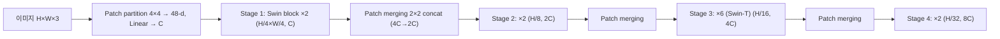
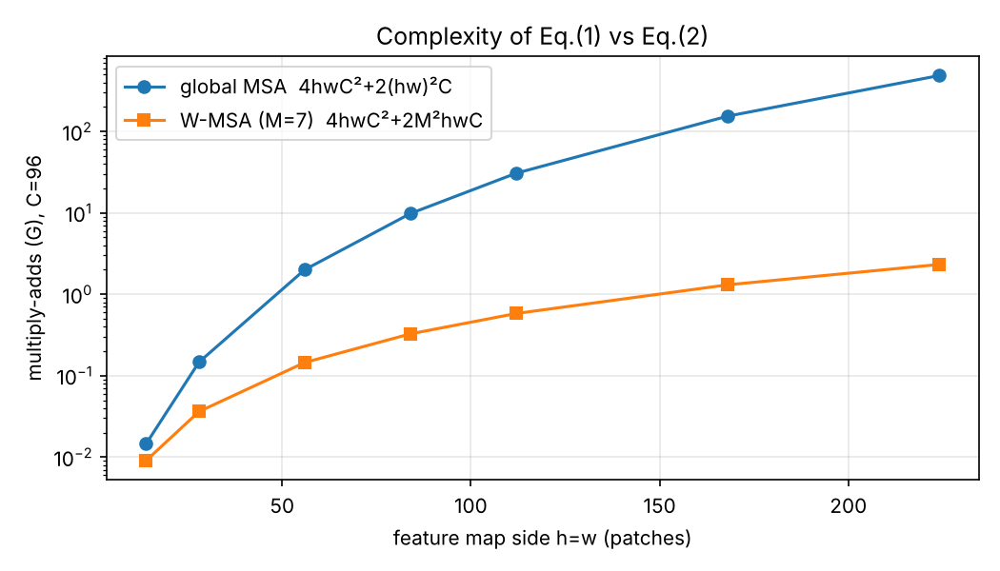
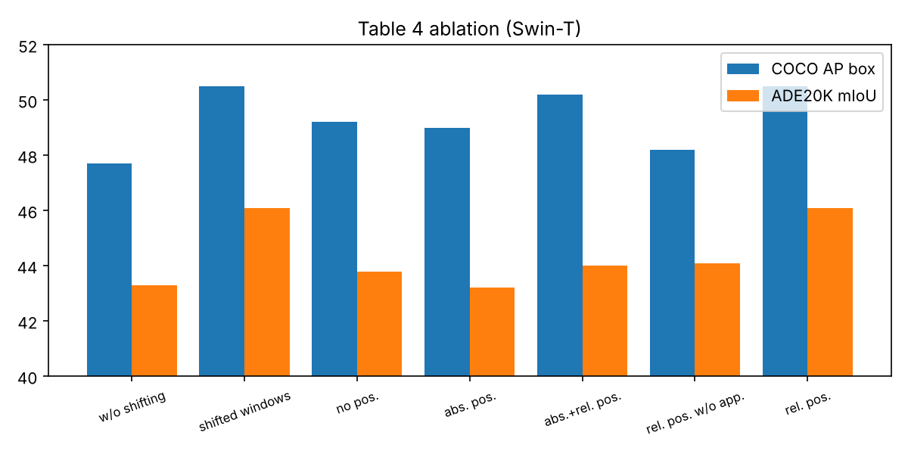
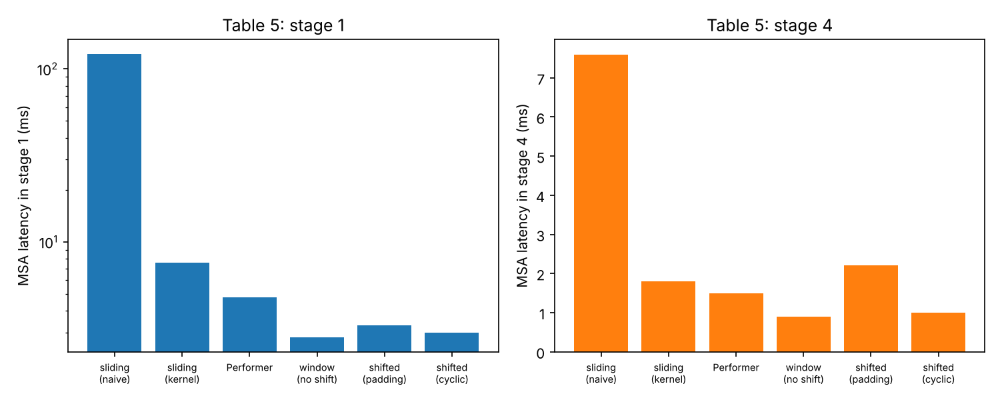

# Swin Transformer: Hierarchical Vision Transformer using Shifted Windows

- 링크: https://arxiv.org/abs/2103.14030
- 저자: Ze Liu, Yutong Lin, Yue Cao, Han Hu, Yixuan Wei, Zheng Zhang, Stephen Lin, Baining Guo (Microsoft Research Asia)
- 발표: arXiv 2021-03 (v2 2021-08-17), ICCV 2021

> 왜 이 논문인가: ICCV 2021 best paper(Marr Prize) 논문이다. ViT 이후 "Transformer를 detection/segmentation까지 쓰는 범용 backbone"의 표준이 되어, Mask2Former 등 많은 dense prediction 모델이 Swin을 기본 backbone으로 쓴다.

## 한 줄 요약
ViT의 전역 self-attention을 **고정 크기(M×M) 비중첩 window 안으로 제한**해 연산량을 이미지 크기에 선형으로 만들고, **연속된 두 블록에서 window 분할을 (⌊M/2⌋,⌊M/2⌋)만큼 밀어(shift)** window 간 정보를 섞으며, **patch merging으로 계층적(1/4→1/32) feature map**을 만들어 CNN 자리에 그대로 꽂히는 Transformer backbone을 만들었다.

## 문제 설정
- 언어 Transformer는 토큰 크기가 고정이지만 시각 요소는 **스케일 변화가 크다**. 기존 ViT 계열 모델의 토큰은 전부 고정 스케일이라 detection 같은 태스크에 맞지 않는다 (Sec. 1).
- 이미지는 텍스트보다 **픽셀 해상도가 훨씬 높다**. segmentation처럼 픽셀 단위 예측이 필요한 태스크에서 전역 self-attention은 이미지 크기에 대해 제곱 복잡도라 감당할 수 없다 (Sec. 1).
- ViT/DeiT는 단일 저해상도 feature map(보통 1/16)만 만들고 복잡도가 제곱이라 dense prediction backbone으로 부적합하다. 논문은 ViT를 dense task에 쓴 시도들도 직접 upsampling/deconvolution이라 성능이 낮았다고 지적한다 (Sec. 2).
- 기존 sliding-window self-attention(Local Relation Networks 등)은 정확도/FLOPs 균형은 약간 낫지만, **query 픽셀마다 key 집합이 달라서 메모리 접근이 비싸 실제 latency가 CNN보다 크게 느리다** (Sec. 1, 2). 같은 window 안의 모든 query가 같은 key 집합을 공유해야 하드웨어 친화적이라는 것이 핵심 관찰이다.

<p align="center"></p>

*그림 1. (a) Swin은 회색 패치를 깊은 층에서 병합해 계층적 feature map을 만들고, self-attention을 빨간 window 안에서만 계산해 이미지 크기에 선형이다. (b) 기존 ViT는 단일 저해상도 feature map을 만들고 전역 attention이라 제곱 복잡도다. (출처: 논문 Fig. 1, arXiv:2103.14030)*

## 방법



*그림 2. Swin-T의 전체 구조. 논문 Fig. 3(a)와 Sec. 3.1, Table 7을 바탕으로 직접 그린 도식이다. stage마다 해상도는 절반, 채널은 2배가 되어 ResNet/VGG와 같은 feature map 해상도(1/4, 1/8, 1/16, 1/32)를 낸다. (직접 그림: 논문 Sec. 3.1 설명 기반 mermaid)*

### 3.1 전체 구조 (patch partition과 patch merging)
- 입력 RGB를 ViT처럼 비중첩 패치로 나눈다. **패치 크기는 4×4**, 각 패치의 특징은 raw 픽셀 RGB를 이어붙인 4×4×3 = 48차원이고, linear embedding으로 임의의 차원 $`C`$로 투영한다.
- Stage 1: Swin block을 적용하되 토큰 수는 $`\frac H4\times\frac W4`$로 유지한다.
- **Patch merging**: 2×2 이웃 패치의 특징을 concat(4C)한 뒤 linear layer로 $`2C`$로 줄인다. 토큰 수는 4분의 1(해상도 2배 다운샘플)이 된다. 이 과정이 stage 2~4에서 반복되어 해상도 $`\frac H8`$, $`\frac H{16}`$, $`\frac H{32}`$를 만든다.
- 결과적으로 VGG/ResNet과 같은 해상도 pyramid를 내므로 FPN, U-Net, UperNet 같은 dense prediction head에 그대로 연결된다.
- Swin block은 표준 Transformer block에서 MSA만 window 기반 모듈로 바꾼 것이다: LayerNorm → (S)W-MSA → residual, LayerNorm → 2-layer MLP(GELU) → residual (Sec. 3.1).

### 3.2 Window 기반 self-attention과 복잡도
한 window에 $`M\times M`$ 패치가 있고 feature map이 $`h\times w`$ 패치일 때, 전역 MSA와 window MSA의 연산량은 (Eq. 1, 2; softmax 제외)

```math
\Omega(\text{MSA})=4hwC^{2}+2(hw)^{2}C,\qquad \Omega(\text{W-MSA})=4hwC^{2}+2M^{2}hwC
```

- 첫 항은 Q, K, V, 출력 projection(4개의 $`C\times C`$ 선형층), 둘째 항은 $`QK^\top`$와 attention×V다. 전역은 $`hw`$의 제곱, window 버전은 $`M`$을 고정(기본 7)하면 $`hw`$에 선형이다.
- 아래 그림은 Eq. 1, 2를 $`C=96`$, $`M=7`$로 계산한 것이다. 56×56 patch(224 입력의 stage 1)에서는 약 2.0G vs 0.14G, 224×224 patch(고해상도 입력)에서는 약 485G vs 2.3G로 벌어진다.

<p align="center"></p>

*그림 3. 전역 MSA와 W-MSA의 연산량(Eq. 1, 2)을 feature map 한 변 길이에 대해 로그 축으로 그린 것. 전역은 변 길이의 4제곱으로 커지고 W-MSA는 2제곱(= 패치 수에 선형)으로 커진다. (직접 그림: 논문 Eq. 1, 2를 C=96, M=7로 계산)*

### 3.2 Shifted window partitioning
window만 쓰면 window 사이에 연결이 없어 표현력이 제한된다. 해결: **연속한 두 블록에서 분할을 번갈아 쓴다.** 첫 블록은 좌상단에서 시작하는 일반 분할(예: 8×8 맵을 M=4인 2×2개 window로), 다음 블록은 window를 $`(\lfloor M/2\rfloor,\lfloor M/2\rfloor)`$ 픽셀만큼 이동한다 (Fig. 2). 연속 두 블록은 (Eq. 3)

```math
\hat z^{l}=\text{W-MSA}(\text{LN}(z^{l-1}))+z^{l-1},\quad z^{l}=\text{MLP}(\text{LN}(\hat z^{l}))+\hat z^{l}
```
```math
\hat z^{l+1}=\text{SW-MSA}(\text{LN}(z^{l}))+z^{l},\quad z^{l+1}=\text{MLP}(\text{LN}(\hat z^{l+1}))+\hat z^{l+1}
```

이동된 window는 이전 층의 인접한 비중첩 window들을 가로지르므로 window 간 연결이 생긴다. 이 때문에 Swin의 블록 수는 항상 짝수(2, 2, 6, 2 등)다.

<p align="center"></p>

*그림 4. 층 l(왼쪽)은 일반 window 분할, 층 l+1(오른쪽)은 분할을 이동시켜 새 window가 이전 window들의 경계를 가로지른다. 이 교번이 window 간 연결을 만들고, Table 4에서 shifting 유무가 +1.1% top-1, +2.8 box AP, +2.8 mIoU 차이를 만든다. (출처: 논문 Fig. 2, arXiv:2103.14030)*

### 3.2 Cyclic shift로 효율적 배치 계산
- 이동하면 window 수가 $`\lceil h/M\rceil\times\lceil w/M\rceil`$에서 $`(\lceil h/M\rceil+1)\times(\lceil w/M\rceil+1)`$로 늘고 일부는 $`M\times M`$보다 작아진다. 작은 window를 padding하는 단순한 방법은 2×2 → 3×3(2.25배) 같은 연산 증가를 낳는다.
- 제안: feature map을 좌상단 방향으로 **cyclic shift**하면 배치된 window 수가 일반 분할과 같다. 이때 한 batch window 안에 지도상 인접하지 않은 sub-window들이 섞이므로 **masking**으로 self-attention을 각 sub-window 안으로 제한한다. attention 후에는 역방향 cyclic shift로 되돌린다 (Fig. 4).
- 효과는 Table 5: 전체 FPS에서 padding 대비 Swin-T/S/B가 각각 13%, 18%, 18% 빠르다.

### 3.2 Relative position bias
Attention에 head별 상대 위치 bias $`B`$를 더한다 (Eq. 4):

```math
\text{Attention}(Q,K,V)=\text{SoftMax}(QK^\top/\sqrt d+B)V
```

- $`Q,K,V\in\mathbb R^{M^2\times d}`$, $`B\in\mathbb R^{M^2\times M^2}`$. 각 축의 상대 위치는 $`[-M+1, M-1]`$ 범위이므로 학습 파라미터는 작은 $`\hat B\in\mathbb R^{(2M-1)\times(2M-1)}`$이고 $`B`$의 값은 $`\hat B`$에서 꺼낸다.
- 절대 위치 임베딩을 입력에 추가하는 ViT 방식은 오히려 성능을 약간 떨어뜨려 쓰지 않는다. 사전학습에서 배운 $`\hat B`$는 bicubic interpolation으로 다른 window 크기의 fine-tuning에 쓸 수 있다.

### 3.3 모델 변형
Swin-B를 ViT-B/DeiT-B와 비슷한 크기·연산량으로 잡고, T/S/L은 각각 약 0.25×, 0.5×, 2×다 (Sec. 3.3, Table 7). $`M=7`$, head당 query 차원 $`d=32`$, MLP 확장 비율 $`\alpha=4`$는 모든 실험에서 공통이다.

| 모델 | $`C`$ | 층 수(stage 1~4) |
|---|---|---|
| Swin-T | 96 | 2, 2, 6, 2 |
| Swin-S | 96 | 2, 2, 18, 2 |
| Swin-B | 128 | 2, 2, 18, 2 |
| Swin-L | 192 | 2, 2, 18, 2 |

Swin-T의 stage별 head 수는 3, 6, 12, 24(= 채널 / 32)이고 224 입력 기준 해상도는 56², 28², 14², 7²다 (Table 7). 7×7인 stage 4에서는 window가 전체 맵과 같아 사실상 전역 attention이 된다는 점도 눈여겨볼 만하다.

## 실험 설정
- **분류**: ImageNet-1K(1.28M 학습/50K 검증, 1000 클래스), single-crop top-1. (1) 일반 학습: AdamW, 300 epoch, cosine decay, 20 epoch warm-up, batch 1024, lr 0.001, weight decay 0.05, grad clip 1. DeiT 설정을 따르며 RandAugment, Mixup, CutMix, random erasing, stochastic depth(T/S/B에 0.2/0.3/0.5)를 쓰고 repeated augmentation과 EMA는 쓰지 않는다. DeiT에서 ViT 학습 안정화에 필수였던 repeated augmentation이 Swin에서는 이득이 없었다고 명시한다. (2) ImageNet-22K(14.2M 이미지) 사전학습 90 epoch, batch 4096 후 ImageNet-1K 30 epoch fine-tuning(lr 1e-5, wd 1e-8, batch 1024) (Sec. 4.1, A2.1).
- **검출**: COCO 2017(118K train, 5K val, 20K test-dev). 비교 실험은 Cascade Mask R-CNN, ATSS, RepPoints v2, Sparse R-CNN을 mmdetection에서 같은 설정(멀티스케일 학습 짧은 변 480~800, AdamW lr 1e-4, wd 0.05, batch 16, 3x = 36 epoch)으로 돌려 **backbone만 교체**했다. 시스템 비교는 HTC++(instaboost, 더 강한 멀티스케일, 6x = 72 epoch, soft-NMS, 마지막 stage 뒤에 전역 self-attention 층 추가, ImageNet-22K 초기화)를 썼다 (Sec. 4.2, A2.2).
- **세그멘테이션**: ADE20K(150 클래스, 20K/2K/3K), UperNet(mmseg), AdamW lr 6e-5, wd 0.01, 160K iteration, 8 GPU × 2 이미지 (Sec. 4.3, A2.3).
- 베이스라인: 분류 RegNet, EfficientNet, ViT, DeiT / 검출 ResNe(X)t, DeiT, 이전 SOTA / 세그멘테이션 DeepLab v3+, OCRNet, SETR 등. DeiT는 단일 해상도 출력만 내므로 deconvolution으로 계층 feature map을 만들어 비교했다. ResNe(X)t도 SGD 대신 AdamW로 공정하게 학습했다(Table 9).

## 결과

### ImageNet-1K 분류 (Table 1)
(a) ImageNet-1K 학습만 사용:

| 모델 | 입력 | 파라미터 | FLOPs | 처리량(img/s) | top-1 |
|---|---|---|---|---|---|
| RegNetY-4G | 224² | 21M | 4.0G | 1156.7 | 80.0 |
| RegNetY-16G | 224² | 84M | 16.0G | 334.7 | 82.9 |
| EffNet-B5 | 456² | 30M | 9.9G | 169.1 | 83.6 |
| EffNet-B7 | 600² | 66M | 37.0G | 55.1 | 84.3 |
| ViT-B/16 | 384² | 86M | 55.4G | 85.9 | 77.9 |
| ViT-L/16 | 384² | 307M | 190.7G | 27.3 | 76.5 |
| DeiT-S | 224² | 22M | 4.6G | 940.4 | 79.8 |
| DeiT-B | 224² | 86M | 17.5G | 292.3 | 81.8 |
| DeiT-B | 384² | 86M | 55.4G | 85.9 | 83.1 |
| **Swin-T** | 224² | 29M | 4.5G | 755.2 | 81.3 |
| **Swin-S** | 224² | 50M | 8.7G | 436.9 | 83.0 |
| **Swin-B** | 224² | 88M | 15.4G | 278.1 | 83.5 |
| **Swin-B** | 384² | 88M | 47.0G | 84.7 | 84.5 |

(b) ImageNet-22K 사전학습:

| 모델 | 입력 | 파라미터 | FLOPs | 처리량 | top-1 |
|---|---|---|---|---|---|
| R-152x4 | 480² | 937M | 840.5G | - | 85.4 |
| ViT-B/16 | 384² | 86M | 55.4G | 85.9 | 84.0 |
| ViT-L/16 | 384² | 307M | 190.7G | 27.3 | 85.2 |
| **Swin-B** | 224² | 88M | 15.4G | 278.1 | 85.2 |
| **Swin-B** | 384² | 88M | 47.0G | 84.7 | 86.4 |
| **Swin-L** | 384² | 197M | 103.9G | 42.1 | 87.3 |

- 같은 복잡도에서 DeiT 대비 Swin-T +1.5%(81.3 vs 79.8), Swin-B 224²/384² +1.5%/+1.4%. RegNet·EfficientNet과는 "약간 더 나은 속도-정확도"로, 논문 스스로도 그 둘은 아키텍처 탐색으로 얻은 모델이고 Swin은 표준 Transformer에서 출발했다고 말한다.
- 22K 사전학습으로 Swin-B가 +1.8~1.9%. 같은 처리량(84.7 vs 85.9 img/s)에서 ViT-B 대비 +2.4%(86.4 vs 84.0), FLOPs도 더 적다.
- (Table 8, 부록) 해상도를 키우면 정확도가 오르고 속도는 내려간다. Swin-T는 224²에서 81.3, 384²에서 82.2.

### COCO 검출·인스턴스 분할 (Table 2)
(a) 프레임워크별 R-50 vs Swin-T (box AP):

| 프레임워크 | R-50 | Swin-T | 차이 | FPS (R-50 → Swin-T) |
|---|---|---|---|---|
| Cascade Mask R-CNN | 46.3 | 50.5 | +4.2 | 18.0 → 15.3 |
| ATSS | 43.5 | 47.2 | +3.7 | 28.3 → 22.3 |
| RepPointsV2 | 46.5 | 50.0 | +3.5 | 13.6 → 12.0 |
| Sparse R-CNN | 44.5 | 47.9 | +3.4 | 21.0 → 18.4 |

(b) Cascade Mask R-CNN, backbone 비교:

| Backbone | AP box | AP mask | 파라미터 | FLOPs | FPS |
|---|---|---|---|---|---|
| DeiT-S† | 48.0 | 41.4 | 80M | 889G | 10.4 |
| R50 | 46.3 | 40.1 | 82M | 739G | 18.0 |
| Swin-T | 50.5 | 43.7 | 86M | 745G | 15.3 |
| X101-32 | 48.1 | 41.6 | 101M | 819G | 12.8 |
| Swin-S | 51.8 | 44.7 | 107M | 838G | 12.0 |
| X101-64 | 48.3 | 41.7 | 140M | 972G | 10.4 |
| Swin-B | 51.9 | 45.0 | 145M | 982G | 11.6 |

(c) 시스템 수준 (test-dev): Swin-L (HTC++) 57.7 box / 50.2 mask, 멀티스케일 테스트를 더한 Swin-L (HTC++)*는 **58.7 box AP / 51.1 mask AP**로 이전 최고(Copy-paste 56.0 box, DetectoRS 48.5 mask)보다 +2.7 box AP, +2.6 mask AP 높다. 같은 HTC++에서 X101-64(52.3 box / 46.0 mask, minival)보다 Swin-B(56.4 / 49.1)가 +4.1 box, +3.1 mask 높다.

- 같은 FLOPs·파라미터에서 ResNe(X)t 대비 +3.4~4.2 box AP. DeiT-S 대비 Swin-T는 +2.5 box AP이면서 더 빠르다(15.3 vs 10.4 FPS). DeiT가 느린 이유는 제곱 복잡도 때문이다. 논문은 Swin의 FPS가 ResNe(X)t보다 낮은 점은 cuDNN 최적화 대비 PyTorch 기본 함수로 구현했기 때문이라고 설명한다.

### ADE20K 의미 분할 (Table 3)

| Backbone (UperNet) | val mIoU | 파라미터 | FLOPs | FPS |
|---|---|---|---|---|
| DeiT-S† | 44.0 | 52M | 1099G | 16.2 |
| ResNet-101 | 44.9 | 86M | 1029G | 20.1 |
| Swin-T | 46.1 | 60M | 945G | 18.5 |
| Swin-S | 49.3 | 81M | 1038G | 15.2 |
| Swin-B‡ | 51.6 | 121M | 1841G | 8.7 |
| Swin-L‡ | **53.5** (test score 62.8) | 234M | 3230G | 6.2 |

(‡: ImageNet-22K 사전학습.) 비교 대상 SETR(T-Large‡)은 50.3 mIoU, 308M 파라미터이며, Swin-S는 DeiT-S보다 +5.3 mIoU, ResNet-101보다 +4.4, ResNeSt-101보다 +2.4 높다. Swin-L은 이전 최고 대비 +3.2 mIoU.

## Ablation에서 알 수 있는 것

<p align="center"></p>

*그림 5. Swin-T에서 shifted window와 위치 인코딩 방식을 바꾼 ablation 중 COCO box AP와 ADE20K mIoU. shifting 제거(47.7 / 43.3)와 상대 위치 bias 제거(no pos. 49.2 / 43.8, abs. pos. 49.0 / 43.2)가 모두 dense prediction에서 크게 손해다. (직접 그림: 논문 Table 4의 수치)*

**Shifted window (Table 4)**: shifting 없음 vs 있음 = ImageNet top-1 80.2 → 81.3 (+1.1), COCO box/mask AP 47.7/41.5 → 50.5/43.7 (+2.8/+2.2), ADE20K mIoU 43.3 → 46.1 (+2.8). 교훈: window 간 연결은 분류보다 dense prediction에서 더 중요하고, 연결을 만드는 비용(latency)은 작다.

**위치 정보 (Table 4)**: no pos. 80.1/49.2/42.6/43.8, abs. pos. 80.5/49.0/42.4/43.2, abs.+rel. 81.3/50.2/43.4/44.0, rel. pos. 81.3/50.5/43.7/46.1 (순서: top-1/box AP/mask AP/mIoU). 상대 위치 bias는 no pos.·abs. pos. 대비 top-1 +1.2/+0.8, mIoU +2.3/+2.9. 절대 위치 임베딩은 분류를 +0.4%p 올리지만 검출(-0.2 AP)과 분할(-0.6 mIoU)은 해친다. 논문의 교훈: ViT/DeiT가 버린 translation invariance 계열 inductive bias는 범용·dense 모델에서 여전히 유리하다. 또 `rel. pos. w/o app.`(Eq. 4의 첫 번째 content 항 $`QK^\top`$ 없이 bias만)은 79.3/48.2/41.9/44.1로 크게 나빠 content 항이 필요하다.

<p align="center"></p>

*그림 6. self-attention 구현별 실제 V100 latency(Table 5). sliding window는 naive 구현이 stage 1에서 122.5 ms로 shifted(cyclic) 3.0 ms의 약 40배이고, kernel 구현도 7.6 ms다. stage 4에서는 padding(2.2 ms)이 cyclic(1.0 ms)보다 두 배 이상 느려 cyclic shift의 효과가 깊은 stage에서 크다. (직접 그림: 논문 Table 5의 수치)*

**Self-attention 구현 (Table 5, 6)**: shifted window(cyclic)는 sliding window(naive/kernel) 대비 stage 1~4에서 각각 40.8×/2.5×, 20.2×/2.5×, 9.3×/2.1×, 7.6×/1.8× 효율적이고, 전체 모델 FPS로는 Swin-T/S/B가 4.1/1.5, 4.0/1.5, 3.6/1.5배 빠르다(예: Swin-T 755 vs 183/488 FPS). 정확도는 sliding window와 거의 같다(Swin-T: 81.4/50.2/43.5/45.8 vs 81.3/50.5/43.7/46.1). Performer 대비 FPS가 소폭 빠르고(Swin-T 755 vs 638) ImageNet top-1은 +2.3(81.3 vs 79.0). 교훈: 같은 모델링 능력을 훨씬 하드웨어 친화적으로 얻을 수 있다.

**Cyclic vs padding**: padding 방식(Swin-T 670 FPS) 대비 cyclic(755 FPS)이 13% 빠르다(Table 5).

**일반화 (Table 10, 부록)**: 같은 계층 구조 + shifted window를 MLP-Mixer에 적용한 Swin-Mixer-B/D24는 81.3%로 MLP-Mixer-B/16의 76.4%보다 높고 연산량도 적다(10.4G vs 12.7G). shift를 빼면 80.3%로 떨어진다. 즉 이 설계는 attention에만 국한되지 않는다.

**ResNe(X)t 학습 옵티마이저 (Table 9)**: R50은 AdamW(46.3 box AP)가 SGD(45.0)보다 좋고 X101-64x4d는 반대로 SGD(48.8)가 AdamW(48.3)보다 약간 좋다. 논문은 일반적으로 AdamW가 낫다며 모든 ResNe(X)t 비교에 AdamW를 쓴다.

## 한계와 비판적으로 보기
- 논문이 인정하는 점: Swin의 속도는 PyTorch 기본 함수 구현이라 ResNe(X)t(cuDNN)보다 느리다. 커널 최적화는 범위 밖이라고 말한다 (Sec. 4.2). 검출에서 FPS는 R-50 대비 동일 FLOPs에서도 낮다(Table 2a).
- 최고 성능 수치(58.7 box AP)는 ImageNet-22K 사전학습, HTC++, 멀티스케일 테스트, soft-NMS, instaboost, 마지막 stage 뒤 전역 self-attention 층 등 **여러 요소가 쌓인 시스템**이다. Table 2c의 비교 대상은 사전학습 데이터와 학습 레시피가 달라 "아키텍처 단독 효과"는 Table 2a, 2b가 더 정확하다.
- 분류에서 EfficientNet 대비 우위는 "slightly better"이고, 논문의 가설(Transformer가 더 확장 가능)은 이 논문만으로 증명되지 않는다. ImageNet-1K only에서는 EffNet-B7(84.3, 55.1 img/s)과 Swin-B 384²(84.5, 84.7 img/s) 차이가 작다.
- window 크기 $`M=7`$이 기본이므로 stage 1~3의 시야는 지역적이고 stage 4에서야 전역이 된다. 장거리 의존성이 필요한 태스크에서는 shift에 의한 점진적 receptive field 확장에 의존한다. 이 점은 ablation에서 M 값 sweep이 없어 본문만으로는 판단할 수 없다(내 지적).
- 입력 크기가 window 배수가 아니면 padding이 필요하고, 해상도를 바꾸면 relative position bias를 interpolation해야 한다(Sec. 3.2).
- ablation 대부분이 Swin-T 한 규모에서만 이뤄져 큰 모델에서 shifting의 이득이 유지되는지는 확인되지 않는다.

## 내 생각 / 더 볼 것
- Swin의 핵심 교훈은 "효율"이 FLOPs가 아니라 **key 집합 공유와 메모리 접근 패턴**에서 온다는 점이다(sliding window의 naive 구현이 stage 1에서 40배 느린 Table 5). 이후 FlashAttention류의 IO-aware 설계와 같은 맥락의 관찰이다.
- 계층적 feature map + 지역 attention이라는 비교적 CNN 친화적인 inductive bias를 되살린 점이, ViT를 dense prediction에 쓰는 흐름(ViTDet 등의 plain ViT backbone 접근과 대비)과 비교해 보기에 좋다. (이후 연구에 대한 이 문장은 논문 본문이 아니라 내 지식이다.)
- 후속으로 볼 것: Swin Transformer V2(대형 모델·해상도 확장), 검출/분할 헤드가 Swin을 backbone으로 쓰는 Mask2Former, 계층 구조를 plain ViT와 비교하는 ViTDet, 그리고 MAE 같은 self-supervised 사전학습과의 결합.
- 직접 해볼 것: 7×7 window를 가진 stage 4에서 shifted window가 사실상 무의미해지는데도 블록을 짝수로 유지하는 이유와, window 크기별 정확도/latency sweep을 직접 재현해 보기.
