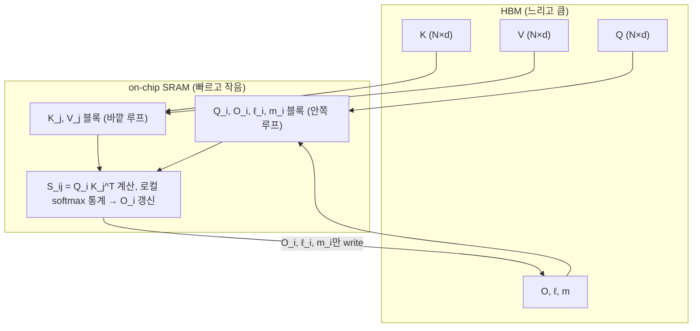
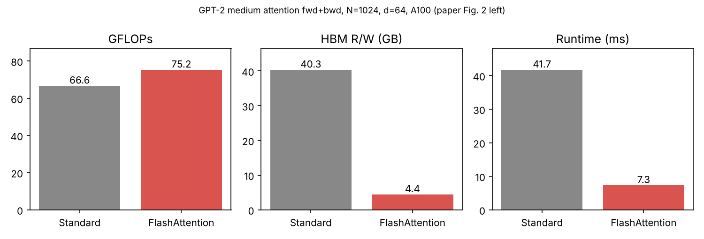
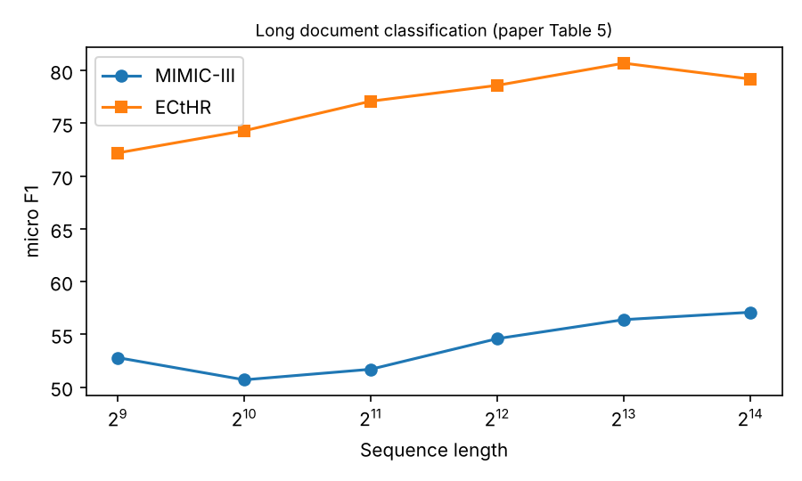

# FlashAttention: Fast and Memory-Efficient Exact Attention with IO-Awareness

- 링크: https://arxiv.org/abs/2205.14135
- 저자: Tri Dao, Daniel Y. Fu, Stefano Ermon, Atri Rudra, Christopher Ré (Stanford, University at Buffalo)
- 발표: arXiv 2022-05-27 (v2 2022-06-23), NeurIPS 2022 (Advances in Neural Information Processing Systems 35, main conference track)

> 왜 이 논문인가: NeurIPS 2022 논문으로, "FLOPs가 아니라 HBM 접근량을 줄여야 wall-clock이 빨라진다"는 IO-aware 관점을 attention 커널에 처음 체계적으로 적용했다. 이후 대부분의 LLM 학습·추론 프레임워크가 FlashAttention 계열 커널을 기본으로 쓴다.

## 한 줄 요약
Attention을 **SRAM에 들어가는 블록 단위로 타일링**하고 softmax를 **(m, ℓ) 통계로 점진적으로 합쳐서** $`N\times N`$ 행렬 $`S,P`$를 HBM에 쓰지 않으며, backward에서는 저장해 둔 통계로 블록을 **재계산**한다. 결과는 FLOPs가 오히려 늘었는데도 정확히 같은 출력(exact attention)을 내면서 HBM 접근이 $`\Theta(N^2d^2M^{-1})`$로 줄어 최대 수 배 빠르고 메모리는 시퀀스 길이에 선형이다.

## 문제 설정
- Self-attention의 시간·메모리는 시퀀스 길이 $`N`$에 제곱이라 긴 문맥이 어렵다 (Sec. 1).
- 기존 근사 attention(sparse, low-rank, 그 조합)은 FLOPs를 선형/준선형으로 줄이지만 **wall-clock 이득이 없는 경우가 많아** 널리 채택되지 못했다. 논문의 진단은 이들이 FLOPs에 집중하고 **메모리 접근(IO) 오버헤드를 무시**한다는 것이다 (Sec. 1).
- GPU 메모리 계층 (Sec. 2.1): A100은 HBM 40-80GB(대역폭 1.5-2.0TB/s)와 SM당 192KB(108개 SM)의 on-chip SRAM(대역폭 약 19TB/s 추정)을 가진다. SRAM은 HBM보다 한 자릿수 빠르지만 몇 자릿수 작다. 연산 속도가 메모리 속도보다 빠르게 늘어서 대부분의 연산이 메모리 병목이 된다.
- 연산은 **compute-bound**(큰 내부 차원의 matmul, 채널 많은 conv)와 **memory-bound**(elementwise, softmax·layernorm 같은 reduction)로 나뉜다. 흔한 가속책은 kernel fusion인데, 학습에서는 backward용 중간값을 어차피 HBM에 저장해야 해서 단순 fusion의 효과가 제한된다.
- 표준 구현 (Algorithm 0, Sec. 2.2): $`S=QK^\top`$를 HBM에 쓰고, 다시 읽어 $`P=\mathrm{softmax}(S)`$를 HBM에 쓰고, 다시 읽어 $`O=PV`$를 계산한다. $`S,P`$가 $`O(N^2)`$ 메모리이고 HBM 접근도 제곱이다. GPT-2에서 $`N=1024`$, $`d=64`$로 $`N\gg d`$. masking, dropout까지 붙으면 elementwise 패스가 더 늘어난다.
- 필요한 것: (i) 전체 입력을 보지 않고 softmax reduction을 계산하는 법, (ii) backward를 위해 $`N\times N`$ 중간 행렬을 저장하지 않는 법 (Sec. 1).

## 방법

*그림 1. FlashAttention의 데이터 흐름. 논문 Fig. 1(left)과 Algorithm 1을 바탕으로 직접 그린 도식이다. 바깥 루프가 $`K_j,V_j`$ 블록을, 안쪽 루프가 $`Q_i`$ 블록을 SRAM에 올리고, $`N\times N`$인 $`S_{ij},P_{ij}`$는 SRAM 안에서만 존재하다 사라진다.*

### 3.1 타일링: softmax를 블록 단위로 분해
수치 안정 softmax: 벡터 $`x\in\mathbb R^B`$에 대해

$$m(x)=\max_i x_i,\quad f(x)=[e^{x_1-m(x)},\dots,e^{x_B-m(x)}],\quad \ell(x)=\sum_i f(x)_i,\quad \mathrm{softmax}(x)=\frac{f(x)}{\ell(x)}$$

두 벡터 $`x^{(1)},x^{(2)}`$를 이어 붙인 $`x`$에 대해 (논문의 분해식):

$$m(x)=\max\big(m(x^{(1)}),m(x^{(2)})\big),\quad \ell(x)=e^{m(x^{(1)})-m(x)}\ell(x^{(1)})+e^{m(x^{(2)})-m(x)}\ell(x^{(2)})$$

- 따라서 블록마다 $`(m,\ell)`$만 들고 다니면 softmax를 한 블록씩 계산해 합칠 수 있다. 논문은 이를 algebraic aggregation이라 부르고 이전 연구(Rabe–Staats 등)의 softmax scaling과 같은 계열로 소개한다.
- 새 최댓값이 나오면 이전 누적값에 $`e^{m_{\text{old}}-m_{\text{new}}}`$를 곱해 보정한다는 것이 핵심이다.

### Algorithm 1 (forward) 단계별
1. SRAM 크기 $`M`$에 대해 블록 크기 $`B_c=\lceil M/4d\rceil`$, $`B_r=\min(\lceil M/4d\rceil,d)`$로 둔다. ($`K_j,V_j,Q_i,O_i`$와 $`S_{ij}`$가 SRAM에 모두 들어가도록 4로 나눈다.)
2. $`O=0`$, $`\ell=0`$, $`m=-\infty`$를 HBM에 초기화한다. $`Q`$를 $`T_r=\lceil N/B_r\rceil`$개, $`K,V`$를 $`T_c=\lceil N/B_c\rceil`$개 블록으로 나눈다.
3. 바깥 루프 $`j=1..T_c`$: $`K_j,V_j`$를 SRAM에 로드.
4. 안쪽 루프 $`i=1..T_r`$: $`Q_i,O_i,\ell_i,m_i`$ 로드. SRAM에서 $`S_{ij}=Q_iK_j^\top`$, $`\tilde m_{ij}=\mathrm{rowmax}(S_{ij})`$, $`\tilde P_{ij}=\exp(S_{ij}-\tilde m_{ij})`$, $`\tilde\ell_{ij}=\mathrm{rowsum}(\tilde P_{ij})`$를 계산.
5. 통계 갱신: $`m_i^{\text{new}}=\max(m_i,\tilde m_{ij})`$, $`\ell_i^{\text{new}}=e^{m_i-m_i^{\text{new}}}\ell_i+e^{\tilde m_{ij}-m_i^{\text{new}}}\tilde\ell_{ij}`$.
6. 출력 갱신 (line 12):

$$O_i\leftarrow \mathrm{diag}(\ell_i^{\text{new}})^{-1}\Big(\mathrm{diag}(\ell_i)\thinspace e^{m_i-m_i^{\text{new}}}\thinspace O_i+e^{\tilde m_{ij}-m_i^{\text{new}}}\thinspace\tilde P_{ij}V_j\Big)$$

   이전 $`O_i`$는 정규화된 상태이므로 $`\mathrm{diag}(\ell_i)`$를 곱해 비정규화로 되돌리고, 새 블록 기여를 더한 뒤 새 $`\ell`$로 다시 나눈다. $`O_i,\ell_i,m_i`$를 HBM에 쓴다.
- **Theorem 1**: Algorithm 1은 $`O=\mathrm{softmax}(QK^\top)V`$를 $`O(N^2d)`$ FLOPs와 입출력 외 $`O(N)`$ 추가 메모리로 정확히 계산한다 (증명은 $`j`$에 대한 귀납법, 부록 C).
- Rabe–Staats(부록 B.5)와의 차이: 그쪽은 블록별 임시 출력을 각각 두고 끝에 합치는 반면, FlashAttention은 출력을 점진 갱신해 사본이 하나뿐이다. 또 그쪽은 총 메모리 사용량 절감이 목적이라 속도는 표준과 비슷하거나 약간 느리지만, FlashAttention은 메모리 **접근 횟수**를 줄여 표준 대비 2-4× 빠르다고 논문은 말한다.

### 재계산(Recomputation)과 kernel fusion
- Backward는 보통 $`S,P`$가 필요하다. 대신 forward 끝에서 $`O`$와 통계 $`(m,\ell)`$만 저장하고, backward에서 $`Q,K,V`$ 블록을 SRAM에 올려 $`S,P`$를 다시 계산한다. 선택적 gradient checkpointing으로 볼 수 있지만, 기존 checkpointing은 속도를 메모리와 맞바꾸는 반면 여기서는 **FLOPs가 늘어도 HBM 접근이 줄어 backward도 빨라진다** (Sec. 3.1).
- 타일링 덕에 matmul → (masking) → softmax → (dropout) → matmul 전체를 **하나의 CUDA 커널**로 fuse할 수 있다. Dropout은 PRNG 상태 $`\mathcal R`$을 저장해 backward에서 같은 마스크를 재생성한다 (부록 B.3).

### 부록 B.2/B.4: Backward 유도
softmax Jacobian $`\mathrm{diag}(y)-yy^\top`$를 이용해 $`dP=dO\thinspace V^\top`$, $`dV=P^\top dO`$로부터

$$D_i=P_{i:}^\top dP_{i:}=do_i^\top o_i,\qquad dS_{ij}=P_{ij}(dP_{ij}-D_i)$$

$$dq_i=\sum_j P_{ij}(do_i^\top v_j-D_i)\thinspace k_j,\qquad dk_j=\sum_i P_{ij}(do_i^\top v_j-D_i)\thinspace q_i$$

- 핵심은 $`D_i=do_i^\top o_i`$로 쓸 수 있다는 점이다. $`P`$ 전체를 읽는 합이 $`O`$와 $`dO`$의 길이 $`d`$ 내적으로 바뀌어, $`dQ,dK,dV`$를 $`O(N)`$ 추가 메모리로 블록 단위로 계산할 수 있다.
- Algorithm 4에서 $`D_i=\mathrm{rowsum}(dO_i\circ O_i)`$를 쓰고, $`dK_j,dV_j`$는 SRAM에 누적하며 $`dQ_i`$는 HBM에서 읽고 더해 다시 쓴다. Backward도 $`O(N^2)`$ FLOPs, $`O(N)`$ 추가 메모리.

### 3.2 IO 복잡도 분석
- **Theorem 2**: $`d\le M\le Nd`$일 때 표준 attention은 $`\Theta(Nd+N^2)`$, FlashAttention은 $`\Theta(N^2d^2M^{-1})`$ HBM 접근. 증명 아이디어: $`K,V`$를 $`\Theta(M)`$씩 올리므로 $`Q`$ 전체를 $`\Theta(NdM^{-1})`$번 훑고, 한 번에 $`\Theta(Nd)`$를 읽는다. Backward도 같은 차이 (Theorem 5).
- $`d=64\text{-}128`$, $`M\approx100`$KB 정도에서는 $`d^2\ll M`$이라 접근량이 크게 줄어든다 (최대 약 9× 적음, Fig. 2).
- **Proposition 3 (하한)**: 모든 $`M\in[d,Nd]`$에서 $`o(N^2d^2M^{-1})`$ HBM 접근으로 exact attention을 계산하는 알고리즘은 없다. 즉 SRAM 크기 전 범위에서 점근적으로 최적이다.

### 3.3 Block-sparse FlashAttention
- 블록 단위 마스크 $`\tilde M\in\lbrace 0,1\rbrace^{N\times N}`$(블록 형태)가 주어지면 0인 블록을 건너뛴다. 알고리즘은 Algorithm 1과 같고 (Algorithm 5, 부록 B) HBM 접근은 **Proposition 4**: $`\Theta(Nd+N^2d^2M^{-1}s)`$, $`s`$는 0이 아닌 블록 비율.
- $`s=N^{-1/2}`$ 또는 $`N^{-1}\log N`$이면 $`\Theta(N\sqrt N)`$ 또는 $`\Theta(N\log N)`$. 실험에는 fixed butterfly 패턴을 쓴다 (임의의 sparsity를 근사할 수 있음이 알려져 있다고 논문이 인용).

## 실험 설정
- 하드웨어: 주로 8×A100 (BERT는 80GB, GPT-2는 40GB), 벤치마크는 A100 40GB 1장. 부록에서 RTX 3090, T4도 측정.
- BERT-large: MLPerf 1.1 레퍼런스 설정, LAMB lr 3.75e-3, batch 448, 최대 7100 step, FP16(Apex AMP O2), 목표 MLM 정확도 72.0%에 도달하는 시간 측정, 10회 평균 (부록 E.1).
- GPT-2 small/medium: OpenWebText, GPT-2 BPE, 검증셋 0.5%, batch 512(grad accumulation), AdamW lr 6e-4(small)/1.5e-4(medium), weight decay 0.1, 400K step, PyTorch AMP. 베이스라인은 HuggingFace와 Megatron-LM (부록 E.2).
- Long-Range Arena(LRA): 시퀀스 길이 1024-4096의 5개 태스크. Tay et al.과 Nyströmformer 재현 설정을 따르며, 재현이 안 되는 베이스라인은 원 논문 수치 중 더 좋은 쪽을 보고(베이스라인에 관대하게). Performer와 Local attention은 mixed precision 없이 실행. 전체 speedup은 5개 태스크 speedup의 기하평균 (부록 E.3).
- 장문 분류: MIMIC-III(평균 2,395 토큰, 최대 14,562)와 ECtHR(평균 2,197, 최대 49,392). 사전학습 RoBERTa의 positional embedding을 반복해 길이를 늘림 (Beltagy et al. 방식).
- Path-X(16K)와 Path-256(64K): Path-64에서 사전학습 후 positional embedding을 공간적으로 보간/복제해 전이.

## 결과

### 학습 속도 (Table 1, 2)
**Table 1. BERT-large, 목표 MLM 정확도 72.0%까지의 시간 (8×A100, 10회 평균)**

| 구현 | 학습 시간(분) |
|---|---|
| Nvidia MLPerf 1.1 | 20.0 ± 1.5 |
| FlashAttention | 17.4 ± 1.4 |

MLPerf 기록 대비 약 15% 빠르다. 이 기록 구현은 당시 가장 빨랐던 Apex FMHA를 쓴다 (부록 E.4).

**Table 2. GPT-2 (OpenWebText, 8×A100)**

| 모델 구현 | ppl | 학습 시간(속도 향상) |
|---|---|---|
| small - HuggingFace | 18.2 | 9.5일 (1.0×) |
| small - Megatron-LM | 18.2 | 4.7일 (2.0×) |
| small - FlashAttention | 18.2 | 2.7일 (3.5×) |
| medium - HuggingFace | 14.2 | 21.0일 (1.0×) |
| medium - Megatron-LM | 14.3 | 11.5일 (1.8×) |
| medium - FlashAttention | 14.3 | 6.9일 (3.0×) |

모델 정의를 바꾸지 않아 perplexity가 같고, 검증 곡선이 HuggingFace 구현과 거의 겹친다 (부록 Fig. 4). 본문 텍스트와 초록은 "최대 3×"라고 쓰는데 Table 2의 small 행은 3.5×로 표기되어 있다. 같은 논문 안에서 표현이 조금 다르다는 점은 감안해서 읽어야 한다.

### 메모리 접근 vs FLOPs (Fig. 2 left)

*그림 2. GPT-2 medium(N=1024, d=64, 16 head, batch 64, A100)에서 attention forward+backward. FlashAttention은 FLOPs가 66.6→75.2 GFLOPs로 늘었지만 HBM 읽기/쓰기는 40.3→4.4GB, 런타임은 41.7→7.3ms로 줄었다. 런타임을 결정하는 것은 FLOPs가 아니라 HBM 접근임을 보여준다. (직접 그림: 논문 Fig. 2 left에 보고된 수치)*

### 하드웨어별 speedup (부록 E.5)
- A100(batch 8, d=64, 12 head): 대체로 2-4× 속도 향상, dropout과 masking이 있을 때 kernel fusion 덕에 더 크다.

*그림 3. A100에서 PyTorch 표준 attention 대비 FlashAttention 속도 향상(시퀀스 길이별, mask/dropout 조합별). 길이가 길수록, 그리고 fused되는 elementwise 연산이 많을수록 이득이 커진다. (출처: 논문 Fig. 5, arXiv:2205.14135)*

- RTX 3090(batch 12, 12 head): 2.5-4.5×. 대역폭이 A100(1.5TB/s)보다 낮은 약 900GB/s라서 IO 절감 효과가 더 크다.

*그림 4. RTX 3090에서의 속도 향상. 메모리 대역폭이 낮은 GPU일수록 HBM 접근을 줄이는 이득이 크다는 IO 분석과 맞는 결과다. (출처: 논문 Fig. 7, arXiv:2205.14135)*

- A100, d=128: 블록이 SRAM을 더 차지해 블록 크기를 줄여야 하므로 전체 속도 향상은 줄지만, causal mask(블록의 절반이 건너뛰어짐)에서는 최대 3×.
- T4: SRAM이 A100보다 작아 블록이 작아지고 speedup이 줄어든다. 논문은 이것이 Sec. 3.2의 IO 복잡도($`M^{-1}`$ 의존)와 일치한다고 해석한다. T4는 추론용으로 흔해서 forward 전용 결과도 함께 보고.

*그림 5. T4에서 forward+backward 속도 향상(위 패널은 Fig. 8 top). SRAM이 작아 이득이 A100/3090보다 작다. $`M`$이 작아질수록 $`\Theta(N^2d^2M^{-1})`$ 접근량이 늘어난다는 분석과 연결된다. (출처: 논문 Fig. 8, arXiv:2205.14135)*

### Apex FMHA와의 비교 (Table 7, 부록 E.4)
Apex FMHA는 길이 ≤512, d=64, A100 전용으로 어텐션 행렬을 forward에서 저장한다.

| 길이 | 128 | 256 | 512 |
|---|---|---|---|
| FMHA fwd (ms) | 0.10 | 0.29 | 1.14 |
| FlashAttention fwd | 0.08 | 0.22 | 0.81 |
| FMHA bwd | 0.17 | 0.52 | 1.81 |
| FlashAttention bwd | 0.20 | 0.53 | 2.00 |
| FMHA fwd+bwd | 0.27 | 0.81 | 2.95 |
| FlashAttention fwd+bwd | 0.28 | 0.75 | 2.81 |

Forward는 약간 빠르고 backward는 약간 느리다(재계산 비용). 합계로는 길이 128에서 약 4% 느리고, 256에서 8%, 512에서 5% 빠르다. 즉 짧은 시퀀스에서는 이득이 작고, 이득은 긴 시퀀스와 메모리에서 나온다.

### Long-Range Arena (Table 3)

| 모델 | ListOps | Text | Retrieval | Image | Pathfinder | Avg | Speedup |
|---|---|---|---|---|---|---|---|
| Transformer | 36.0 | 63.6 | 81.6 | 42.3 | 72.7 | 59.3 | - |
| FlashAttention | 37.6 | 63.9 | 81.4 | 43.5 | 72.7 | 59.8 | 2.4× |
| Block-sparse FlashAttention | 37.0 | 63.0 | 81.3 | 43.6 | 73.3 | 59.6 | 2.8× |
| Linformer | 35.6 | 55.9 | 77.7 | 37.8 | 67.6 | 54.9 | 2.5× |
| Linear Attention | 38.8 | 63.2 | 80.7 | 42.6 | 72.5 | 59.6 | 2.3× |
| Performer | 36.8 | 63.6 | 82.2 | 42.1 | 69.9 | 58.9 | 1.8× |
| Local Attention | 36.1 | 60.2 | 76.7 | 40.6 | 66.6 | 56.0 | 1.7× |
| Reformer | 36.5 | 63.8 | 78.5 | 39.6 | 69.4 | 57.6 | 1.3× |
| Smyrf | 36.1 | 64.1 | 79.0 | 39.6 | 70.5 | 57.9 | 1.7× |

Exact attention인 FlashAttention이 정확도를 유지하며 2.4×, block-sparse가 2.8×로 검토된 근사 기법 중 가장 빠르다. 같은 표의 근사 방법들은 Linformer처럼 속도가 비슷해도 정확도가 4점 이상 낮은 경우가 있다. 다만 부록 E.3 설명처럼 LRA 정확도는 튜닝에 크게 의존한다.

### 긴 문맥이 만드는 품질 (Table 4, 5, 6)
**Table 4. GPT-2 small, Megatron 1K 대비**

| 구현 | 문맥 | ppl | 학습 시간 (속도) |
|---|---|---|---|
| Megatron-LM | 1k | 18.2 | 4.7일 (1.0×) |
| FlashAttention | 1k | 18.2 | 2.7일 (1.7×) |
| FlashAttention | 2k | 17.6 | 3.0일 (1.6×) |
| FlashAttention | 4k | 17.5 | 3.6일 (1.3×) |

문맥을 4배로 늘려도 Megatron 1K보다 약 30% 빠르고 ppl이 0.7 좋다.

**Table 5. 장문 분류 micro F1 (시퀀스 길이별)**

| 길이 | 512 | 1024 | 2048 | 4096 | 8192 | 16384 |
|---|---|---|---|---|---|---|
| MIMIC-III | 52.8 | 50.7 | 51.7 | 54.6 | 56.4 | 57.1 |
| ECtHR | 72.2 | 74.3 | 77.1 | 78.6 | 80.7 | 79.2 |

*그림 6. Table 5를 그린 것. MIMIC-III는 길이 16K에서 512 대비 +4.3, ECtHR은 8K에서 +8.5로 오르지만 MIMIC은 1024에서 먼저 내려가고 ECtHR은 16K에서 8K보다 떨어진다. 단조 증가가 아니다. (직접 그림: 논문 Table 5의 수치)*

논문은 두 데이터셋 차이를 분포 이동(의료 전문 텍스트가 길이 분포 변화에 더 민감할 수 있음)으로 추측만 한다. 초록의 "6.4 points"는 두 데이터셋 개선의 요약 표현이다.

**Table 6. Path-X(16K), Path-256(64K)**

| 모델 | Path-X | Path-256 |
|---|---|---|
| Transformer, Linformer, Linear, Performer, Local, Reformer, SMYRF | ✗ | ✗ |
| FlashAttention | 61.4 | ✗ |
| Block-sparse FlashAttention | 56.0 | 63.1 |

✗는 OOM이거나 무작위 수준이다. 순수한 Transformer가 Path-X에서 무작위를 넘은 첫 사례이며, Path-256은 block-sparse로만 가능했다. 각주: Path-256은 더 긴 시퀀스지만 경로가 상대적으로 짧아 정확도를 얻기 더 쉽다. 또한 Path-X는 best checkpoint를 200 epoch 더 fine-tune하면 FlashAttention에서 약 4점이 오르고, 그 뒤엔 과적합이 시작된다고 부록 E.3이 밝힌다.

### 벤치마크 (Fig. 3, Sec. 4.3)
- 런타임: exact attention 대비 최대 3×(PyTorch). 근사/sparse 방법은 선형으로 늘지만 FlashAttention이 짧은 시퀀스에서는 더 빠르고, **512-1024 사이에서 일부 근사 방법과 교차**한다. Block-sparse FlashAttention은 모든 길이에서 알려진 exact/sparse/approximate 구현 중 가장 빠르다.
- 메모리: FlashAttention과 block-sparse가 선형이고 exact 베이스라인 대비 최대 20×. Linformer 외에는 64K 전에 A100에서 OOM이며, Linformer 대비도 2× 효율적.

## Ablation에서 알 수 있는 것
이 논문은 전형적인 구성요소 ablation 표가 없고, Sec. 3.2의 분석 실험(Fig. 2, 수치는 막대/곡선으로만 제시)이 그 역할을 한다.
- **FLOPs vs HBM 접근 (Fig. 2 left)**: 재계산으로 FLOPs +13%(66.6→75.2) 해도 HBM 접근 −89%(40.3→4.4GB)로 런타임이 41.7→7.3ms(약 5.7×). 교훈: memory-bound 연산에서는 FLOPs 증가를 감수하고 IO를 줄이는 것이 이득이다.
- **블록 크기 $`B_c`$ (Fig. 2 middle)**: 블록이 커지면 입력을 훑는 횟수가 줄어 HBM 접근과 forward 런타임이 줄지만, 256 이후에는 연산 등 다른 요인이 병목이 되고 더 큰 블록은 SRAM에 맞지 않는다. 교훈: 이득은 SRAM 용량에 의해 상한이 정해진다. T4와 d=128 결과도 같은 방향이다.
- **Sparsity (Fig. 2 right)**: 시퀀스 4K에서 block-sparse FlashAttention의 런타임은 sparsity에 비례해 줄어든다 (Proposition 4와 일치).
- **재계산 자체의 비용 (Table 7)**: FMHA는 어텐션 행렬을 저장해 backward가 약간 더 빠르다(길이 512에서 1.81 vs 2.00ms). 메모리 절감과 맞바꾼 약간의 backward 손해다.

## 한계와 비판적으로 보기
**논문이 밝힌 한계 (Sec. 5)**
- 새 attention 변형마다 CUDA 커널을 새로 써야 하고, GPU 아키텍처 간 이식도 어렵다. 그래서 PyTorch 같은 고수준 언어로 쓰고 IO-aware 구현으로 컴파일하는 방법(Halide 같은)이 필요하다고 본다.
- Multi-GPU에서는 GPU 간 전송까지 포함한 IO 분석이 추가로 필요하다. 이 논문의 최적성은 단일 GPU 기준이다.
- IO-aware 접근을 attention 밖(모든 레이어가 HBM을 건드린다)으로 확장하자는 제안 (부록 D).

**내 비판**
- 최적성(Proposition 3)은 "모든 $`M`$ 범위에서"라는 조건부이고, 논문 스스로도 $`M`$으로 매개화된 하한은 future work로 남긴다. 실제 하드웨어에서 상수 인자(레지스터, warp 스케줄링, Tensor Core 활용)는 이 분석 밖이다.
- 속도 수치는 PyTorch 표준 구현 대비가 많아서 "얼마나 순진한 베이스라인이었는가"에 크게 좌우된다. 최적화된 Apex FMHA와의 비교(Table 7)는 길이 128에서 지고, 이득은 5-8% 수준이다.
- Table 2의 end-to-end 이득(3.0-3.5× vs HuggingFace)에는 attention 외의 구현 차이(Megatron은 1.8-2.0×)도 섞여 있어, attention 커널만의 기여를 분리하려면 Megatron 대비 수치(1.7×)를 보는 편이 안전하다.
- Path-X/Path-256 "첫 성공"은 사전학습 + positional embedding 전이 + 추가 fine-tune 같은 레시피에 의존하며, 정확도 61.4%/63.1%는 절대적으로 높지는 않다.
- Block-sparse 패턴(butterfly)은 고정이고 데이터에 의존하지 않는다. 학습 가능한 sparse 패턴과의 결합은 다루지 않는다.

## 내 생각 / 더 볼 것
- 가장 큰 기여는 알고리즘 자체보다 **분석 틀**이다. "복잡도 = FLOPs"를 버리고 메모리 계층 사이의 이동량을 세는 관점은 attention 밖의 연산(norm, 활성화 fusion, 양자화 커널, MoE 라우팅)에도 그대로 통한다. 부록 D가 이를 예고한다.
- 같은 아이디어 위에서 나온 후속 작업은 논문 본문이 아니라 내 기억에 의존하므로 단정하지 않고 "더 볼 것"으로만 적는다: FlashAttention-2(작업 분할과 병렬화 개선), 이후 세대 GPU에 맞춘 버전들, 추론용 KV cache를 다루는 PagedAttention·flash-decoding 계열. 읽기 전에 각 논문의 abstract가 아니라 본문을 확인할 것.
- 직접 해볼 것: numpy로 Algorithm 1의 online softmax 갱신을 구현해 표준 attention과 출력이 일치하는지(부동소수점 오차 수준) 확인하고, 블록 크기별 "HBM 읽기 횟수"를 세어 $`\Theta(N^2d^2M^{-1})`$를 눈으로 보기.
- 관련해서 이 로그의 로드맵에 있는 "FlashAttention (IO-aware tiling)" 개념 정리는 위 구현 실험을 코드와 함께 다루기 좋은 주제다.
