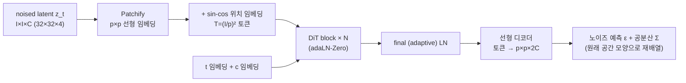
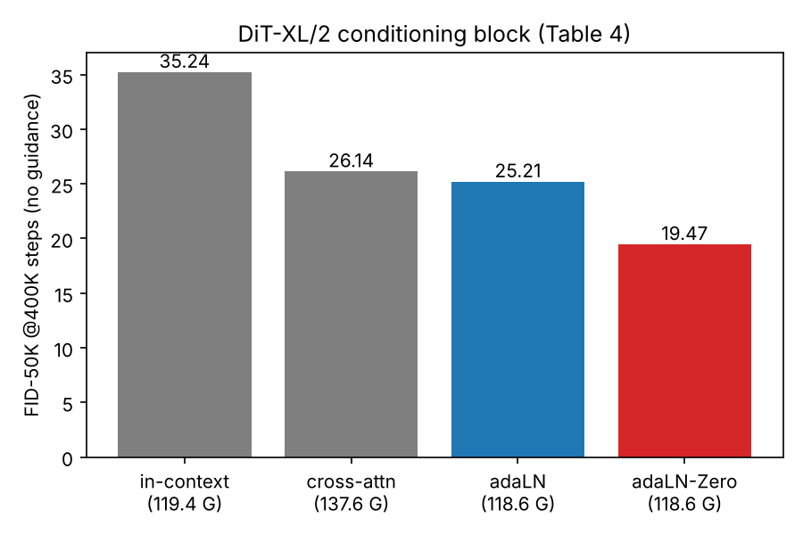
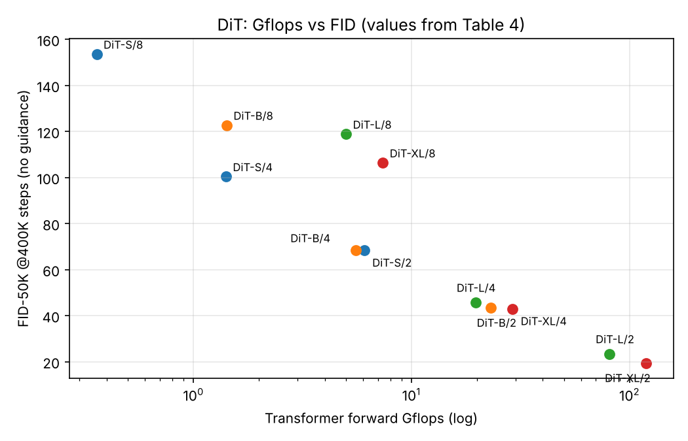

# Scalable Diffusion Models with Transformers (DiT)

- 링크: https://arxiv.org/abs/2212.09748
- 저자: William Peebles (UC Berkeley), Saining Xie (New York University) — 연구는 Meta AI FAIR 인턴십 중 수행
- 발표: arXiv 2022-12-19 (v2 2023-03-02), ICCV 2023

> 왜 이 논문인가: ICCV 2023에 실린 논문으로, diffusion의 backbone이 U-Net이어야 한다는 관행을 깨고 "ViT 그대로 + 조건 주입 방식만 손본" 모델이 ImageNet 256×256에서 당시 최고 FID를 냈다. 이후 대규모 이미지·비디오 diffusion 모델들이 transformer backbone을 채택하는 흐름의 출발점이 됐다.

## 한 줄 요약
VAE latent를 **p×p 패치로 잘라 토큰으로 만들고**, 표준 ViT 블록에서 LayerNorm의 scale/shift/residual gate를 **timestep+class 임베딩으로 회귀(adaLN-Zero)** 하는 것만 바꿔 diffusion backbone으로 쓴다. 모델 품질은 파라미터 수가 아니라 **forward Gflops(깊이·너비 + 토큰 수)** 와 강하게 상관하고, DiT-XL/2(118.6 Gflops)는 classifier-free guidance와 함께 ImageNet 256×256에서 FID 2.27을 기록했다.

## 문제 설정
- 이미지 diffusion 모델은 거의 전부 convolutional U-Net을 backbone으로 쓴다. Ho et al.(DDPM)이 PixelCNN++에서 물려받은 구조(ResNet 블록 + 낮은 해상도에서만 self-attention)이고, Dhariwal & Nichol이 adaptive norm 등을 ablation했지만 큰 틀은 그대로다 (Sec. 1).
- 반면 언어·비전·RL 등 다른 영역은 transformer로 통일되며, 모델 크기·데이터·compute에 따라 예측 가능하게 좋아지는 scaling 성질과 학습 레시피를 공유한다 (Sec. 1, 2).
- 질문: **U-Net의 inductive bias가 diffusion에 정말 필요한가?** 순수 transformer로 바꾸면 scaling이 되는가? 저자들은 "복잡한 새 구조"가 아니라 ViT 모범 사례를 최대한 그대로 따르는 것을 원칙으로 삼는다 (Sec. 3.2).
- 복잡도를 재는 기준도 문제다. 이미지 생성 문헌은 흔히 파라미터 수를 쓰지만, 해상도 등을 반영하지 못하므로 이 논문은 이론적 forward **Gflops**를 복잡도 척도로 쓴다 (Sec. 2).
- 연산량을 현실적으로 만들기 위해 pixel 공간이 아니라 **Latent Diffusion Model(LDM)** 틀 안에서 실험한다. 같은 해상도에서 ADM은 1120 Gflops(256×256), LDM-4는 104 Gflops 수준이라 아키텍처 탐색의 출발점으로 적합하다 (Sec. 3.1, Table 6).

<p align="center"></p>

*그림 1. 클래스 조건부 DiT-XL/2가 ImageNet에서 생성한 샘플. 논문 Fig. 1은 512×512와 256×256 모델의 샘플을 함께 보여 준다(여기서는 그중 한 패널). 객체 질감·배경까지 자연스럽다는 것이 "U-Net 없이도 된다"의 정성적 증거이고, 정량 결과는 Table 2·3에 있다. (출처: 논문 Fig. 1, arXiv:2212.09748)*

## 방법

### 3.1 준비물: diffusion, CFG, LDM
**Diffusion 정식화.** 순방향 과정은 $`q(x_t\mid x_0)=\mathcal N(x_t;\sqrt{\bar\alpha_t}\thinspace x_0,(1-\bar\alpha_t)\mathbf I)`$이고, 재매개변수화로 $`x_t=\sqrt{\bar\alpha_t}\thinspace x_0+\sqrt{1-\bar\alpha_t}\thinspace\epsilon_t`$, $`\epsilon_t\sim\mathcal N(0,\mathbf I)`$이다. 역과정 $`p_\theta(x_{t-1}\mid x_t)=\mathcal N(\mu_\theta(x_t),\Sigma_\theta(x_t))`$는 변분 하한으로 학습하며, $`\mu_\theta`$를 노이즈 예측망 $`\epsilon_\theta`$로 바꾸면

```math
\mathcal L_{simple}(\theta)=\Vert \epsilon_\theta(x_t)-\epsilon_t\Vert_2^2
```

가 된다. 다만 공분산 $`\Sigma_\theta`$까지 학습하려면 전체 $`\mathcal D_{KL}`$ 항이 필요하므로 Nichol & Dhariwal 방식을 따른다: **$`\epsilon_\theta`$는 $`\mathcal L_{simple}`$로, $`\Sigma_\theta`$는 전체 $`\mathcal L`$로** 학습한다. 그래서 DiT의 출력은 노이즈 예측과 (대각) 공분산 예측 두 가지다.

**Classifier-free guidance(CFG).** 조건 $`c`$에 대해 $`\nabla_x\log p(c\mid x)\propto\nabla_x\log p(x\mid c)-\nabla_x\log p(x)`$이고, 모델 출력을 score로 보면

```math
\hat\epsilon_\theta(x_t,c)=\epsilon_\theta(x_t,\varnothing)+s\cdot\big(\epsilon_\theta(x_t,c)-\epsilon_\theta(x_t,\varnothing)\big),\quad s>1
```

이다 ($`s=1`$이면 일반 샘플링). $`\varnothing`$은 학습 중 $`c`$를 무작위로 떨어뜨려 얻는 학습된 "null" 임베딩이다.

**LDM.** 인코더 $`E`$(고정)로 $`z=E(x)`$를 만들고 $`z`$ 공간에서 diffusion을 학습, 샘플링 후 디코더로 $`x=D(z)`$. 이 논문은 Stable Diffusion의 off-the-shelf **convolutional VAE**(다운샘플 8배)를 쓰므로 파이프라인은 "conv VAE + transformer DDPM"의 하이브리드다. 256×256×3 이미지는 32×32×4 latent가 된다 (Sec. 3.1, 4).

### 3.2 DiT 구조
전체 구조는 Fig. 3(아래 그림 2 참고)에 있다. 설계 공간은 **패치 크기, 블록 종류, 모델 크기**의 세 축이다.



*그림 2. DiT의 전체 데이터 흐름. 논문 Fig. 3(left)·Fig. 4와 Sec. 3.2의 서술을 바탕으로 직접 그린 도식이다. 패치 크기 $`p`$가 토큰 수 $`T=(I/p)^2`$를 정하고, 조건($`t`$, $`c`$)은 입력 토큰이 아니라 각 블록의 정규화 층을 통해 들어간다.*

#### Patchify
- 입력 latent $`I\times I\times C`$를 $`p\times p`$ 패치로 나눠 각각 선형 임베딩하면 길이 $`T=(I/p)^2`$, 차원 $`d`$의 토큰열이 된다. 여기에 ViT의 sine-cosine 위치 임베딩을 모든 토큰에 더한다.
- $`p`$를 절반으로 줄이면 $`T`$는 4배가 되어 Gflops가 **최소 4배** 늘지만, 파라미터 수는 의미 있게 변하지 않는다 (오히려 약간 줄기도 한다). 설계 공간에 $`p=2,4,8`$을 넣었다 — 이것이 "파라미터를 고정한 채 compute만 바꾸는" 실험의 핵심 손잡이다.

#### DiT 블록: 조건 주입 4종
이미지 토큰 외에 timestep $`t`$, class $`c`$ 같은 조건을 어떻게 넣느냐가 핵심 설계 선택이다.

1. **In-context conditioning**: $`t`$, $`c`$의 임베딩을 토큰 2개로 시퀀스에 붙인다(ViT의 cls 토큰과 유사). 블록 수정이 필요 없고 마지막 블록 뒤에 제거한다. 추가 Gflops는 거의 없다.
2. **Cross-attention block**: $`t`$, $`c`$ 임베딩을 길이 2의 별도 시퀀스로 두고, self-attention 뒤에 multi-head cross-attention을 추가한다(원조 Transformer·LDM의 class 조건과 유사). 추가 Gflops가 가장 커서 약 **15% 오버헤드**다.
3. **Adaptive layer norm (adaLN)**: 블록 안의 LayerNorm을 adaptive norm으로 바꾼다. 차원별 scale $`\gamma`$와 shift $`\beta`$를 직접 파라미터로 두지 않고 **$`t`$와 $`c`$ 임베딩의 합에서 회귀**한다. Gflops 추가가 가장 작고, 모든 토큰에 같은 함수를 적용하도록 제한되는 유일한 방식이다.
4. **adaLN-Zero**: adaLN에 더해, residual 연결 직전에 곱해지는 차원별 scale $`\alpha`$도 같은 MLP에서 회귀하고, 그 MLP가 **$`\alpha`$에 대해 0 벡터를 출력하도록 초기화**한다. 그러면 초기 상태에서 블록 전체가 항등 함수가 된다. ResNet의 마지막 BN $`\gamma=0`$ 초기화(Goyal et al.)와 diffusion U-Net의 마지막 conv 0 초기화에서 온 아이디어다.

구현 디테일(Appendix A): timestep은 256차원 frequency 임베딩 → 2층 MLP(은닉 크기 = transformer hidden, SiLU)로 만들고, 각 adaLN 층은 $`t`$·$`c`$ 임베딩 합을 SiLU → 선형층에 통과시켜 adaLN이면 은닉 크기의 4배, adaLN-Zero이면 6배 개의 출력을 낸다($`\gamma,\beta,\alpha`$가 attention 쪽과 MLP 쪽에 각각 필요하므로 6개). 코어 transformer의 비선형은 GELU(tanh 근사)다.

아래는 위 서술을 정리한 adaLN-Zero 블록의 의사코드다(논문에 코드가 있는 것은 아니며, 텍스트 설명을 옮긴 것).

```text
c_emb = t_emb + class_emb                       # 조건 임베딩
(γ1, β1, α1, γ2, β2, α2) = Linear(SiLU(c_emb))  # 6×d, 마지막 Linear는 0으로 초기화
h = x + α1 * Attn( scale_shift(LN(x), γ1, β1) )
y = h + α2 * MLP ( scale_shift(LN(h), γ2, β2) )
# 초기에 α=0 이므로 y == x  (블록이 항등 함수)
```

#### 모델 크기 (Table 1)
ViT 설정을 따라 S/B/L을 쓰고 가장 큰 XL을 새로 정의한다. $`N`$, $`d`$, head 수를 함께 키운다.

| 모델 | 층 수 $`N`$ | 은닉 크기 $`d`$ | Heads | Gflops (I=32, p=4) |
|---|---|---|---|---|
| DiT-S | 12 | 384 | 6 | 1.4 |
| DiT-B | 12 | 768 | 12 | 5.6 |
| DiT-L | 24 | 1024 | 16 | 19.7 |
| DiT-XL | 28 | 1152 | 16 | 29.1 |

패치 크기까지 곁들여 0.3~118.6 Gflops의 범위를 덮는다. 파라미터 수는 Table 4 기준 S 약 33M, B 약 130M, L 약 458M, XL 약 675M이며 VAE(84M)는 제외된 수치다.

#### Transformer decoder
마지막 블록 뒤에 (adaLN 계열이면 adaptive) LayerNorm을 적용하고, 각 토큰을 **선형층 하나로 $`p\times p\times 2C`$ 텐서**로 디코딩한다(노이즈 $`C`$채널 + 공분산 $`C`$채널). 토큰을 원래 공간 배치로 재배열하면 입력과 같은 모양의 예측이 나온다. 마지막 선형층은 0으로 초기화한다.

## 실험 설정
- **데이터**: ImageNet, 클래스 조건부 256×256 및 512×512 (Sec. 4).
- **학습**: AdamW, 고정 learning rate $`1\times10^{-4}`$, weight decay 없음, batch size 256, 데이터 증강은 좌우 반전뿐. ViT에서 흔한 **LR warmup과 정규화가 필요 없었고**, loss spike 없이 모든 크기에서 학습이 안정적이었다고 보고한다. 가중치 EMA 감쇠 0.9999를 쓰고 보고 수치는 모두 EMA 모델이다. 하이퍼파라미터는 ADM에서 거의 그대로 가져왔고 LR·schedule·Adam $`\beta`$·weight decay는 튜닝하지 않았으며, 모든 모델 크기·패치 크기에 동일하게 적용했다.
- **Diffusion**: ADM 설정 그대로 $`t_{max}=1000`$, 선형 분산 스케줄 $`1\times10^{-4}\to2\times10^{-2}`$, ADM의 공분산 매개변수화와 timestep/label 임베딩 방식.
- **평가**: FID-50K(250 DDPM 스텝)를 기본으로, sFID·Inception Score·Precision/Recall을 보조 지표로 쓴다. FID는 구현 세부에 민감하므로 ADM의 TensorFlow 평가 스위트로 샘플을 내보내 계산한다. CFG는 별도 언급이 없으면 쓰지 않는다.
- **Baseline**: BigGAN-deep, StyleGAN-XL, ADM 계열(ADM, ADM-U, ADM-G), CDM, LDM-4/8 (Table 2, 3).
- **Compute**: JAX로 구현, TPU-v3 pod에서 학습. DiT-XL/2는 TPU v3-256에서 초당 약 5.7 iteration (batch 256).
- 모델 이름은 `DiT-XL/2`처럼 크기/패치로 표기한다.

## 결과

### 블록 설계와 scaling (Sec. 5)
<p align="center"></p>

*그림 3. 같은 DiT-XL/2에서 조건 주입 방식만 바꿔 400K step 학습한 뒤의 FID-50K(CFG 없음). adaLN-Zero(19.47)가 in-context(35.24)와 cross-attention(26.14), 일반 adaLN(25.21)을 모두 이긴다. 괄호는 각 변형의 Gflops로, adaLN 계열이 가장 가볍다. (직접 그림: 논문 Table 4의 값)*

- 4개 블록 변형 비교(Fig. 5, Table 4): 400K step에서 adaLN-Zero의 FID는 in-context의 거의 **절반**이다. 조건 주입 방식이 품질을 좌우하며, 초기화(항등 시작) 자체도 중요해서 adaLN-Zero가 일반 adaLN을 크게 앞선다. 이후 모든 실험은 adaLN-Zero 블록을 쓴다.
- 12개 모델(S/B/L/XL × p=8/4/2)을 400K step 학습해 보면(Fig. 2 left, Fig. 6), **모델을 키우거나 패치 크기를 줄이면 모든 학습 단계에서 FID가 좋아진다**. 패치 크기만 줄이는 경우는 파라미터가 사실상 그대로이고 Gflops만 증가한다는 점이 포인트다.

<p align="center"></p>

*그림 4. 12개 DiT의 forward Gflops(가로, 로그)와 400K step FID-50K(세로, CFG 없음). 같은 색(같은 크기) 점이 패치를 줄일수록 오른쪽 아래로 이동하고, Gflops가 비슷하면 크기·패치 조합이 달라도 FID가 비슷하다(예: DiT-S/2 68.40 vs DiT-B/4 68.38). 논문 Fig. 8의 상관 관계를 Table 4의 숫자로 다시 그린 것이다. (직접 그림: 논문 Table 4의 FID-50K와 Gflops)*

- Fig. 8: Gflops와 FID-50K 사이에 **강한 음의 상관**. Fig. 12(appendix)에서는 Inception Score 등 다른 지표에서도 같은 경향이 나온다고 확인한다. 특히 Inception Score와 Precision이 모델 규모에서 큰 이득을 본다.
- Fig. 9: 학습 compute(= 모델 Gflops × batch × step × 3, 3은 backward ≈ forward의 2배로 근사)에 대해 **큰 모델이 compute를 더 효율적으로 쓴다**. 작은 모델은 오래 학습해도 결국 큰 모델의 짧은 학습보다 비효율적이 된다. 같은 크기에서 패치만 다른 모델도 compute를 맞춰도 성능 프로필이 다르며, XL/4는 약 $`10^{10}`$ Gflops 이후 XL/2에 뒤진다.

<p align="center"></p>

*그림 5. 12개 DiT 모델에서 같은 초기 노이즈·같은 class label로 400K step 시점에 뽑은 샘플(논문 Fig. 7). 깊이/너비를 키우거나 토큰 수를 늘릴수록 형태와 질감이 눈에 띄게 또렷해져, 그림 4의 FID 추세가 시각적으로도 나타난다. (출처: 논문 Fig. 7, arXiv:2212.09748)*

### SOTA 비교: ImageNet 256×256 (Table 2)
DiT-XL/2를 7M step까지 계속 학습했다. 숫자는 논문 그대로다.

| 모델 | FID↓ | sFID↓ | IS↑ | Precision↑ | Recall↑ |
|---|---|---|---|---|---|
| BigGAN-deep | 6.95 | 7.36 | 171.4 | 0.87 | 0.28 |
| StyleGAN-XL | 2.30 | 4.02 | 265.12 | 0.78 | 0.53 |
| ADM | 10.94 | 6.02 | 100.98 | 0.69 | 0.63 |
| ADM-U | 7.49 | 5.13 | 127.49 | 0.72 | 0.63 |
| ADM-G | 4.59 | 5.25 | 186.70 | 0.82 | 0.52 |
| ADM-G, ADM-U | 3.94 | 6.14 | 215.84 | 0.83 | 0.53 |
| CDM | 4.88 | - | 158.71 | - | - |
| LDM-8 | 15.51 | - | 79.03 | 0.65 | 0.63 |
| LDM-8-G | 7.76 | - | 209.52 | 0.84 | 0.35 |
| LDM-4 | 10.56 | - | 103.49 | 0.71 | 0.62 |
| LDM-4-G (cfg=1.25) | 3.95 | - | 178.22 | 0.81 | 0.55 |
| LDM-4-G (cfg=1.50) | 3.60 | - | 247.67 | 0.87 | 0.48 |
| DiT-XL/2 | 9.62 | 6.85 | 121.50 | 0.67 | 0.67 |
| DiT-XL/2-G (cfg=1.25) | 3.22 | 5.28 | 201.77 | 0.76 | 0.62 |
| **DiT-XL/2-G (cfg=1.50)** | **2.27** | 4.60 | 278.24 | 0.83 | 0.57 |

- CFG를 쓴 DiT-XL/2는 이전 최고 diffusion 모델 LDM의 FID 3.60을 **2.27**로 낮췄고, 논문은 이것이 StyleGAN-XL(2.30)을 포함한 기존 모든 생성 모델 중 최저라고 쓴다.
- 의외로 CFG 없는 DiT-XL/2의 FID(9.62)는 LDM-4(10.56)보다 약간 낫지만 압도적이지는 않다. 대신 **CFG 스케일이 달라져도 Recall이 LDM-4/8보다 높다**고 보고한다.
- 2.35M step(ADM과 비슷한 학습량)에서도 XL/2는 이전 diffusion 모델을 앞서 FID 2.55다.
- 효율: DiT-XL/2 118.6 Gflops는 LDM-4(103.6)와 비슷한 수준이며 pixel 공간 U-Net인 ADM(1120)·ADM-U(742)보다 크게 가볍다 (Fig. 2 right, Table 6).

### ImageNet 512×512 (Table 3)
3M step 학습, 패치 크기 2에서 64×64×4 latent가 1024 토큰이 된다(524.6 Gflops).

| 모델 | FID↓ | sFID↓ | IS↑ | Precision↑ | Recall↑ |
|---|---|---|---|---|---|
| BigGAN-deep | 8.43 | 8.13 | 177.90 | 0.88 | 0.29 |
| StyleGAN-XL | 2.41 | 4.06 | 267.75 | 0.77 | 0.52 |
| ADM | 23.24 | 10.19 | 58.06 | 0.73 | 0.60 |
| ADM-U | 9.96 | 5.62 | 121.78 | 0.75 | 0.64 |
| ADM-G | 7.72 | 6.57 | 172.71 | 0.87 | 0.42 |
| ADM-G, ADM-U | 3.85 | 5.86 | 221.72 | 0.84 | 0.53 |
| DiT-XL/2 | 12.03 | 7.12 | 105.25 | 0.75 | 0.64 |
| DiT-XL/2-G (cfg=1.25) | 4.64 | 5.77 | 174.77 | 0.81 | 0.57 |
| **DiT-XL/2-G (cfg=1.50)** | **3.04** | 5.02 | 240.82 | 0.84 | 0.54 |

- 이전 최고 diffusion 모델 ADM-G, ADM-U(3.85)를 3.04로 앞선다. 토큰이 1024개로 늘어도 524.6 Gflops로, ADM 1983 / ADM-U 2813 Gflops에 비해 훨씬 가볍다 (Table 6).
- 다만 이 표에서 **StyleGAN-XL의 FID(2.41)가 DiT(3.04)보다 낮다**. 논문 본문은 256×256의 SOTA 주장만 강조하고 512에서는 diffusion 모델 간 비교로 서술하므로, 이 차이를 놓치지 않는 것이 좋다.

### 샘플링 compute로 모델 compute를 대체할 수 있나? (Sec. 5.2, Fig. 10)
400K step의 12개 모델을 [16, 32, 64, 128, 256, 1000] 샘플링 스텝으로 평가(FID-10K)했다. 예: DiT-L/2는 1000 스텝으로 이미지당 80.7 Tflops를 쓰고, DiT-XL/2는 128 스텝으로 5배 적은 15.2 Tflops를 쓰는데도 XL/2의 FID-10K가 **23.7 vs 25.9**로 더 좋다. 즉 **작은 모델이 샘플링 스텝을 늘려도 큰 모델의 모델 compute를 따라잡지 못한다.**

<p align="center"></p>

*그림 6. 모든 DiT 모델의 학습 loss 곡선(noise MSE + $`\mathcal D_{KL}`$의 합; 논문 Fig. 13). Gflops가 큰 모델일수록 loss가 빨리 떨어지고 더 낮은 값에서 포화한다. 언어 모델에서 보이는 현상과 같은 경향이며, 그림 4의 FID 추세가 학습 loss에서도 확인된다는 뜻이다. (출처: 논문 Fig. 13, arXiv:2212.09748)*

## Ablation에서 알 수 있는 것
- **조건 주입 방식 (Fig. 5, Table 4)**: 400K step FID-50K — in-context 35.24(119.4 Gflops), cross-attention 26.14(137.6 G), adaLN 25.21(118.6 G), adaLN-Zero 19.47(118.6 G). 교훈: ① cross-attention은 15% 더 비싼데도 adaLN보다 나쁘다. ② 같은 adaLN 구조에서 **항등 초기화(Zero)만으로** 25.21 → 19.47로 개선된다. 초기화·조건화의 세부가 구조 변경만큼 중요하다.
- **파라미터 vs Gflops (Fig. 6, 8)**: 패치 크기만 줄이면 파라미터는 그대로인데 FID가 크게 좋아진다. 예를 들어 XL: p=8 106.41 → p=4 43.01 → p=2 19.47 (Table 4). 교훈: 이 모델군에서 품질의 지배 변수는 파라미터가 아니라 **토큰당 연산 × 토큰 수**, 즉 Gflops다.
- **모델 크기별 (Table 4, p=2)**: S/2 68.40 → B/2 43.47 → L/2 23.33 → XL/2 19.47. 크기를 키울수록 단조 개선되지만 L→XL은 Gflops 격차가 작아(80.7 vs 118.6) 이득도 작다(논문도 L과 XL이 상대적으로 가깝다고 언급).
- **학습 길이**: DiT-XL/2 256×256은 400K step 19.47 → 2352K step 10.67 → 7000K step 9.62(CFG 없음, Table 4). 512×512는 1301K step 13.78 → 3000K step 11.93. FID가 포화하지 않아 최대한 오래 학습했다고 한다.
- **샘플링 스텝 (Fig. 10)**: 위에서 본 대로 sampling compute로는 모델 compute를 대체하지 못한다.
- **VAE 디코더 (Table 5)**: DiT-XL/2-G(cfg=1.5) FID — 원본 LDM 디코더 2.46, ft-MSE 2.30, ft-EMA 2.27. 디코더 종류에 따라 차이가 있지만 원본 디코더에서도 이전 diffusion 모델을 능가한다.
- **CFG를 일부 채널에만 (Appendix A)**: 실험에서는 latent 4채널 중 앞 3채널에만 guidance를 적용했다. 3채널 scale $`(1+x)`$는 4채널 scale $`(1+\tfrac34 x)`$로 대략 근사된다(예: 3채널 scale 1.5 → FID 2.27, 4채널 scale 1.375 → FID 2.20). 논문 스스로 "흥미롭다"고 하고 후속 과제로 남긴다.

## 한계와 비판적으로 보기
**논문이 인정하는 것 / 본문에서 드러나는 것**
- 결론에서 향후 과제로 더 큰 모델과 더 많은 토큰으로의 scaling, 그리고 DALL·E 2나 Stable Diffusion 같은 **text-to-image 모델의 drop-in backbone**으로서의 가능성을 든다. 즉 이 논문 자체는 **클래스 조건부 ImageNet**까지만 검증했다.
- 모든 비교는 **고정된 conv VAE** 위에서 이루어진다. VAE 디코더를 바꾸면 FID가 2.46~2.27로 움직이므로(Table 5), latent 품질이 최종 지표의 상당 부분을 좌우한다.

**내 비평**
- "U-Net의 inductive bias가 필수는 아니다"는 결론은 설득력이 있지만, 강한 주장을 위해서는 **동일 Gflops의 U-Net과 직접 비교한 scaling 곡선**이 더 있으면 좋았다. 본문 비교는 기존 ADM/LDM의 최종 수치와 Gflops(Fig. 2, Table 6)에 의존한다.
- Gflops가 FID를 지배한다는 결론은 400K step이라는 비교적 이른 시점의 FID-50K를 중심으로 한다. 또한 Gflops ↔ 실제 latency/메모리는 별개다. 패치 크기 2는 토큰 수가 4배라 attention 비용(제곱)이 실제 시간에는 더 크게 작용할 수 있고, 이 논문은 이를 측정하지 않는다.
- FID 중심 평가라서 diversity는 Recall로만 간접 확인한다. CFG 스케일을 키우면 다양성이 줄어든다는 점은 appendix에서 지적하지만 정량 trade-off 곡선은 제한적이다.
- 512×512에서는 StyleGAN-XL의 FID가 더 낮아서 "모든 생성 모델 최고"는 256×256 조건부 설정에 한정해서 읽어야 한다.
- 학습 안정성(warmup·정규화·튜닝 없음)은 매력적이지만 ADM의 하이퍼파라미터를 가져온 설정에서의 관찰이며, 더 큰 규모나 다른 데이터에서의 일반성은 별도 검증이 필요하다.

## 내 생각 / 더 볼 것
- 핵심 기여는 새 연산자가 아니라 **"무엇이 diffusion backbone의 scaling을 결정하는가"에 대한 실험적 답**이다: (1) 조건을 토큰이 아닌 정규화 층의 변조로 넣고(adaLN-Zero), (2) 항등 초기화하고, (3) Gflops를 올리는 두 축(크기, 토큰 수)을 분리해서 본다. 이 세 가지는 이후 transformer 기반 생성 모델 설계의 기본 체크리스트가 됐다.
- 패치 크기 = 토큰 수 = compute 손잡이라는 관점은 언어 모델의 context 길이/모델 크기와 달리, **해상도와 compute를 독립적으로 조절**할 수 있다는 점에서 이미지·비디오 생성 scaling에 직접 연결된다. 학습·샘플링 Gflops를 함께 적는 습관도 따라 할 만하다.
- 같은 흐름에서 더 볼 것: LDM(VAE latent 위의 diffusion; 이 로그의 2026-11-15), classifier-free guidance, 그리고 DiT 계열을 text-conditioning·flow matching·비디오로 확장한 후속 연구들. DiT 자체의 설계는 이후 대규모 text-to-image/video 시스템에서 변형되어 쓰이는 것으로 알려져 있으므로, 어떤 부분(adaLN, 패치화, cross-attention 대체)이 그대로 남고 어떤 부분이 바뀌었는지 비교해 보는 것이 좋은 다음 공부다.
