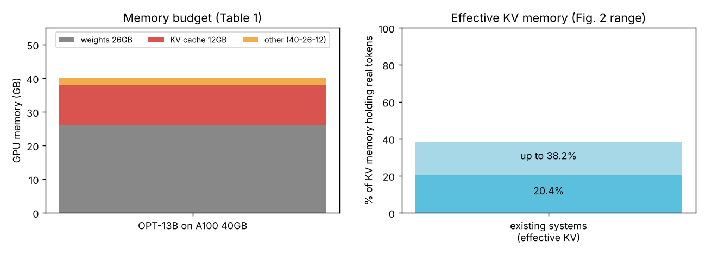
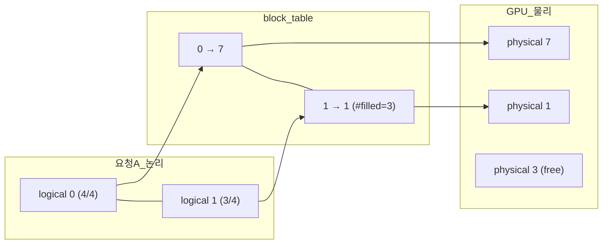
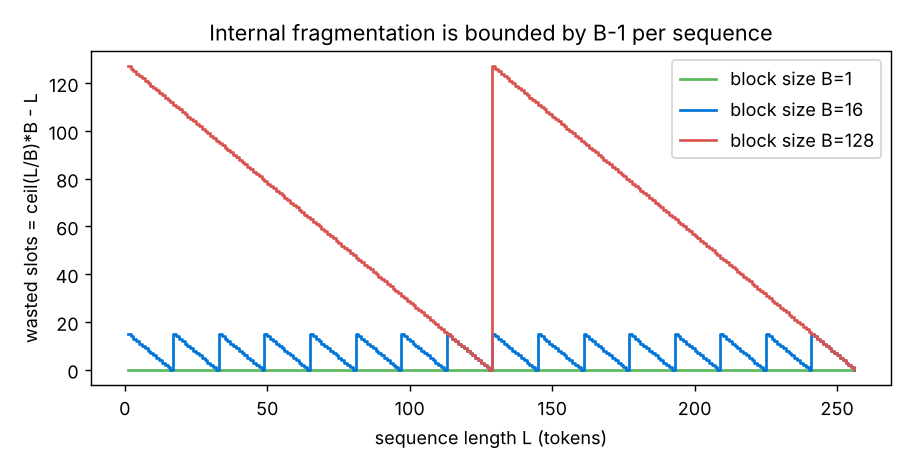
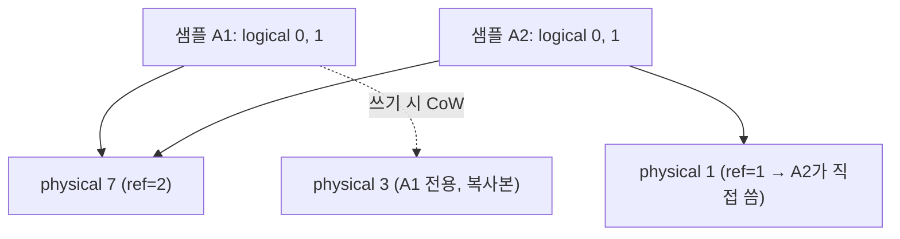
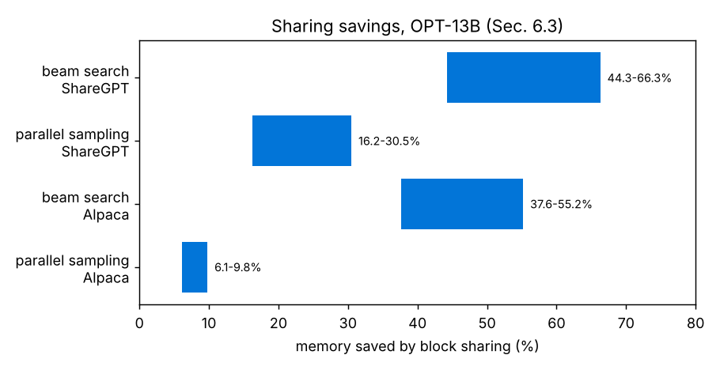

# Efficient Memory Management for Large Language Model Serving with PagedAttention (vLLM)

- 링크: https://arxiv.org/abs/2309.06180
- 저자: Woosuk Kwon, Zhuohan Li, Siyuan Zhuang, Ying Sheng, Lianmin Zheng, Cody Hao Yu, Joseph E. Gonzalez, Hao Zhang, Ion Stoica (UC Berkeley, Stanford University, UC San Diego 등)
- 발표: arXiv 2023-09-12, SOSP 2023 (ACM Symposium on Operating Systems Principles)

> 왜 이 논문인가: 시스템 최상위 학회 SOSP 2023에 실린 논문으로, LLM 서빙의 병목이 연산이 아니라 **KV cache 메모리 관리**라는 점을 정량화하고 OS의 가상 메모리·paging을 그대로 가져와 풀었다. 논문과 함께 공개된 vLLM은 오픈소스 LLM 서빙 엔진의 사실상 표준이 되었고, block 단위 KV 관리·prefix 공유라는 아이디어는 이후 서빙 시스템 전반에서 기본 부품으로 쓰인다.

## 한 줄 요약
요청마다 "최대 길이만큼 연속 메모리를 미리 잡는" 기존 방식 때문에 KV cache 메모리의 20.4%-38.2%만 실제 토큰 상태를 담고 있었는데(Fig. 2), KV cache를 고정 크기 **block(page)** 으로 쪼개 비연속 물리 메모리에 두고 **block table**로 논리-물리 주소를 변환하는 PagedAttention과, 그 위의 서빙 엔진 vLLM은 메모리 낭비를 거의 0으로 만들고 같은 지연 시간에서 FasterTransformer와 Orca 대비 처리량을 2-4배 높인다(Abstract).

## 문제 설정
LLM 서빙의 비용 구조부터 짚는다. 생성은 토큰을 하나씩 뽑는 autoregressive 과정이라 연산이 matrix-vector 위주가 되고 GPU 연산 자원이 남는다. 이를 메우려면 여러 요청을 batch로 묶어야 하는데, batch 크기를 결정하는 것은 GPU 메모리다 (Sec. 1).

- **메모리 구성**: A100 40GB에서 13B 모델을 서빙할 때 약 65%가 모델 가중치(서빙 내내 고정), 약 30%가 요청별 동적 상태인 KV cache, 나머지 소량이 activation이다 (Fig. 1 왼쪽). 가중치와 activation은 크기가 정해져 있으므로 **batch 크기의 상한을 정하는 것은 KV cache를 얼마나 알뜰히 쓰느냐**다.
- **KV cache는 크다**: OPT-13B에서 토큰 하나의 KV cache는 $`2\times 5120\times 40\times 2\text{ bytes}=800\text{KB}`$(K와 V, hidden 5120, 40 layer, FP16)이고, 2048 토큰이면 요청 하나가 최대 1.6GB다. 수십 GB 메모리를 전부 써도 수십 개 요청만 들어간다 (Sec. 3). 또한 A100에서 H100으로 갈 때 FLOPS는 2배 넘게 늘었지만 메모리는 최대 80GB로 그대로여서 병목은 더 심해질 것이라고 본다.
- **KV cache는 성질이 독특하다**: 토큰이 생성될 때마다 자라고, 최종 길이와 수명을 미리 알 수 없다. 반면 PyTorch 같은 프레임워크의 텐서 연산은 연속 메모리를 요구해서, 기존 시스템(FasterTransformer, Orca)은 요청마다 **모델이 허용하는 최대 길이(예: 2048)만큼 연속 청크를 미리 잡는다** (Sec. 3.1).

이 방식은 세 종류의 낭비를 낳는다 (Fig. 3).
1. **Reserved**: 앞으로 생성될 토큰 자리. 결국 쓰이긴 하지만 요청 수명 내내 점유해서 다른 요청이 못 쓴다.
2. **Internal fragmentation**: 실제 길이가 최대 길이보다 짧아서 끝내 안 쓰이는 자리. 요청이 끝나야 비로소 알 수 있다.
3. **External fragmentation**: buddy allocator 등 할당기가 만드는 틈. 요청마다 예약 크기가 다르니 틈이 생긴다.

프로파일링 결과 기존 시스템에서 실제 토큰 상태를 담는 비율은 **20.4%-38.2%**에 불과하다 (Fig. 2). compaction은 KV cache가 너무 커서 성능이 중요한 서빙 경로에서 현실적이지 않다고 한다 (Sec. 3.1).

*그림 1. 왼쪽은 Table 1의 OPT-13B/A100 40GB 구성(가중치 26GB, KV cache용 12GB)이 40GB 중 어떻게 나뉘는지, 오른쪽은 기존 시스템이 그 KV cache 공간 중 실제 토큰 상태에 쓰는 비율의 범위(20.4%-38.2%, Fig. 2)다. 12GB 중 실제로 쓰이는 몫이 3분의 1 안팎이라는 점이 batch 크기를 제한한다. (직접 그림: Table 1과 Sec. 1의 보고 수치)*

두 번째 문제는 **공유 불가**다. 한 요청이 여러 출력을 만드는 parallel sampling과 beam search에서는 프롬프트(와 beam의 앞부분) KV를 공유할 수 있지만, 시퀀스마다 별도의 연속 공간에 저장하는 구조에서는 불가능하다. 프롬프트 KV는 parallel sampling 실험에서 전체 KV 메모리의 12%를, beam search에서는 최대 55%까지 절약 가능한 몫이다 (Sec. 3, Sec. 6.3). 세 번째는 입출력 길이를 모르는 상태에서의 스케줄링으로, 메모리가 바닥나면 어떤 KV를 쫓아낼지 정해야 한다.

## 방법
핵심 발상은 한 문장이다. **"토큰은 바이트, KV block은 page, 요청은 프로세스"**. 가상 메모리가 연속 가상 주소를 비연속 물리 page에 매핑해 단편화와 공유 문제를 풀듯, KV cache에도 같은 층을 추가한다 (Sec. 4.1-4.2).

### 시스템 개요
vLLM은 중앙 scheduler가 여러 GPU worker를 조율하는 구조이고, scheduler 안의 **KV cache manager**가 worker들의 물리 KV 메모리를 관리한다 (Sec. 4, Fig. 4).

*그림 2. vLLM 시스템 개요. 중앙 scheduler 안의 KV cache manager가 block table을 들고 GPU worker들의 물리 block을 할당·회수·교체(swap)한다. worker는 매 iteration 입력 토큰과 block table을 받아 모델을 실행한다. (출처: 논문 Fig. 4, arXiv:2309.06180)*

### PagedAttention 알고리즘
요청의 KV를 길이 $`B`$(KV block size)짜리 block으로 나눈다. key block $`K_j=(k_{(j-1)B+1},\ldots,k_{jB})`$, value block $`V_j=(v_{(j-1)B+1},\ldots,v_{jB})`$라 하면 기존 attention(식 3)

$$a_{ij}=\frac{\exp(q_i^\top k_j/\sqrt d)}{\sum_{t=1}^{i}\exp(q_i^\top k_t/\sqrt d)},\qquad o_i=\sum_{j=1}^{i}a_{ij}v_j$$

은 block 단위 계산(식 4)으로 바뀐다.

$$A_{ij}=\frac{\exp(q_i^\top K_j/\sqrt d)}{\sum_{t=1}^{\lceil i/B\rceil}\exp(q_i^\top K_t\mathbf 1/\sqrt d)},\qquad o_i=\sum_{j=1}^{\lceil i/B\rceil}V_jA_{ij}^\top$$

- $`A_{ij}=(a_{i,(j-1)B+1},\ldots,a_{i,jB})`$는 $`j`$번째 block 위의 attention 점수 행벡터다.
- $`\mathbf 1`$은 길이 $`B`$의 all-ones 벡터로, 분모에서 block 안의 $`B`$개 exp 합을 구하는 역할이다.
- **수학적으로는 기존 attention과 똑같다.** 달라지는 것은 오직 **메모리 접근 방식**이다. 커널이 block을 하나씩 찾아와(block table 조회) 부분 점수와 부분 출력을 계산한다. 그래서 정확도 손실이 없다 (Sec. 1).
- 논문은 한 KV block에 모든 layer와 head의 K/V를 같이 담는 설계와, head·layer별로 따로 block table을 두는 설계가 성능 차이 없다고 보고 구현이 쉬운 후자를 택했다 (Sec. 4.1 각주).

### KV cache manager와 block table
- 요청의 KV는 **논리 block** 시퀀스로 보이고 왼쪽부터 채워진다. 마지막 block의 빈 칸이 앞으로 생성될 토큰 몫이다.
- GPU worker의 block engine은 DRAM 한 덩어리를 잡아 **물리 block**들로 나눈다(CPU RAM에도 동일하게, swap용).
- block table은 요청별로 논리 block → 물리 block 매핑과 **채워진 칸 수(#filled)** 를 기록한다. 이 분리 덕에 KV 메모리가 필요한 만큼만 자란다 (Sec. 4.2).

### 한 시퀀스의 디코딩 (Fig. 6)
프롬프트가 7토큰, block 크기 4인 예제다 (Sec. 4.3).
1. 프롬프트 7토큰에 필요한 논리 block 2개(0, 1)만 물리 block 7, 1에 매핑한다. prefill은 기존 attention(논문은 FlashAttention을 언급)으로 계산하고 KV를 block 0에 4토큰, block 1에 3토큰 저장한다. 최대 길이는 미리 잡지 않는다.
2. 첫 디코딩 step은 PagedAttention으로 물리 block 7, 1을 읽어 계산하고, 새 KV를 block 1의 남은 한 칸에 쓴 뒤 #filled를 갱신한다.
3. 둘째 step에서 마지막 논리 block이 꽉 차 있으면 새 물리 block(3번)을 할당하고 매핑을 기록한다.

block은 "앞이 다 차야 새로 할당"되므로 **한 요청의 낭비는 마지막 block 한 개 안으로 한정**된다. 요청이 끝나면 block이 즉시 반환되어 다른 요청이 쓴다.

*그림 3. block table의 역할. 논리적으로는 연속인 block 0, 1이 물리적으로는 7번, 1번에 흩어져 있고, 마지막 block만 부분적으로 차 있다. 물리 block 3은 다음 step에서 필요할 때 할당된다. (직접 그림: 논문 Sec. 4.3, Fig. 6의 예시를 단순화)*

각 iteration에서 vLLM은 batch 후보를 고르고 필요한 물리 block을 할당한 뒤, **prefill 요청의 전체 토큰과 decode 요청의 최신 토큰을 하나의 시퀀스로 이어 붙여** 모델에 넣는다. 이전 KV는 PagedAttention 커널이 block table로 읽는다 (Sec. 4.3).

### block 크기 $`B`$의 양면성
- $`B`$가 크면 커널이 한 번에 더 많은 위치를 병렬 처리해 GPU 활용이 좋아지지만, 내부 단편화가 늘고 공유 확률이 줄어든다.
- $`B`$가 작으면 단편화는 줄지만 GPU 병렬성을 못 살린다.
- 시퀀스당 낭비는 마지막 block 안이라 최대 $`B-1`$ 칸이다. (Sec. 4.3의 "낭비는 한 block 안"이라는 설명에서 따른 식이다.)

*그림 4. 길이 $`L`$인 시퀀스의 낭비 슬롯 수 $`\lceil L/B\rceil B-L`$을 block 크기별로 그린 것. $`B=1`$은 낭비가 없지만 GPU 효율이 나쁘고, $`B=128`$은 짧은 시퀀스에서 낭비가 최대 127칸까지 커진다. 최대 길이 선할당과 달리 낭비가 시퀀스 길이와 무관하게 $`B-1`$ 이하로 묶인다. (직접 그림: 위 식)*

### 다른 디코딩 시나리오와 메모리 공유 (Sec. 4.4)
핵심 장치는 **물리 block의 reference count**와 **block 단위 copy-on-write**다. 이는 프로세스 fork 때 OS가 쓰는 기법과 같다.

**Parallel sampling.** 같은 프롬프트에서 여러 샘플을 뽑는다. 두 샘플의 프롬프트 논리 block이 같은 물리 block(7, 1)에 매핑되고 refcount가 2가 된다. 샘플 A1이 마지막 논리 block(블록 1)에 쓰려 하면 refcount가 1보다 크므로 새 물리 block 3을 할당하고 내용을 복사한 뒤 원래 block의 refcount를 1로 낮춘다. A2가 쓸 때는 refcount가 이미 1이라 그대로 쓴다. 따라서 프롬프트 KV는 마지막 block만 빼고 모두 공유된다.

*그림 5. parallel sampling의 copy-on-write. 프롬프트 block은 refcount 2로 공유되고, 마지막 block에 처음 쓰는 샘플이 복사본을 받는다. 복사 대상은 block 한 개뿐이다. (직접 그림: 논문 Fig. 8 설명을 단순화)*

**Beam search.** 프롬프트뿐 아니라 beam 후보들 사이의 앞부분도 공유되고, 그 패턴이 step마다 바뀐다. 논문은 OS의 프로세스 트리와 비교한다. 예제(k=4)에서 탈락한 후보의 논리 block이 해제되면 refcount가 줄고 0이 된 물리 block(2, 4, 5, 8)이 회수되며 새 block(9-12)이 할당된다. 기존 시스템은 beam이 바뀔 때마다 KV를 대량 복사해야 했지만, vLLM은 CoW 때 block 하나만 복사한다.

**Shared prefix.** system prompt나 few-shot 예제처럼 여러 요청이 공유하는 앞부분을 서비스 측이 미리 계산해 물리 block에 두고, 새 요청이 그 block을 가리키게(마지막 block은 CoW) 한다. OS의 shared library와 같은 방식이며, 프롬프트 연산은 사용자 입력 부분에만 하면 된다.

**Mixed decoding.** 공유 패턴의 복잡성이 "논리-물리 매핑 층" 뒤에 숨는다. 모델과 커널은 시퀀스별 물리 block ID 목록만 보므로 서로 다른 디코딩 설정의 요청을 한 batch에 섞을 수 있다.

구현에서는 디코딩 알고리즘을 세 가지 메서드로 표현한다 (Sec. 5.2): `fork`(기존 시퀀스에서 새 시퀀스 생성), `append`(토큰 추가), `free`(시퀀스 삭제). parallel sampling, beam search, prefix 공유 모두 이 조합이다.

### 스케줄링과 preemption (Sec. 4.5)
- 정책은 **FCFS**로, 가장 늦게 온 요청이 가장 먼저 preempt된다.
- 물리 block이 바닥나면 쫓아낼 대상을 정해야 한다. 한 시퀀스의 block들은 항상 함께 접근되므로 **all-or-nothing**(그 시퀀스의 block을 전부 쫓아내거나 하나도 안 쫓아냄)으로 한다. 한 요청 안의 여러 시퀀스(예: beam 후보)는 공유 때문에 **sequence group**으로 묶어 함께 preempt하고 함께 재개한다(gang scheduling).
- 복구 방식은 두 가지다.
  - **Swapping**: 쫓아낸 block을 CPU RAM으로 복사한다. 이때 swap 공간은 GPU의 KV block 수를 넘지 않는다. preempt가 일어나면 선점된 시퀀스가 끝날 때까지 새 요청을 받지 않는다.
  - **Recomputation**: 재개할 때 KV를 다시 계산한다. 그동안 생성한 토큰을 원래 프롬프트에 이어 붙여 **한 번의 prefill iteration**으로 모든 위치의 KV를 만들 수 있어서, 원래 생성에 걸린 시간보다 훨씬 짧다. OS에서는 불가능한 LLM 특유의 방법이다.

### 분산 실행 (Sec. 4.6)
Megatron-LM 방식 tensor model parallelism(attention은 head 차원으로 분할)을 지원한다. 모든 shard가 같은 위치의 KV를 필요로 하므로 **KV cache manager는 scheduler에 하나만** 두고, 각 worker는 같은 물리 block ID를 쓰되 자기 head 몫만 저장한다. scheduler가 iteration마다 입력 토큰 ID와 block table을 broadcast하면, worker들은 all-reduce로 중간 결과를 동기화하며 실행하고 샘플된 토큰을 돌려준다. 메모리 관리를 위한 worker 간 동기화는 필요 없다.

### 커널 최적화 (Sec. 5.1)
block 접근은 기존 시스템이 효율적으로 지원하지 않는 패턴이라 세 가지 커널을 직접 만들었다.
1. **Fused reshape and block write**: 새 KV를 block 단위로 나누고, block 읽기에 맞는 레이아웃으로 reshape하고, block table이 가리키는 위치에 쓰는 것을 한 커널로 묶어 launch 오버헤드를 줄인다.
2. **Fusing block read and attention**: FasterTransformer의 attention 커널을 block table 기반 읽기로 개조했다. 메모리 coalescing을 위해 block 하나를 GPU warp 하나가 읽게 하고, 배치 내 가변 길이를 지원한다.
3. **Fused block copy**: CoW가 만드는 불연속 block 복사를 `cudaMemcpyAsync` 호출 여러 번 대신 한 커널로 batch 처리한다.

엔진은 FastAPI 프런트엔드(OpenAI API 호환 인터페이스)와 Python 8.5K줄·C++/CUDA 2K줄로 구성되고, scheduler와 block manager는 Python, PagedAttention 같은 핵심 연산은 CUDA 커널이다. 모델은 GPT, OPT, LLaMA를 PyTorch로 구현했고 GPU 간 통신은 NCCL을 쓴다 (Sec. 5).

## 실험 설정
- **모델/서버** (Table 1): OPT-13B(A100 1장, 총 40GB, 파라미터 26GB, KV용 12GB, 최대 KV 슬롯 15.7K), OPT-66B(A100 4장, 160GB, 132GB, 21GB, 9.7K), OPT-175B(A100-80GB 8장, 640GB, 346GB, 264GB, 60.1K), 그리고 공유 prefix 실험용 LLaMA-13B. 모두 Google Cloud의 A2 인스턴스를 쓴다 (Sec. 6.1).
- **워크로드**: ShareGPT(사용자 공유 ChatGPT 대화)와 Alpaca(GPT-3.5 self-instruct 데이터)의 입출력 길이로 요청을 합성한다. ShareGPT는 Alpaca보다 입력이 평균 8.4배, 출력이 5.8배 길고 분산이 크다 (Fig. 11). 데이터에 시간 정보가 없어 도착 시각은 Poisson 분포로 만든다. 대부분 1시간 trace를 쓰고 OPT-175B만 비용 때문에 15분이다.
- **Baseline 1, FasterTransformer**: 지연 시간에 최적화된 분산 추론 엔진이다. 자체 scheduler가 없어 Triton 같은 dynamic batching을 따라 구현했고, 최대 batch 크기 $`B`$를 메모리가 허용하는 한 크게 잡아 가장 일찍 도착한 $`B`$개를 보낸다.
- **Baseline 2, Orca**: iteration-level scheduling을 쓰는 처리량 최적화 시스템이지만 공개되어 있지 않아 **자체 구현**했다. 메모리는 buddy allocator로 관리한다고 가정하고 출력 공간 예약 방식에 따라 세 버전을 만들었다. Oracle(실제 출력 길이를 안다고 가정, 현실에서는 불가능한 상한), Pow2(출력 공간을 최대 2배까지 과다 예약), Max(항상 모델 최대 길이 2048까지 예약).
- **지표**: **normalized latency**, 즉 요청별 end-to-end 지연을 출력 길이로 나눈 값의 평균(Orca와 같은 지표)이다. 좋은 시스템은 요청률(req/s)이 높아져도 이 값이 낮게 유지된다. 요청률이 용량을 넘으면 대기열이 무한히 늘어 지연이 폭발하므로, 곡선이 꺾이는 지점이 곧 처리량 한계다 (Sec. 6.2).

## 결과
논문의 주요 결과는 요청률-지연 곡선(Fig. 12, 14, 16, 17)과 배치 크기·메모리 절약 그림이라서 표 대신 본문이 밝힌 수치를 정리한다.

| 실험 | 비교 대상 | 보고된 결과 | 출처 |
|---|---|---|---|
| 기본 sampling, ShareGPT | Orca (Oracle) | 비슷한 지연에서 1.7배-2.7배 높은 요청률 | Sec. 6.2, Fig. 12 |
| 기본 sampling, ShareGPT | Orca (Max) | 2.7배-8배 | Sec. 6.2, Fig. 12 |
| 기본 sampling, ShareGPT | FasterTransformer | 최대 22배 | Sec. 6.2, Fig. 12 |
| 동시 처리 요청 수, OPT-13B ShareGPT | Orca (Oracle) / Orca (Max) | 2.2배 / 4.3배 | Sec. 6.2, Fig. 13(a) |
| Beam search(beam 폭 6), OPT-13B Alpaca | Orca (Oracle) | 기본 sampling의 1.3배 → 2.3배 | Sec. 6.3, Fig. 14 |
| Shared prefix, 1-shot(80토큰) | Orca (Oracle) | 1.67배 처리량 | Sec. 6.4, Fig. 16(a) |
| Shared prefix, 5-shot(341토큰) | Orca (Oracle) | 3.58배 처리량 | Sec. 6.4, Fig. 16(b) |
| Chatbot (프롬프트 마지막 1024토큰, 출력 최대 1024) | Orca 세 버전 | 2배 높은 요청률 | Sec. 6.5, Fig. 17 |

해석은 다음과 같다.
- **이득의 원천은 batch 크기다.** 같은 GPU 메모리에서 더 많은 요청이 동시에 돌고(Fig. 13), 그 차이가 곧 처리량 차이다. FasterTransformer와의 격차가 특히 큰 것은 Orca (Max)처럼 메모리를 비효율적으로 쓰는 데다 iteration-level scheduling도 없기 때문이다 (Sec. 6.2).
- **Alpaca에서 이득이 줄어드는 경우**: OPT-175B(Fig. 12(f))는 KV에 쓸 수 있는 메모리가 넉넉하고(Table 1) Alpaca의 시퀀스가 짧아, Orca (Oracle)와 Pow2도 큰 batch를 만들 수 있다. 이때 시스템은 메모리 한계가 아니라 **compute-bound**가 되어 vLLM의 우위가 작아진다 (Sec. 6.2).
- **복잡한 디코딩일수록 이득이 커진다**: parallel sampling 수가 많을수록, beam 폭이 넓을수록 격차가 커진다 (Sec. 6.3). 공유할 KV가 많아지기 때문이다.
- **메모리 절약량** (Fig. 15, Sec. 6.3): 공유 block 수를 공유가 없을 때의 총 block 수로 나눈 값이다. Alpaca에서 parallel sampling은 6.1%-9.8%, beam search는 37.6%-55.2%이고, ShareGPT에서는 각각 16.2%-30.5%, 44.3%-66.3%다.

*그림 6. 블록 공유로 절약된 메모리 비율(Sec. 6.3의 보고 범위). 공유할 prefix가 길고 후보가 많은 beam search가 parallel sampling보다 훨씬 크게 절약하며, 프롬프트가 긴 ShareGPT에서 절약이 더 크다. (직접 그림: 논문 Sec. 6.3의 보고 수치)*

- **Chatbot**: 이 실험에서는 대화 턴 사이의 KV cache를 보존하지 않는다. 라운드 사이에 그 공간이 다른 요청의 자리를 차지하기 때문이다. ShareGPT에는 긴 대화가 많아 대부분의 프롬프트가 1024토큰이고, buddy allocator 때문에 Orca 세 버전은 예측 방식과 무관하게 비슷한 1024토큰 출력 공간을 예약해 서로 비슷한 성능을 보인다 (Sec. 6.5).

## Ablation에서 알 수 있는 것
**Kernel microbenchmark (Sec. 7.1, Fig. 18(a)).** block table 접근, 추가 분기, 가변 길이 처리 때문에 PagedAttention의 attention 커널은 최적화된 FasterTransformer 구현보다 **20-26% 느리다**. 간접 참조의 값은 공짜가 아니다. 다만 이 오버헤드는 attention 연산에만 걸리고 Linear 같은 다른 연산에는 영향이 없으며, 메모리 효율로 얻는 batch 크기 이득이 훨씬 커서 end-to-end로는 크게 앞선다.

**Block size (Sec. 7.2, Fig. 18(b)).** ShareGPT trace는 block 크기 16-128에서 가장 좋다. 시퀀스가 짧은 Alpaca는 16과 32가 좋고 더 큰 block에서는 시퀀스가 block보다 짧아져 성능이 크게 떨어진다. 논문은 "16이면 GPU를 효율적으로 쓰기에 충분히 크고, 대부분 워크로드에서 단편화가 문제될 만큼 크지 않다"며 기본값을 **16**으로 정했다. 교훈은 block 크기가 병렬성과 단편화·공유 사이의 trade-off이고, 워크로드의 시퀀스 길이 분포에 의존한다는 것이다 (그림 4).

**Recomputation vs. swapping (Sec. 7.3, Fig. 19).**
- swapping은 block이 작으면 작은 CPU-GPU 전송이 잔뜩 생겨 PCIe 대역폭을 못 채워 오버헤드가 크다.
- recomputation은 KV block을 쓰지 않으므로 block 크기와 무관하게 오버헤드가 일정하고, 그 오버헤드는 swapping 지연의 20%를 넘지 않는다.
- block이 작을 땐 recomputation이, 클 땐 swapping이 효율적이며, 중간 크기(16-64)에서는 end-to-end 성능이 비슷하다. 어느 쪽이든 정답은 하드웨어(PCIe 대역폭 대 GPU 연산력)에 달려 있다.

## 한계와 비판적으로 보기
**논문이 밝힌 한계 (Sec. 8).**
- 가상 메모리·paging이 잘 맞는 이유는 워크로드가 ① 출력 길이를 몰라 **메모리를 동적으로 할당**해야 하고 ② 성능이 **GPU 메모리 용량에 묶여 있기** 때문이다. 이 조건이 없으면 효과가 없다. 예를 들어 학습은 텐서 모양이 정적이라 할당을 사전에 최적화할 수 있고, LLM이 아닌 DNN 서빙은 compute-bound라 메모리 효율이 성능으로 이어지지 않는다. 이 경우 메모리 간접 참조와 비연속 block의 오버헤드가 오히려 성능을 떨어뜨릴 수 있다.
- OS의 아이디어를 그대로 쓰지 않고 LLM 특성에 맞게 바꿨다. all-or-nothing 교체, recomputation, 커널 fusion으로 간접 참조 비용을 흡수한 것이 그 예다.

**내 비판.**
- **baseline의 공정성**: Orca는 비공개라 저자들이 직접 구현했고 buddy allocator를 쓴다고 가정했다. 실제 Orca가 어떻게 메모리를 관리하는지에 따라 격차가 달라질 수 있다. Oracle 버전을 상한으로 두어 보수적으로 비교하려 한 점은 좋지만, "2-4배"는 이 구현 가정 위에서의 숫자다. FasterTransformer 대비 22배 같은 극단값은 iteration-level scheduling 유무의 차이가 섞여 있어 PagedAttention 단독의 효과가 아니다.
- **지표와 부하**: normalized latency는 요청률 곡선을 읽기에 좋지만 TTFT(첫 토큰 시간)나 토큰 간 지연 분포는 보여주지 않는다. preemption이 꼬리 지연에 미치는 영향이 궁금하다. Poisson 도착, FCFS, 1시간 trace라는 설정이 실제 서비스의 burst와 어떻게 다른지도 확인이 필요하다.
- **모델 범위**: OPT와 LLaMA-13B 중심으로 멀티-쿼리/그룹 쿼리 attention처럼 KV 크기를 줄이는 구조에서는 메모리 압박의 크기와 block 크기의 최적점이 달라질 수 있다. (이 논문이 다루는 범위 밖이므로 추측이다.)
- **커널 20-26% 오버헤드**는 짧은 문맥·작은 batch에서는 순손해일 수 있다. 이득은 메모리-bound 영역에서만 나온다는 점을 기억해야 한다.
- 공유 prefix는 서비스 측이 **사전에 정한 prefix** 집합을 예약해 두는 방식(Sec. 4.4)이고, 임의의 요청 사이에서 자동으로 prefix를 찾아 재사용하는 기능은 이 논문에는 없다.

## 내 생각 / 더 볼 것
- 이 논문의 기여는 알고리즘보다 **추상화 층의 도입**이다. "논리 block → 물리 block" 한 단계가 단편화, 공유, 동적 성장, 교체를 한꺼번에 풀었고, 모델과 커널은 물리 block ID 목록만 보면 된다. 시스템 설계에서 indirection이 왜 강력한지 보여주는 사례다.
- 앞서 다룬 FlashAttention은 attention **연산**의 IO를 줄이는 쪽이고, PagedAttention은 KV **저장**의 낭비를 줄이는 쪽이라 서로 보완적이다. 논문도 prefill에 FlashAttention류 알고리즘을 쓴다고 적었다.
- Orca의 iteration-level scheduling과도 보완 관계다. 논문은 요청을 잘게 교차 실행할수록 메모리 관리가 어려워지므로 vLLM 같은 기법이 더 중요해진다고 쓴다 (Sec. 9).
- 이어 볼 주제: block 단위 해시로 임의 요청 사이의 prefix를 자동 재사용하는 방식, prefill과 decode를 분리 배치하는 서빙, KV cache 양자화·압축, MQA/GQA 같은 KV 크기 축소 구조, speculative decoding과 block 관리의 결합.
